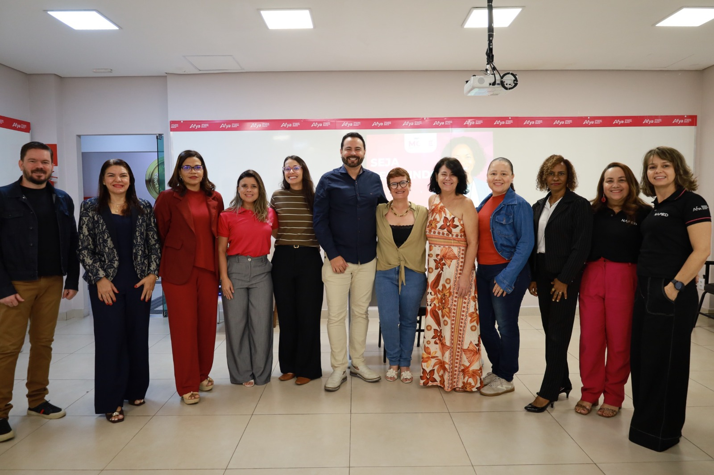
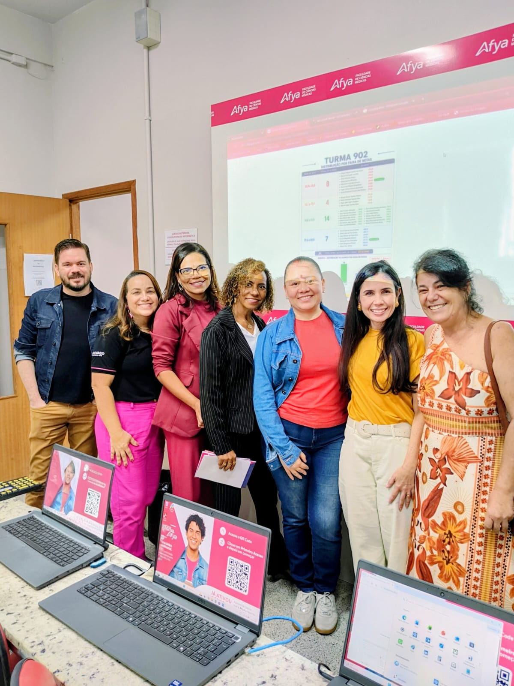
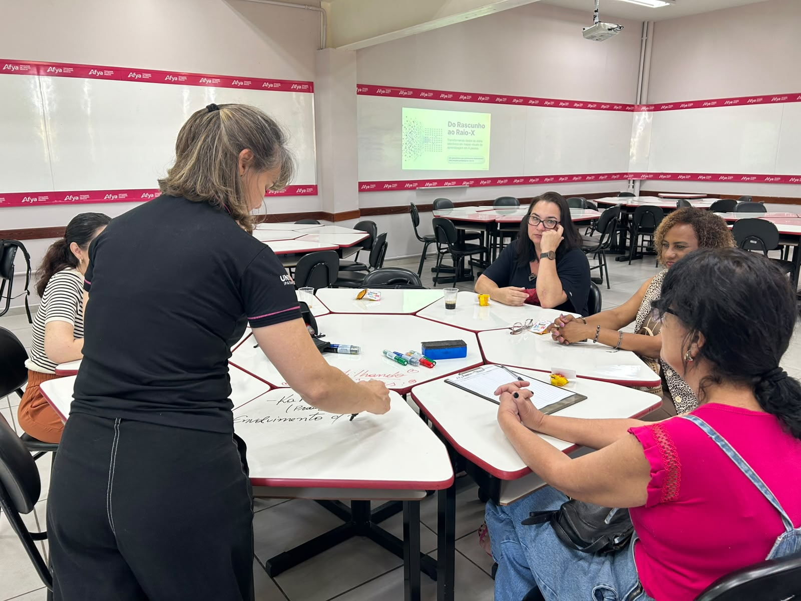

::: {.acao-figura}
{#fig-move-metodologias-ativas fig-alt="Grupo de participantes reunido durante encontro do Projeto MOVE na Afya Ipatinga"}
:::

## Metodologias ativas em movimento

Em 30 de maio de 2026, o **Projeto MOVE — Professores em Movimento** promoveu um encontro dedicado ao compartilhamento de práticas pedagógicas e à experimentação de metodologias ativas. A atividade reuniu docentes e a equipe do NAPED em um espaço de troca, planejamento e aprendizagem entre pares.

O encontro contou com a participação de **Rone Cesario da Silva** e com oficinas conduzidas por duas docentes integrantes do NAPED: **Tatiane Araújo**, sobre possibilidades de uso do **NotebookLM** na prática docente, e **Jaqueline Melo Soares**, sobre **aprendizagem em pequenos grupos**.

As oficinas aproximaram ferramentas e estratégias do cotidiano de quem ensina, valorizando a colaboração, a participação ativa e a construção coletiva de soluções pedagógicas. O registro reforça o Projeto MOVE como espaço contínuo de formação, experimentação e circulação de boas práticas entre docentes.

## Evidências

::: {.acao-figura}
{fig-alt="Grupo de participantes da oficina sobre NotebookLM conduzida por Tatiane Araújo, integrante do NAPED" fig-cap="Oficina de NotebookLM com a Prof.ª Tatiane Araújo."}
:::

::: {.acao-figura}
{fig-alt="Jaqueline Melo Soares conduz atividade de aprendizagem em pequenos grupos com participantes do Projeto MOVE" fig-cap="Oficina de aprendizagem em pequenos grupos com a Prof.ª Jaqueline Melo Soares."}
:::
