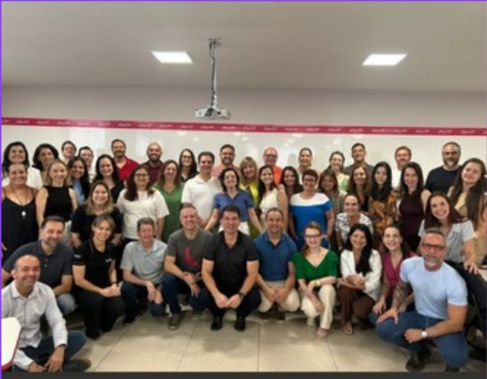

::: {.acao-figura}
{#fig-sdd-oficinas fig-alt="Docentes reunidos em atividade da Semana de Desenvolvimento Docente da Afya Ipatinga"}
:::

## Objetivo

Reunir, em uma programação integrada da Semana de Desenvolvimento Docente (SDD), temas que ampliam o repertório pedagógico, científico e institucional dos docentes.

## Desenvolvimento

As oficinas realizadas em 02 de julho articularam três frentes complementares de desenvolvimento docente:

### Inteligência Artificial e NotebookLM

Oficina prática sobre o uso crítico e intencional de recursos de Inteligência Artificial e do NotebookLM no planejamento e na organização de materiais didáticos.

### Produção Científica em Movimento

Encontro com orientações para fortalecer publicações, organizar a trajetória científica e qualificar o Currículo Lattes, valorizando a pesquisa vinculada à docência.

### NED em foco: acolhimento, diversidade e permanência

Espaço de reflexão sobre escuta, inclusão e estratégias institucionais de acolhimento e permanência estudantil, reafirmando a responsabilidade coletiva por um ambiente formativo respeitoso.

## Resultados e encaminhamentos

Ao integrar tecnologia educacional, produção científica e cuidado com a trajetória estudantil em um único registro, a SDD evidencia uma formação docente ampla e conectada às demandas do cotidiano acadêmico. As listas de presença correspondentes permanecem reunidas na seção Comprovações do site.

## Evidências

O registro fotográfico da SDD e a documentação de participação integram o acervo institucional da ação.
