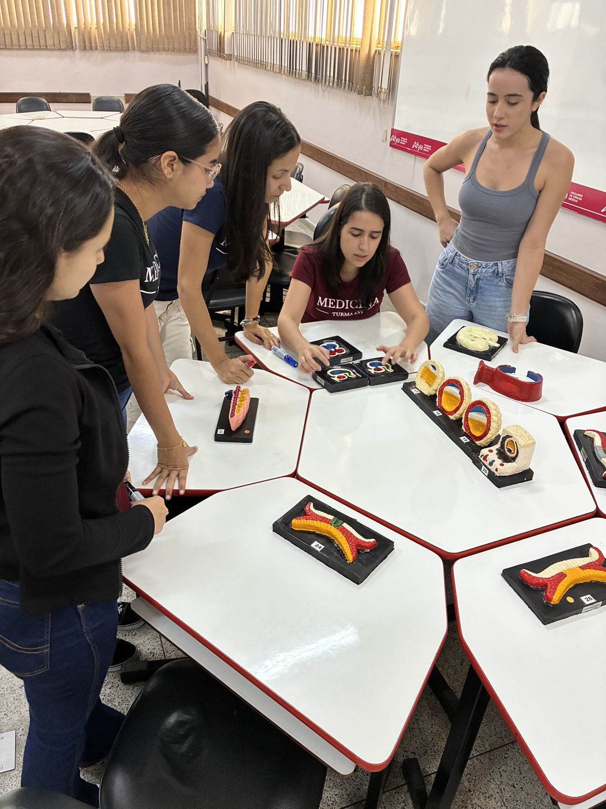
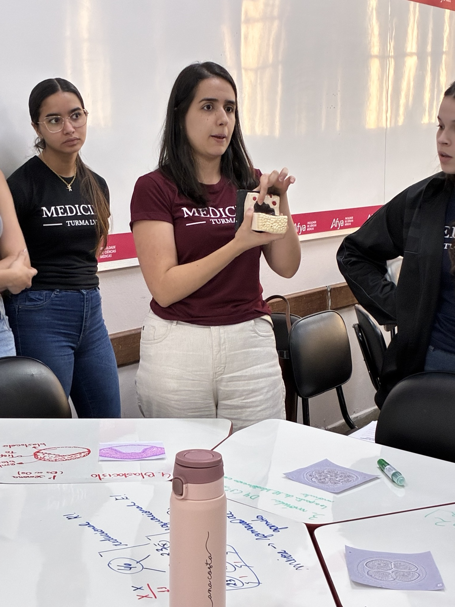
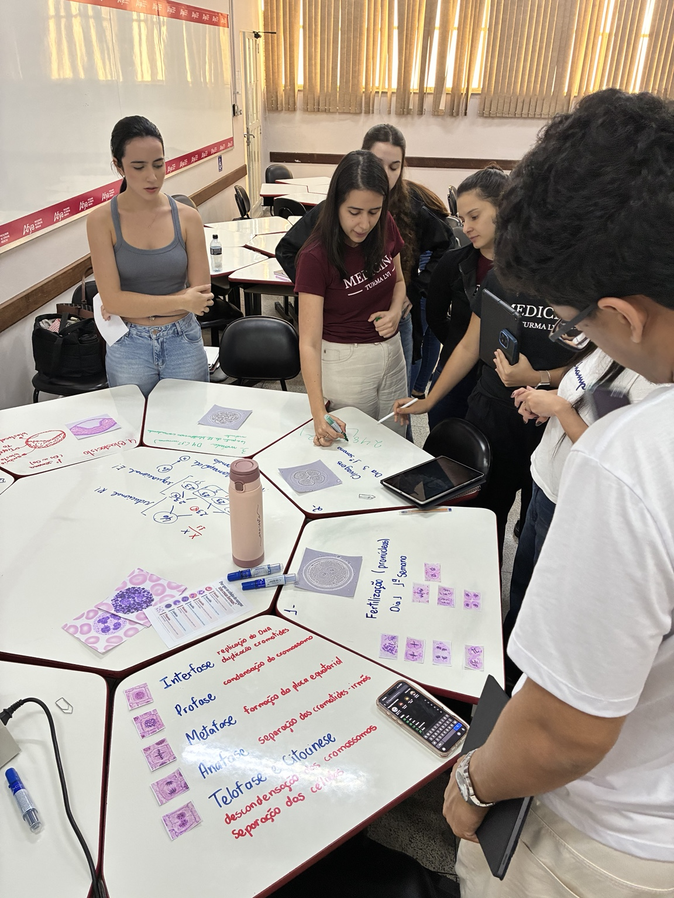
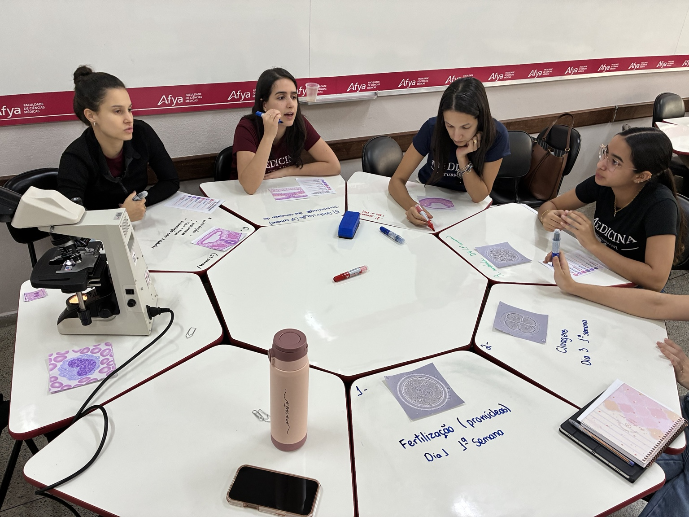

## Objetivo

Realizar uma revisão formativa preparatória para a prova prática, fortalecendo a articulação entre conhecimentos das bases biológicas e sua aplicação nos Sistemas Orgânicos Integrados.

## Desenvolvimento

Em 29 de setembro de 2026, o BASEMED promoveu uma revisão prática organizada em estações de aprendizagem. Os registros fotográficos disponíveis evidenciam a identificação de modelos embriológicos, a discussão sobre fertilização e desenvolvimento inicial, o reconhecimento das fases da divisão celular, a análise de imagens histológicas e o uso de microscópio.

A proposta integrou conteúdos de Anatomia, Histologia, Citologia e Bioquímica ao eixo de Sistemas Orgânicos Integrados (SOI). Em pequenos grupos, os estudantes organizaram explicações, relacionaram forma e função e discutiram os conteúdos com os colegas, mobilizando identificação de estruturas, interpretação de imagens, argumentação científica e comunicação de conceitos.

## Resultados e encaminhamentos

A atividade registrou um momento de revisão e consolidação conceitual em preparação para a prova prática. O registro tem caráter formativo e não atribui notas nem apresenta resultados de desempenho dos estudantes.

## Evidências

::: {.acao-figura}
{fig-alt="Estudantes em estação de aprendizagem manipulam modelos embriológicos durante revisão do BASEMED"}
:::

::: {.acao-figura}
{fig-alt="Estudante apresenta um modelo enquanto o grupo discute conceitos de desenvolvimento inicial"}
:::

::: {.acao-figura}
{fig-alt="Grupo organiza imagens histológicas e esquemas das fases da divisão celular nas mesas"}
:::

::: {.acao-figura}
{fig-alt="Mesa de estação de aprendizagem com microscópio, imagens histológicas e estudantes em discussão"}
:::
