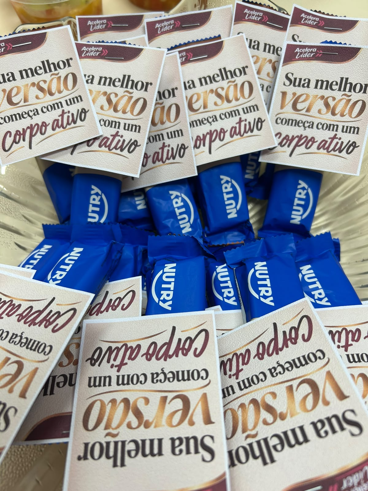
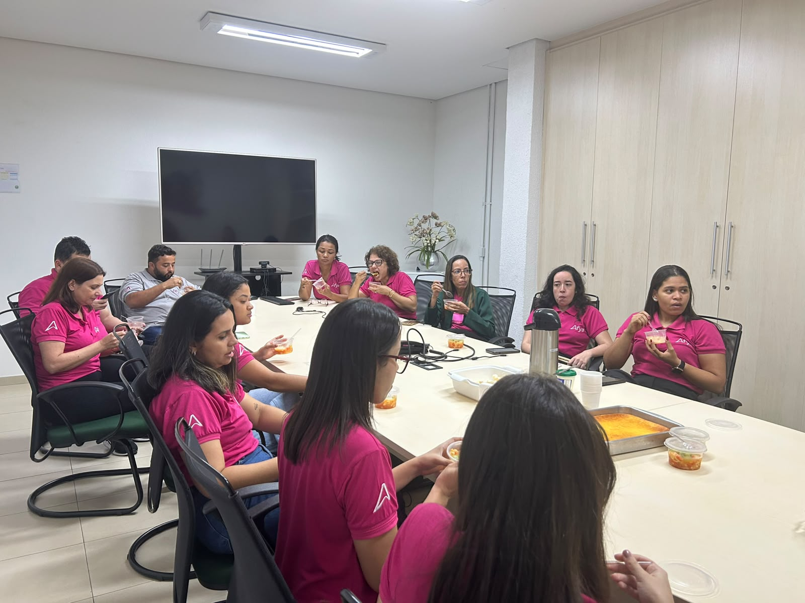

::: {.acao-figura}
{#fig-acelera-lider-02 fig-alt="Profissionais da Afya Ipatinga reunidos em uma sala, durante uma atividade do treinamento Acelera Líder"}
:::

## Objetivo

Registrar a ação local do **Projeto Acelera Líder**, iniciativa institucional da Afya dedicada ao desenvolvimento de lideranças e ao fortalecimento da gestão de pessoas, da comunicação e da cultura organizacional.

## Desenvolvimento

A Afya Ipatinga realizou um encontro formativo com participação de profissionais de diferentes setores técnico-administrativos. O treinamento favoreceu a integração, a troca de experiências e a construção de uma visão compartilhada sobre desafios, responsabilidades e oportunidades de desenvolvimento no cotidiano institucional.

Como parceiro da coordenação, o **NAPED** apoiou a articulação da atividade e contribuiu para aproximar o desenvolvimento de lideranças da aprendizagem institucional. Sua participação fortaleceu o diálogo entre os setores, a reflexão sobre práticas de trabalho e a conexão do treinamento com projetos e objetivos da unidade.

O registro está alinhado à proposta institucional do Acelera Líder, apresentado pela Afya como um programa de desenvolvimento de carreira e de fortalecimento de lideranças nas instituições de ensino.

## Resultados e encaminhamentos

A ação ampliou a integração entre setores técnico-administrativos e criou um espaço de escuta, colaboração e reflexão sobre a atuação das lideranças. Os aprendizados podem apoiar melhorias contínuas na comunicação, na organização do trabalho e no desenvolvimento das equipes.

## Evidências

As fotografias registram a preparação da atividade, a participação da equipe e o momento de integração entre os profissionais.

::: {.acao-figura}
{#fig-acelera-lider-01 fig-alt="Cartões com a identidade visual do Acelera Líder e chocolates preparados para os participantes da atividade"}
:::

::: {.acao-figura}
{#fig-acelera-lider-03 fig-alt="Profissionais reunidos ao redor de uma mesa durante um momento de integração do Acelera Líder"}
:::

### Referências institucionais

- [Afya Pato Branco — edição do programa Acelera Líder](https://faculdades.afya.com.br/noticias/afya-pato-branco-recebe-edicao-do-programa-acelera-lider-e-promove-imersao-em-desenvolvimento-de-liderancas)
- [Afya Carreiras — Desenvolvimento de carreira](https://carreiras.afya.com.br/desenvolvimento-de-carreira)
