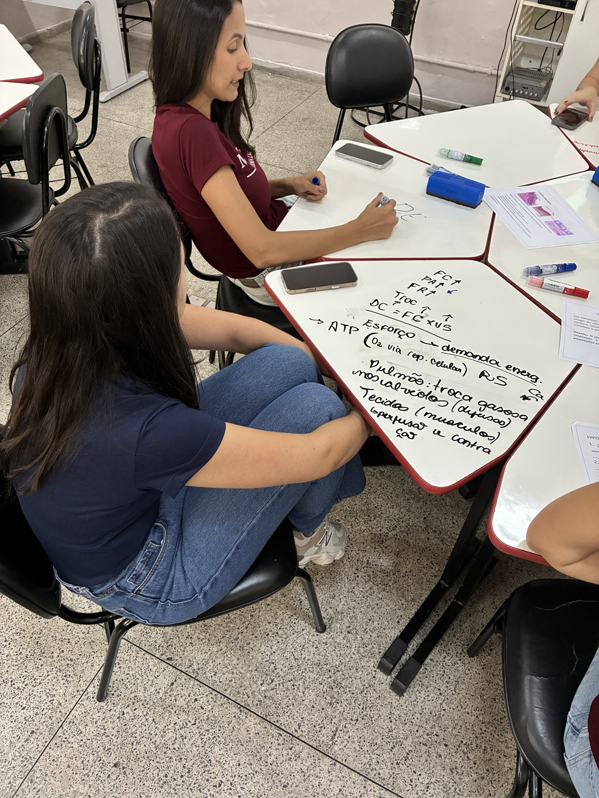
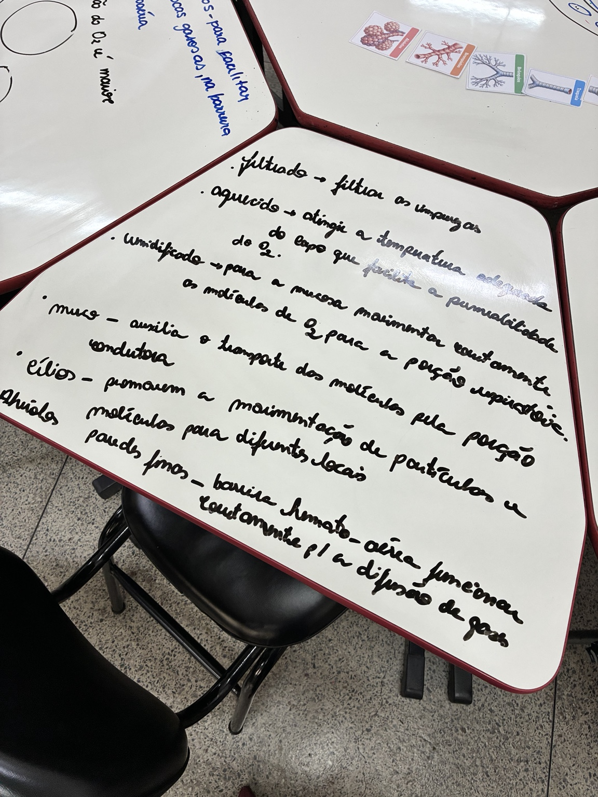
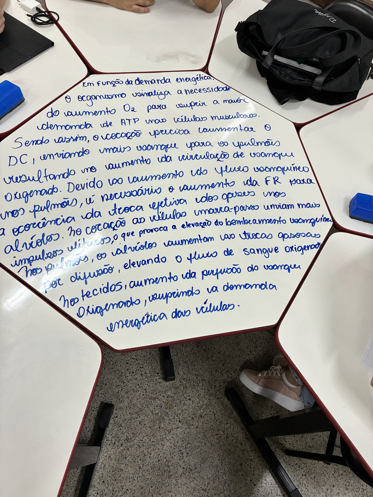
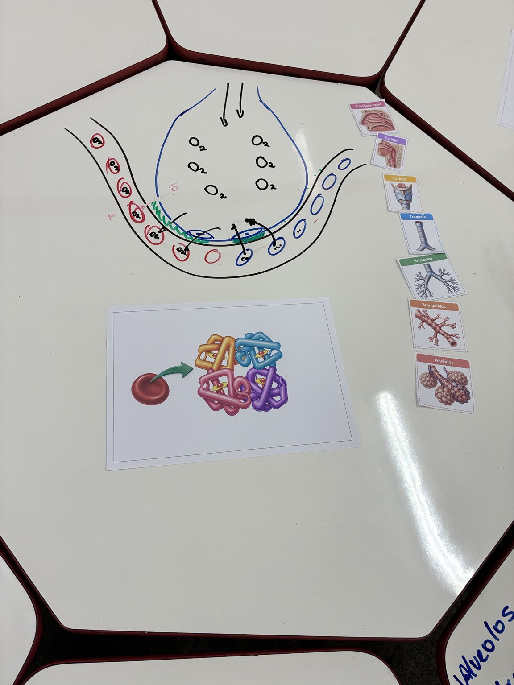
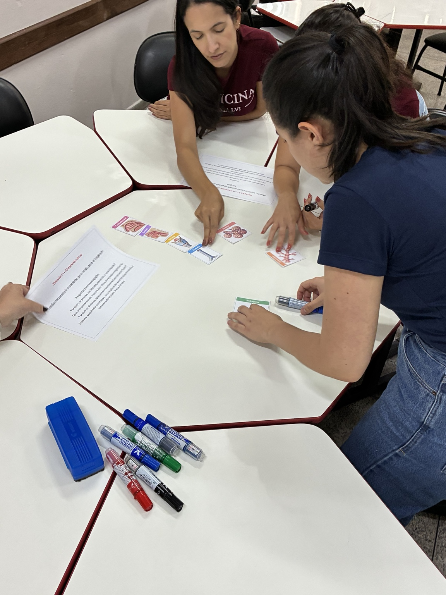

## Objetivo

Consolidar conteúdos integrados das bases biológicas e fortalecer a escrita científica e a elaboração de respostas discursivas, diante da lacuna identificada na primeira avaliação de aprendizagem.

## Desenvolvimento

No encontro de 20 de outubro de 2026, os estudantes revisaram conteúdos por meio de estações de aprendizagem e construíram explicações coletivas. As atividades envolveram a organização de sequências anatômicas, a representação da hematose e a relação entre transporte de oxigênio, demanda energética dos tecidos e respostas fisiológicas.

A proposta articulou Anatomia, Histologia, Citologia, Bioquímica e Fisiologia, em diálogo com os Sistemas Orgânicos Integrados (SOI). Os grupos interpretaram imagens, organizaram conceitos e resolveram situações-problema, mobilizando identificação de estruturas, raciocínio fisiológico, comunicação científica e trabalho colaborativo.

Além da revisão conceitual, a atividade orientou a produção de explicações e respostas discursivas com maior clareza, encadeamento lógico e emprego adequado dos conceitos científicos. Esse foco foi definido como resposta pedagógica à necessidade identificada na primeira avaliação de aprendizagem, sem atribuição de notas ou divulgação de resultados individuais.

## Resultados e encaminhamentos

O encontro constituiu um registro formativo de acompanhamento do BASEMED. A escrita científica foi trabalhada como ferramenta para explicitar relações entre estrutura, função e processos fisiológicos, apoiando os estudantes na preparação para avaliações e nas aprendizagens subsequentes.

## Evidências

::: {.acao-figura}
{fig-alt="Estudantes escrevem um esquema relacionando transporte de oxigênio e demanda energética"}
:::

::: {.acao-figura}
{fig-alt="Mesa com anotações dos estudantes sobre as funções das vias respiratórias"}
:::

::: {.acao-figura}
{fig-alt="Resposta discursiva escrita coletivamente relacionando oxigenação, ventilação e demanda energética"}
:::

::: {.acao-figura}
{fig-alt="Representação gráfica da hematose acompanhada por sequência das vias respiratórias"}
:::

::: {.acao-figura}
{fig-alt="Estudantes organizam cartões das vias respiratórias em uma sequência anatômica"}
:::
