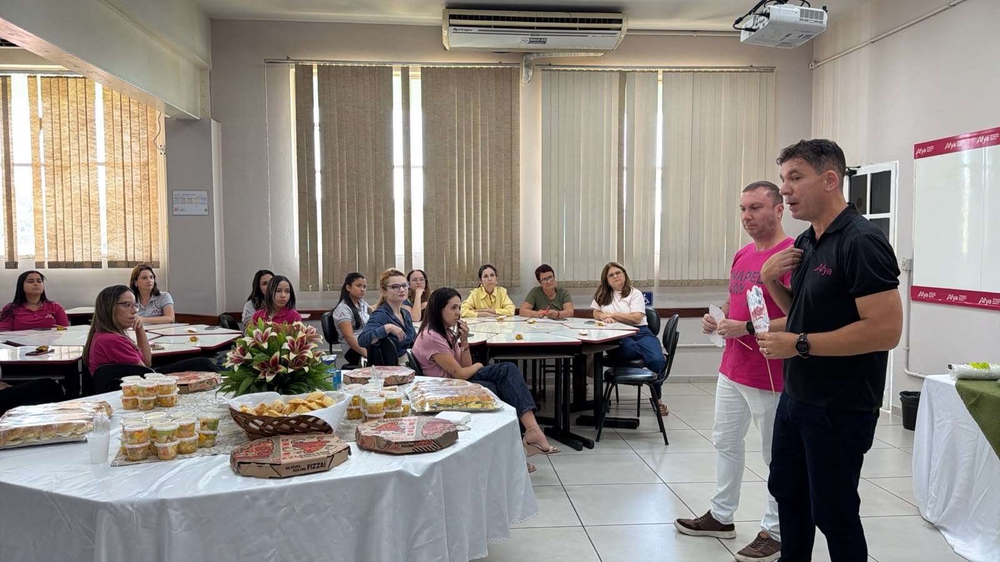
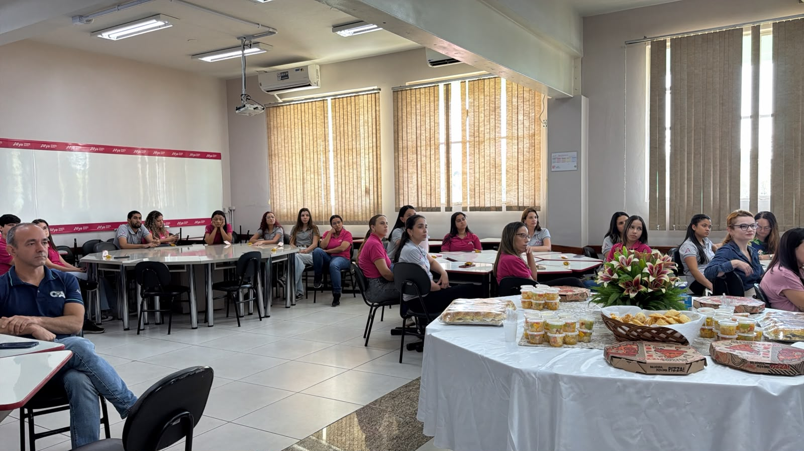
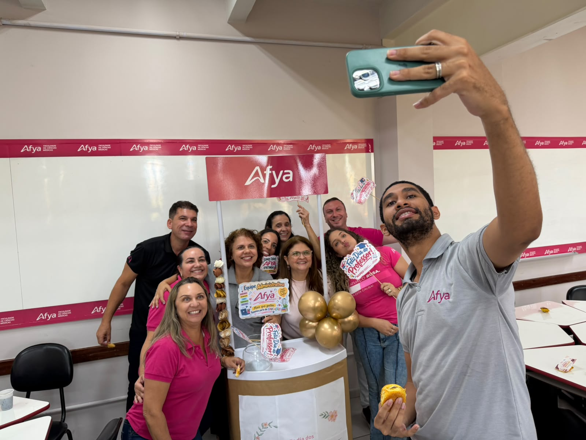
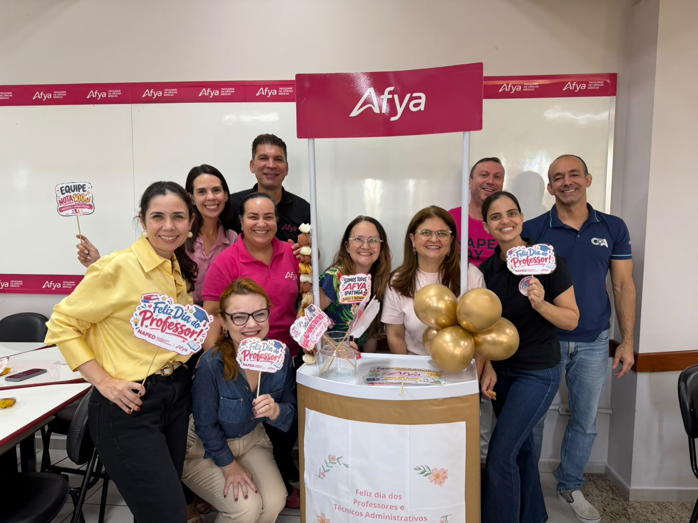

::: {.acao-figura}
{#fig-cafe-dia-professores-tecnicos fig-alt="Card institucional convidando professores e técnicos administrativos para um café da tarde em 8 de outubro, às 14h30, na Sala 4 da Afya Ipatinga"}
:::

## Valorização de quem ensina, apoia e transforma

### Objetivo

Promover um momento de convivência, reconhecimento e integração entre professores e técnicos administrativos, valorizando as pessoas que constroem diariamente a experiência acadêmica e institucional da Afya Ipatinga.

### Desenvolvimento

Em comemoração ao **Dia dos Professores e dos Técnicos Administrativos**, foi realizado um café da tarde no dia **8 de outubro de 2026**, às **14h30**, na **Sala 4**. O encontro foi planejado como um espaço de acolhimento, diálogo e celebração do trabalho desenvolvido pelas equipes.

A iniciativa reconhece que a formação dos estudantes é resultado de uma construção coletiva, que reúne ensino, apoio pedagógico, gestão e cuidado com a comunidade acadêmica. Ao criar um ambiente de encontro fora da rotina, a ação fortalece os vínculos e favorece a troca entre os profissionais.

Durante a atividade, o **Diretor Geral Vinícius Lana Ferreira** ressaltou a importância da equipe para a construção dos resultados institucionais, destacando as mudanças em andamento e os novos projetos que estão sendo desenvolvidos na Afya Ipatinga. A fala reforçou que cada profissional contribui para a qualidade da experiência acadêmica e para o avanço da instituição.

A **coordenadora do NAPED, Maria Cristina Almeida Duarte Gonzaga (Cristina Gonzaga)**, também participou do momento de integração e valorização. Sua atuação junto aos docentes e às equipes pedagógicas reafirma o compromisso do NAPED com o diálogo, o apoio ao trabalho docente e a construção coletiva de melhorias para o ensino. As funções institucionais dos envolvidos foram conferidas na [página de transparência da Afya Ipatinga](https://faculdades.afya.com.br/unidades/ipatinga/transparencia) e na [página oficial do NAPED](https://ipatinga.afya.com.br/institucional/naped).

### Resultados e encaminhamentos

O encontro ampliou o sentimento de pertencimento, reconheceu as contribuições das equipes e fortaleceu a colaboração entre os diferentes setores da instituição. O momento também reforçou a cultura de valorização das pessoas como parte essencial do compromisso da Afya com uma educação transformadora.

### Evidência

O card de divulgação registra a data, o horário, o local e o convite para a participação dos professores e técnicos administrativos.

As fotografias abaixo registram a fala da direção, a participação das equipes e o momento de confraternização realizado pela Afya Ipatinga.

::: {.acao-figura}
{#fig-cafe-dia-professores-tecnicos-01 fig-alt="Diretor Geral Vinícius Lana Ferreira falando diante de professores e técnicos administrativos durante o café comemorativo"}
:::

::: {.acao-figura}
{#fig-cafe-dia-professores-tecnicos-02 fig-alt="Professores e técnicos administrativos reunidos em uma sala da Afya Ipatinga durante o café de comemoração"}
:::

::: {.acao-figura}
{#fig-cafe-dia-professores-tecnicos-03 fig-alt="Integrantes da equipe Afya Ipatinga reunidos para uma fotografia durante a celebração"}
:::

::: {.acao-figura}
{#fig-cafe-dia-professores-tecnicos-04 fig-alt="Grupo de professores e técnicos administrativos reunido junto à decoração da comemoração do Dia dos Professores"}
:::
