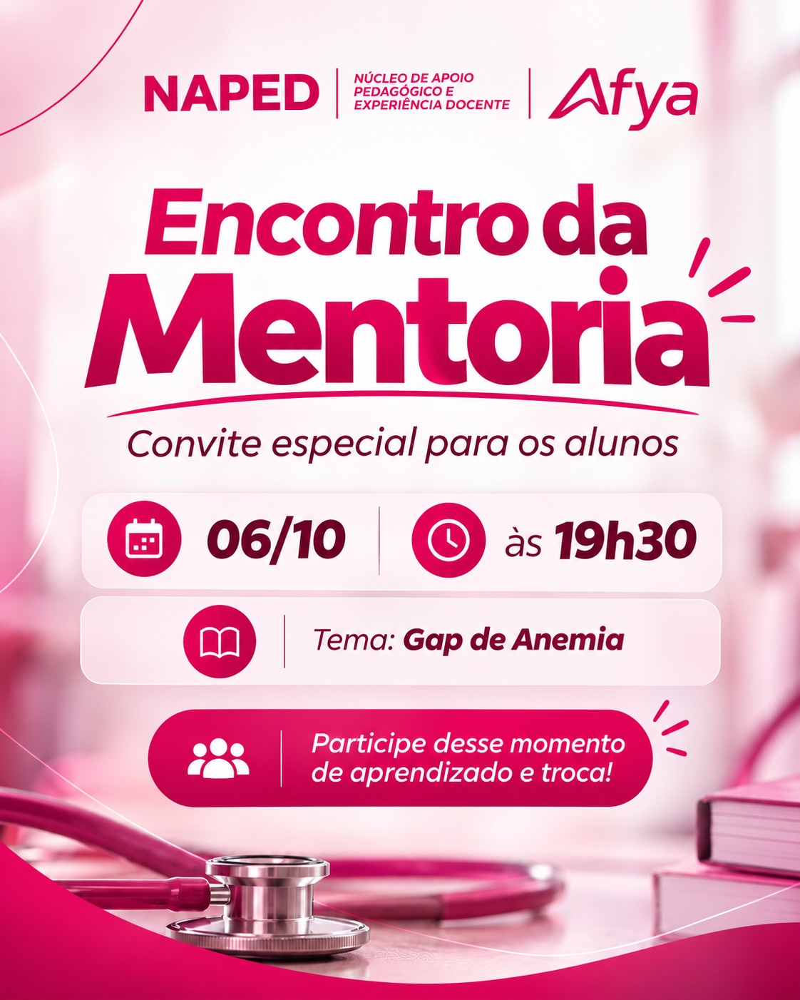
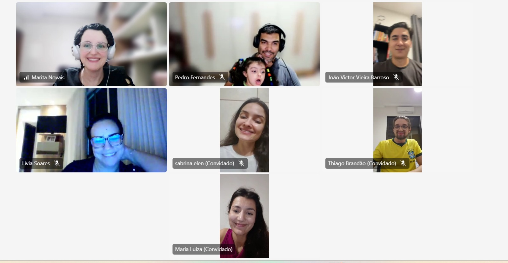
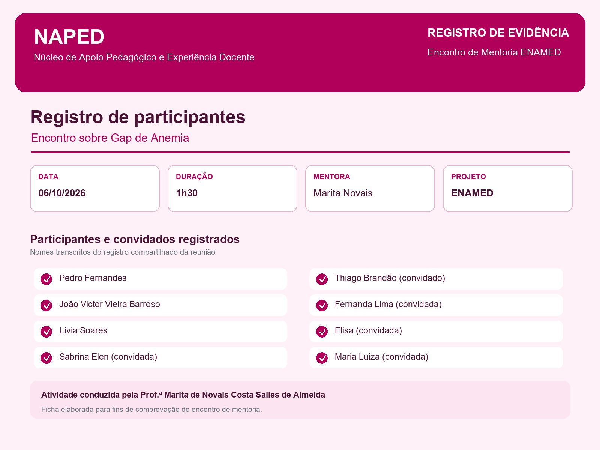

::: {.acao-figura}
{#fig-encontro-mentoria-gap-anemia fig-alt="Card do NAPED convidando estudantes para encontro de mentoria do Projeto ENAMED, em 6 de outubro, às 19h30, com o tema Gap de Anemia"}
:::

## Mentoria ENAMED para fortalecer a aprendizagem

### Objetivo

Promover um momento de estudo, diálogo e acompanhamento acadêmico sobre o tema **Gap de Anemia**, contribuindo para a preparação dos estudantes para os desafios do ENAMED.

### Desenvolvimento

No dia **6 de outubro, às 19h30**, a professora **Marita de Novais Costa Salles de Almeida**, mentora e integrante do NAPED, conduziu um encontro on-line com os estudantes do Projeto ENAMED. Com duração de **1 hora e 30 minutos**, a atividade foi dedicada à discussão do tema, à revisão de conhecimentos e à troca de experiências relacionadas à formação médica.

### Resultados e encaminhamentos

O encontro integra as ações de mentoria do Projeto ENAMED e amplia as oportunidades de acompanhamento próximo dos estudantes. A proposta é favorecer a participação ativa, o esclarecimento de dúvidas e a construção de estratégias de estudo alinhadas às necessidades identificadas no percurso acadêmico.

### Evidências

O card de divulgação registra a data, o horário, o tema e o convite aos estudantes para participação no encontro de mentoria. As capturas do encontro documentam a realização da atividade, conduzida pela professora Marita, com a participação dos estudantes e convidados do Projeto ENAMED.

::: {.acao-figura}
{#fig-mentoria-enamed-gap-anemia-encontro-01 fig-alt="Captura de reunião on-line do Projeto ENAMED com a professora Marita Novais e estudantes participantes"}
:::

::: {.acao-figura}
{#fig-mentoria-enamed-gap-anemia-encontro-02 fig-alt="Participantes em reunião on-line de mentoria do Projeto ENAMED, com a professora Marita Novais em destaque"}
:::

Para fins de comprovação, o registro compartilhado da reunião foi organizado em uma ficha visual de participantes e convidados. A ficha identifica a data, a duração, a mentora e o Projeto ENAMED, preservando os nomes registrados sem reproduzir a captura original da plataforma.

::: {.acao-figura}
{#fig-mentoria-enamed-gap-anemia-ficha-participantes fig-alt="Ficha visual com data de 6 de outubro de 2026, duração de 1 hora e 30 minutos, mentora Marita Novais e os participantes e convidados registrados no encontro de mentoria ENAMED"}
:::
