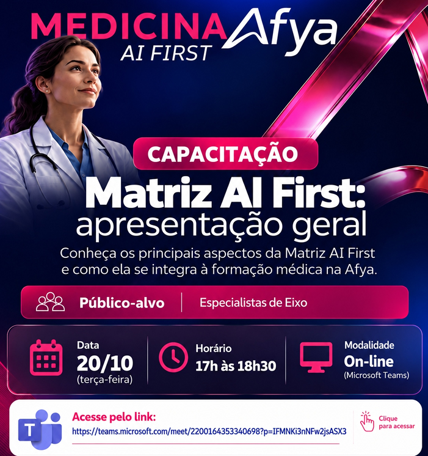

::: {.acao-figura}
{#fig-matriz-ai-first-card fig-alt="Card institucional da Afya para a capacitação on-line Matriz AI First, voltada a especialistas de eixo e realizada em 20 de outubro, das 17h às 18h30"}
:::

## Objetivo

Registrar a participação do NAPED da Afya Ipatinga na semana de reuniões de alinhamento e capacitações da **Matriz AI First 2027.1** do curso de Medicina, realizada de **20 a 30 de outubro de 2026**. Os encontros contribuíram para compreender os novos eixos, os desafios de implementação e os princípios que orientam a formação médica na nova proposta.

## Desenvolvimento

Entre **20 e 30 de outubro de 2026**, integrantes do NAPED participaram de uma semana de reuniões e formações on-line sobre a **Matriz AI First 2027.1**, direcionada aos especialistas de eixo. A programação incluiu a apresentação geral da proposta e debates sobre as mudanças em relação à matriz anterior, incluindo a integração multidimensional entre sistemas, pessoa e contexto, o percurso dos Eixos Integrados Multidimensionais em Saúde (EIMS) e a organização progressiva do método SOAP para apoiar o raciocínio clínico.

As discussões também abordaram a integração entre saúde, território, sustentabilidade e práticas de cuidado. Esse processo de atualização reafirma que os novos desafios curriculares devem permanecer conectados às **metodologias ativas**, à aprendizagem significativa, à problematização e ao protagonismo discente.

A participação foi acompanhada por **Maria Cristina Almeida Duarte Gonzaga (Cristina Gonzaga)**, coordenadora do NAPED, e por diversos integrantes do núcleo. O grupo contribuiu para o alinhamento das orientações recebidas, a reflexão sobre os impactos pedagógicos e o planejamento de estratégias que apoiem docentes e estudantes na transição para a nova matriz.

## Resultados e encaminhamentos

As formações ampliaram o repertório da equipe para acompanhar a implementação da Matriz AI First em 2027.1. Como encaminhamento, o NAPED seguirá articulando diálogos com coordenações, especialistas de eixo e docentes, favorecendo a apropriação gradual da proposta e a coerência das práticas pedagógicas com os novos objetivos de aprendizagem.

## Evidências

Os registros a seguir documentam a participação nas reuniões on-line e os conteúdos discutidos ao longo da semana de formações da nova matriz.

::: {.acao-figura}
{#fig-matriz-ai-first-01 fig-alt="Tela de reunião on-line com apresentação que agradece ao time de sustentabilidade da Afya e ao Instituto Afya pela parceria na formação médica"}
:::

::: {.acao-figura}
{#fig-matriz-ai-first-02 fig-alt="Tela de reunião on-line com slide sobre clima e saúde, discutindo riscos, agravos e acesso ao cuidado"}
:::

::: {.acao-figura}
{#fig-matriz-ai-first-03 fig-alt="Tela de capacitação on-line com slide que compara a matriz anterior à Matriz AI First nos aspectos de concepção, raciocínio clínico, percurso e ultrassonografia"}
:::

::: {.acao-figura}
{#fig-matriz-ai-first-04 fig-alt="Tela de capacitação on-line com slide explicando os componentes subjetivo, objetivo, avaliação e plano do método SOAP"}
:::

### Referências institucionais

O NAPED atua em articulação com a Direção Acadêmica e as coordenações de curso em questões relacionadas ao planejamento institucional, aos projetos pedagógicos e às matrizes curriculares. [Conheça o NAPED da Afya Ipatinga](https://ipatinga.afya.com.br/institucional/naped) e consulte a página de [transparência institucional](https://faculdades.afya.com.br/unidades/ipatinga/transparencia), que identifica Maria Cristina Almeida Duarte Gonzaga no NAPED.
