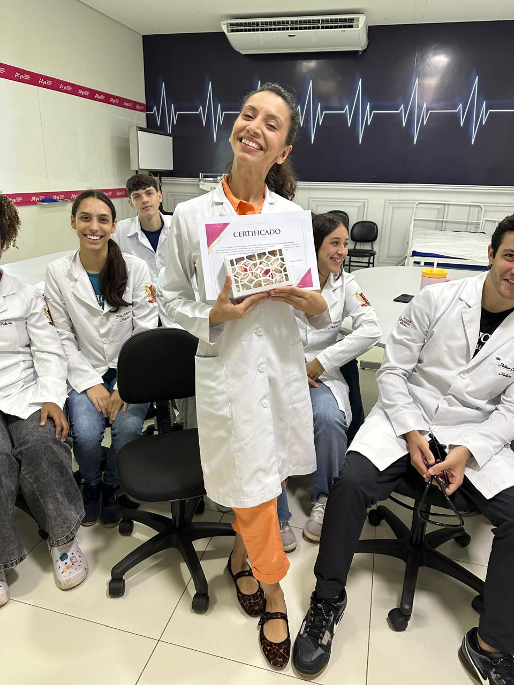
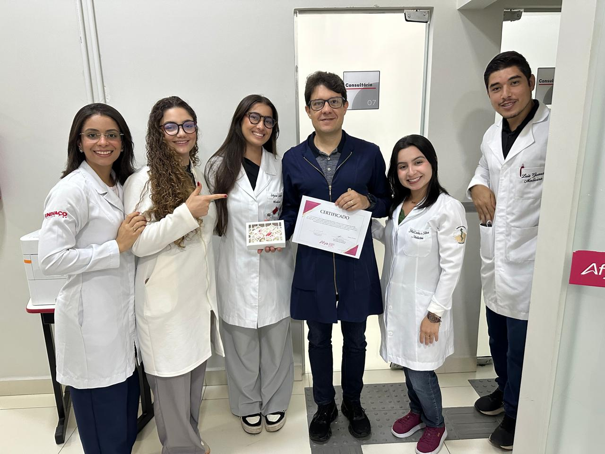

::: {.acao-figura}
{#fig-premiacao-docente-01 fig-alt="Docente recebendo um certificado de reconhecimento, acompanhada por integrantes da equipe da Afya Ipatinga"}
:::

## Reconhecer quem ensina é valorizar a formação

### Objetivo

Celebrar o compromisso dos docentes da Afya Ipatinga e reconhecer sua participação nas avaliações acadêmicas, valorizando o trabalho que sustenta a aprendizagem, o acompanhamento dos estudantes e a qualidade da formação em saúde.

### Desenvolvimento

O NAPED, em parceria com a instituição, promoveu uma ação de valorização profissional com a entrega de certificados e lembranças aos docentes reconhecidos. A premiação foi organizada por curso e por faixas de avaliações registradas, destacando diferentes níveis de participação e dedicação ao processo acadêmico.

Cada reconhecimento representa mais do que uma quantidade: traduz presença, responsabilidade, disponibilidade para acompanhar os estudantes e compromisso com a construção cotidiana de uma educação em saúde cada vez mais qualificada.

### Docentes reconhecidos

#### Enfermagem

- **Tatiane Teixeira Lima**

#### Medicina

**Até 20 avaliações**

- **Marcela Cajazeira Pereira Leite**
- **Simone Floresta Leal**

**Até 40 avaliações**

- **Felippe Hauck Mansu**
- **Leonardo Ennes Carrilho**

**Até 60 avaliações**

- **Juliana Cristina de Vasconcellos Benatti**
- **Mariana de Souza Furtado**

**Até 80 avaliações**

- **Renata Xavier de Almeida**
- **Marlene Aredes Mota**

**Até 100 avaliações**

- **Paula Ohana Rodrigues**
- **Leonardo de Araujo Lopes**

**Acima de 100 avaliações**

- **Fabio Araujo Gomes de Castro**
- **Giani Martins Garcia**

### Homenagem

Parabéns a todos os docentes reconhecidos! A dedicação de cada profissional fortalece o vínculo com os estudantes, amplia as oportunidades de aprendizagem e contribui para que a Afya Ipatinga siga formando profissionais preparados, éticos e comprometidos com o cuidado.

Que esta premiação represente o reconhecimento de uma trajetória de trabalho, parceria e compromisso. O NAPED agradece e celebra todos que fazem da docência uma prática de transformação.

### Resultados e encaminhamentos

A ação fortaleceu a cultura institucional de reconhecimento, aproximou a equipe pedagógica dos docentes e evidenciou a importância da participação dos professores nos processos avaliativos. O registro também contribui para preservar a memória das iniciativas de valorização profissional da Afya Ipatinga.

### Evidências

As fotografias registram a entrega dos certificados e os momentos de celebração junto aos docentes e estudantes.

::: {.acao-figura}
{#fig-premiacao-docente-02 fig-alt="Docente homenageada segurando certificado ao lado de estudantes em ambiente de prática da Afya Ipatinga"}
:::

::: {.acao-figura}
{#fig-premiacao-docente-03 fig-alt="Docente recebendo certificado de reconhecimento acompanhada por duas integrantes da equipe da Afya Ipatinga"}
:::

::: {.acao-figura}
{#fig-premiacao-docente-04 fig-alt="Equipe da Afya Ipatinga reunida ao redor de um docente reconhecido, que segura um certificado"}
:::
