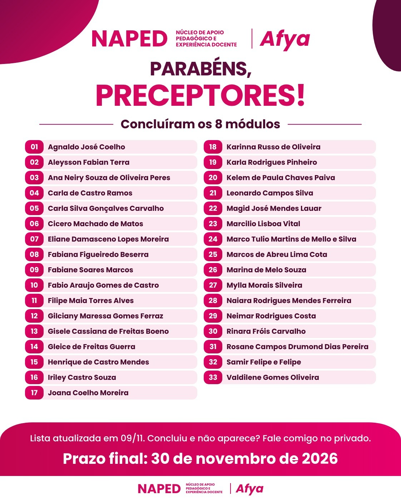
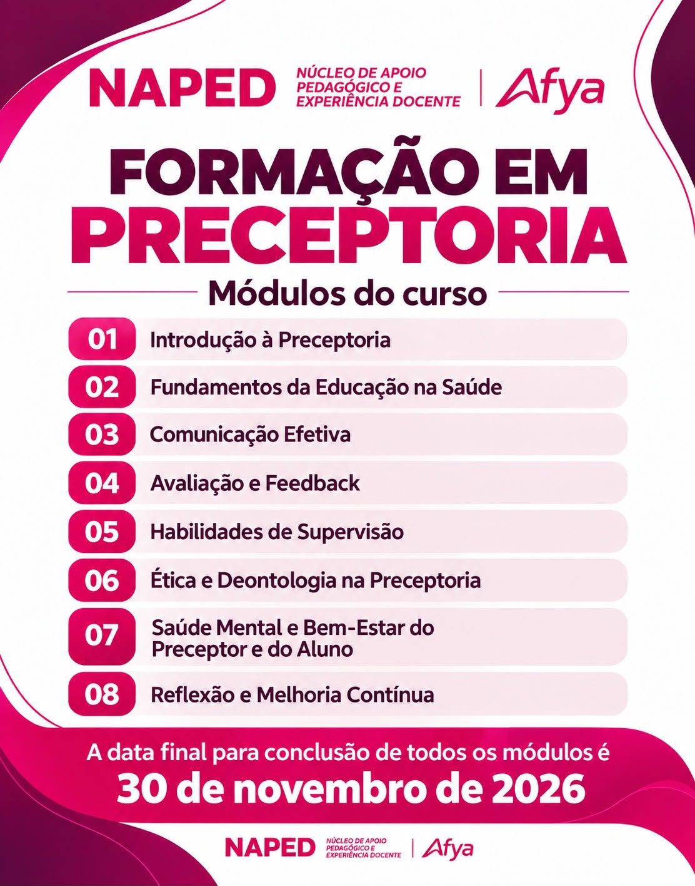

::: {.acao-figura}
{#fig-acompanhamento-preceptoria fig-alt="Card de reconhecimento aos preceptores que concluíram os oito módulos da formação em preceptoria"}
:::

## Objetivo

Fortalecer o acompanhamento dos preceptores na pós-graduação em Preceptoria, oferecendo comunicação clara sobre o percurso, apoio diante de dúvidas e reconhecimento da trajetória já concluída.

## Desenvolvimento

No Projeto Preceptoria, o NAPED atua em parceria com os preceptores durante toda a trilha formativa. Essa atuação inclui divulgar os oito módulos, orientar sobre os critérios de conclusão, acompanhar prazos, acolher dificuldades de acesso e manter um canal de suporte para que os participantes avancem com segurança.

O acompanhamento também valoriza cada etapa concluída. Ao reconhecer os preceptores que já finalizaram a formação, o NAPED reforça a importância de uma prática educativa qualificada nos cenários de ensino e serviço. A pós-graduação aborda fundamentos da educação em saúde, comunicação, avaliação e feedback, supervisão, ética, saúde mental e melhoria contínua — dimensões essenciais para o acompanhamento de estudantes.

Os cards institucionais reforçaram que a conclusão dos módulos deve ocorrer até **30 de novembro de 2026**, com pontuação mínima de 70 pontos por módulo e duas oportunidades de tentativa, permanecendo a maior nota.

## Resultados e encaminhamentos

O NAPED segue junto aos preceptores até a finalização do percurso, acompanhando pendências, respondendo a solicitações de apoio e incentivando a conclusão dentro do prazo. A ação aproxima formação, prática assistencial e desenvolvimento docente, reconhecendo os profissionais que contribuem diariamente para uma formação em saúde mais ética, segura e humanizada.

## Evidências

::: {.acao-figura}
{fig-alt="Card de orientação aos preceptores sobre os módulos abertos e prazo de 30 de novembro"}
:::

::: {.acao-figura}
{fig-alt="Card com informações sobre pontuação, tentativas por módulo e suporte do NAPED"}
:::

::: {.acao-figura}
{fig-alt="Card da formação em preceptoria com os oito módulos e prazo final de conclusão"}
:::
