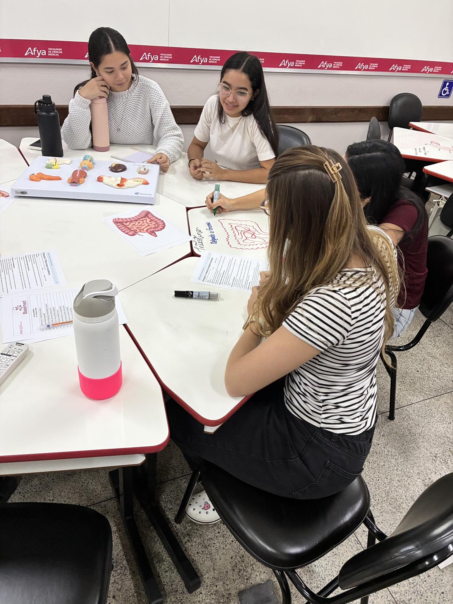
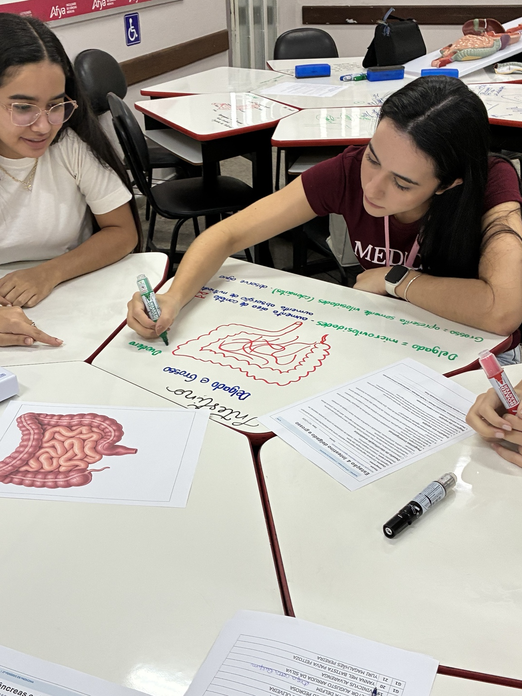
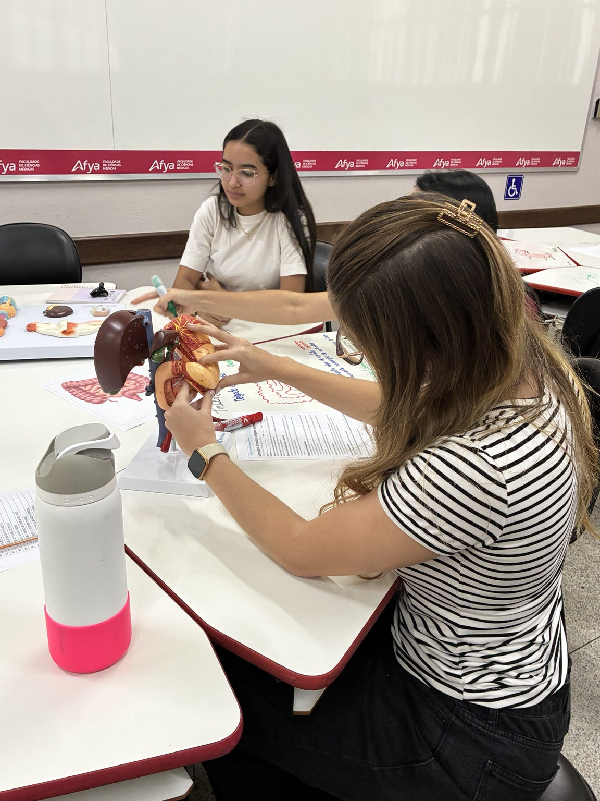
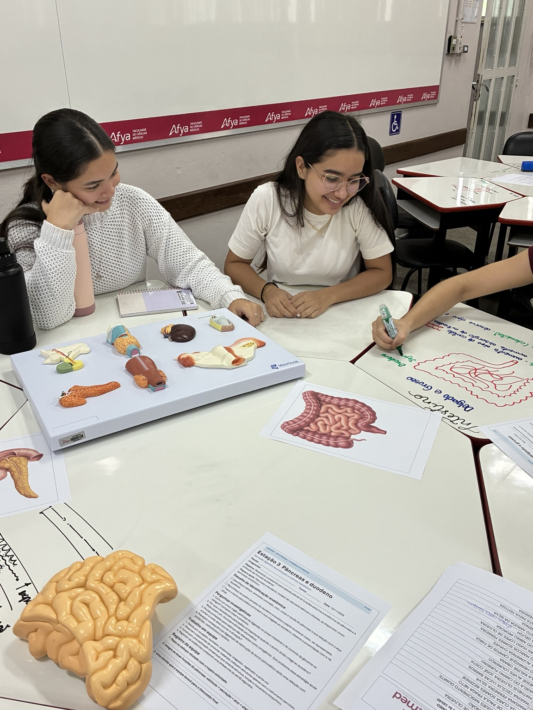
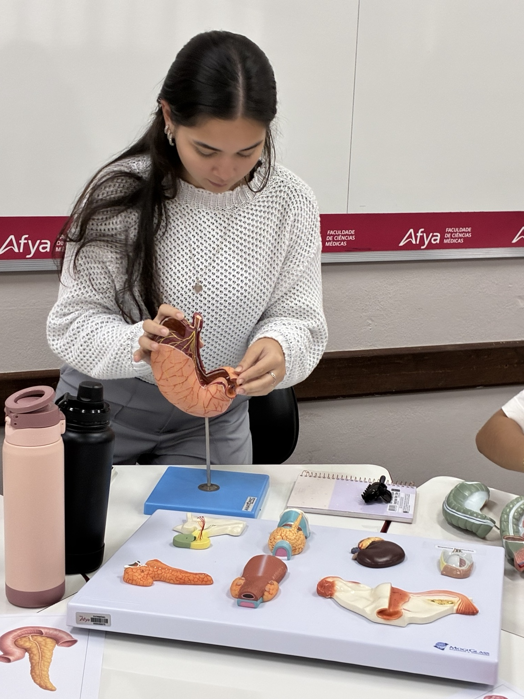
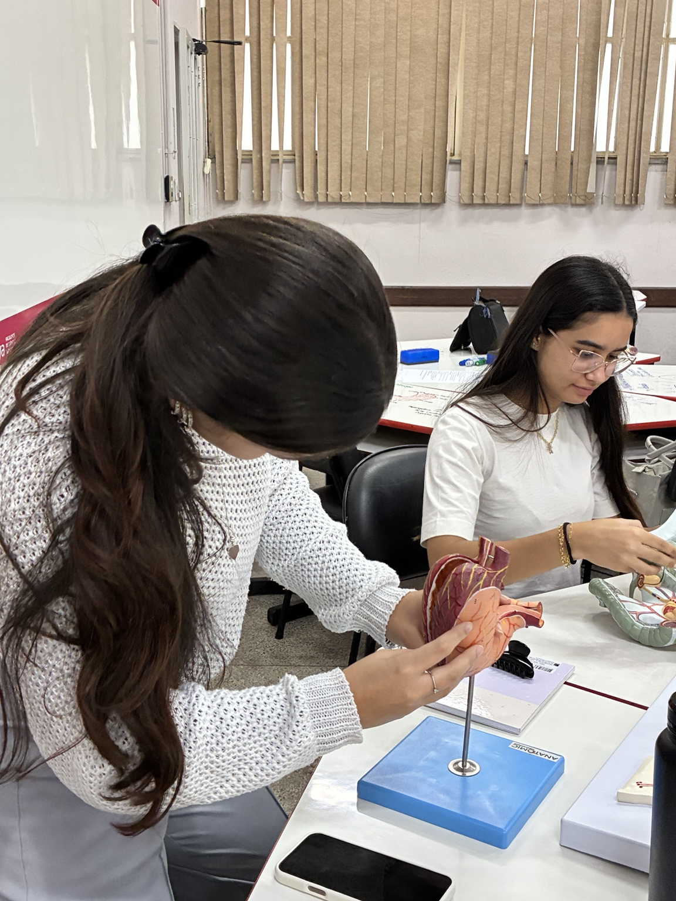

## Objetivo

Consolidar as bases biológicas do sistema digestório por meio da integração entre Anatomia, Fisiologia e Bioquímica, favorecendo a construção ativa do conhecimento na formação médica.

## Desenvolvimento

Em 10 de novembro de 2026, o BASEMED realizou uma atividade prática organizada em estações de aprendizagem sobre o sistema digestório. Com modelos anatômicos, roteiros de estudo, esquemas explicativos e discussão em pequenos grupos, os estudantes identificaram estruturas do estômago, intestinos, fígado, pâncreas e duodeno.

As estações abordaram a digestão, a absorção de nutrientes, a produção e a ação da bile, o metabolismo hepático e o armazenamento de glicogênio. A estação sobre pâncreas e duodeno aproximou a identificação das estruturas de suas relações funcionais, permitindo que os estudantes conectassem forma, processo e função.

## Resultados e encaminhamentos

O BASEMED fortalece a consolidação das bases biológicas que sustentam o raciocínio clínico ao longo da formação médica. A manipulação de peças, a elaboração coletiva de esquemas e a explicação entre colegas favorecem uma aprendizagem ativa, mais significativa e progressivamente autônoma.

## Evidências

::: {.acao-figura}
{fig-alt="Grupo de estudantes discute modelos anatômicos e esquema do sistema digestório"}
:::

::: {.acao-figura}
{fig-alt="Estudante elabora um esquema do intestino em mesa de aprendizagem"}
:::

::: {.acao-figura}
{fig-alt="Estudante manipula modelo anatômico de fígado e pâncreas"}
:::

::: {.acao-figura}
{fig-alt="Mesa organizada para estação de aprendizagem sobre pâncreas e duodeno"}
:::

::: {.acao-figura}
{fig-alt="Estudante explora modelo anatômico de órgãos do sistema digestório"}
:::

::: {.acao-figura}
{fig-alt="Estudantes utilizam modelo anatômico durante estação prática do BASEMED"}
:::
