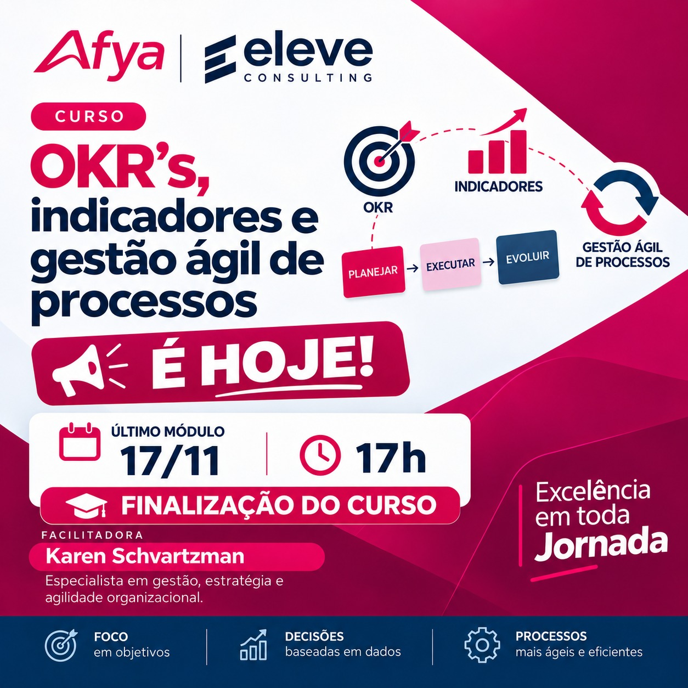
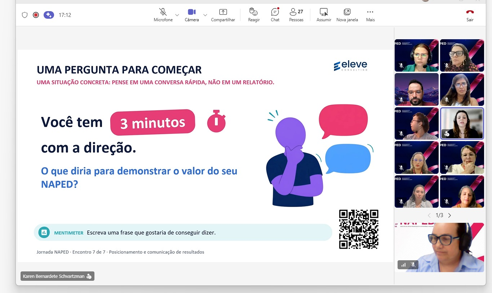
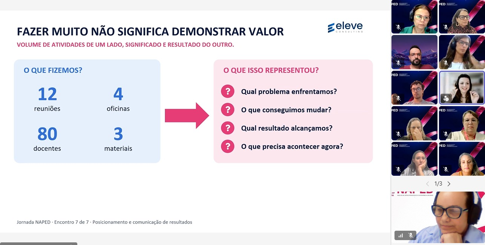

::: {.acao-figura}
{#fig-formacao-equipe-naped-okrs fig-alt="Arte da Afya e da Eleve Consulting para o módulo final do curso OKRs, indicadores e gestão ágil de processos, realizado em 17 de novembro às 17 horas"}
:::

## Objetivo

Fortalecer a capacidade da equipe do NAPED para definir objetivos, acompanhar indicadores, organizar processos e comunicar resultados de forma clara e alinhada às prioridades institucionais.

## Desenvolvimento

A equipe do NAPED participou do curso **OKRs, indicadores e gestão ágil de processos**, promovido pela Afya em parceria com a Eleve Consulting. O último módulo foi realizado em **17 de novembro de 2026**, às **17h**, com facilitação de **Karen Schvartzman**.

O encontro integrou a Jornada NAPED e abordou o posicionamento e a comunicação de resultados. As atividades propuseram a reflexão sobre como demonstrar o valor do trabalho desenvolvido, relacionando o volume de ações aos problemas enfrentados, às mudanças produzidas, aos resultados alcançados e aos próximos passos.

## Resultados e encaminhamentos

A formação ofereceu referências para tornar o planejamento mais objetivo, apoiar decisões baseadas em dados e aperfeiçoar a comunicação dos resultados do NAPED. Os conteúdos podem subsidiar a organização de metas, indicadores e processos de acompanhamento das ações da equipe.

## Evidências

As capturas registram a participação da **coordenadora do NAPED, Cristina Gonzaga**, no treinamento on-line e os conteúdos trabalhados no módulo de encerramento.

::: {.action-evidence-grid}
{fig-alt="Tela do treinamento on-line sobre comunicação de resultados, com Cristina Gonzaga e outros integrantes do NAPED visíveis na reunião"}

{fig-alt="Tela do curso com participantes do NAPED e slide sobre a diferença entre volume de atividades, significado e resultado"}
:::
