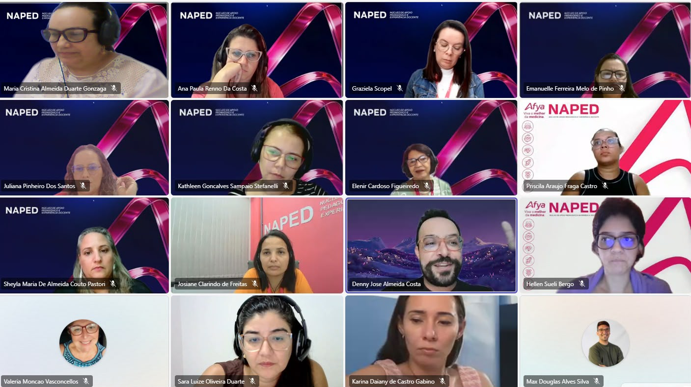
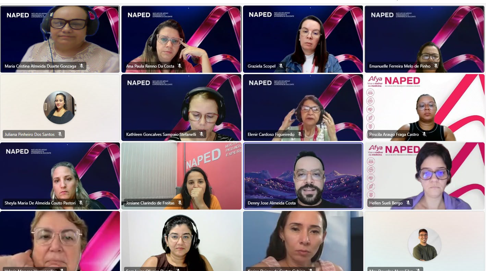

## Objetivo

Alinhar, em âmbito nacional, as orientações e o planejamento da **Semana de Desenvolvimento Docente (SDD)**, favorecendo a organização integrada das ações formativas nas unidades.

## Desenvolvimento

O NAPED participou de uma reunião nacional dedicada à preparação da SDD. O encontro reuniu integrantes das equipes para compartilhar direcionamentos, esclarecer pontos do planejamento e articular as etapas necessárias à realização da programação.

A reunião contou com a participação de **Denny José Almeida Costa** e possibilitou o diálogo entre os profissionais envolvidos na organização das ações de desenvolvimento docente.

## Resultados e encaminhamentos

O alinhamento fortaleceu a comunicação entre as equipes do NAPED e contribuiu para a organização conjunta da SDD. As orientações discutidas servirão de referência para os próximos encaminhamentos e para a adequação do planejamento às necessidades institucionais.

## Evidências

As capturas abaixo registram a participação das equipes na reunião on-line do NAPED Nacional.

::: {.action-evidence-grid}
{fig-alt="Grade de participantes em reunião on-line do NAPED Nacional, com Denny José Almeida Costa em destaque"}

{fig-alt="Segundo registro da grade de participantes durante o alinhamento nacional da Semana de Desenvolvimento Docente"}
:::
