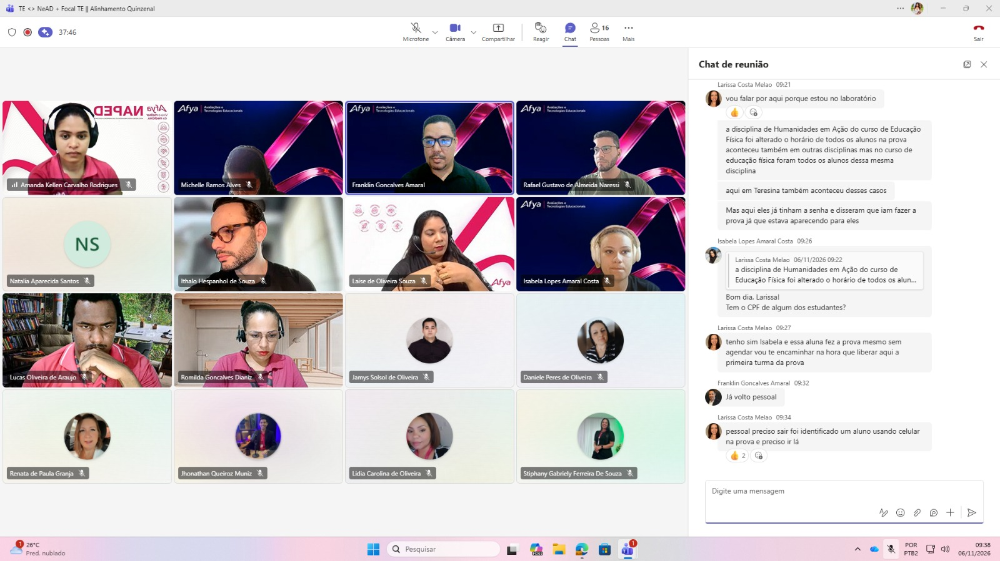
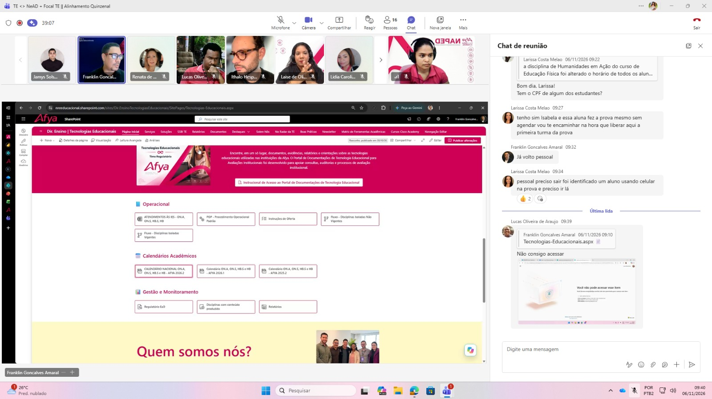
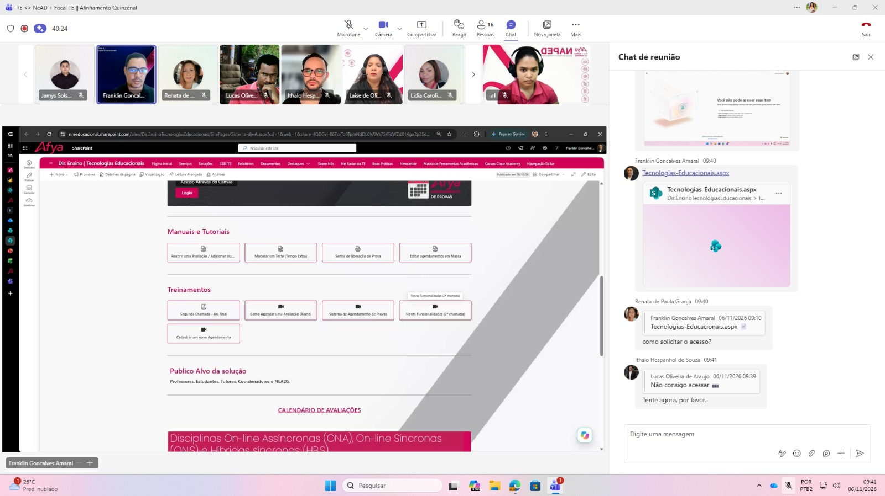

## Alinhamento quinzenal

A reunião quinzenal de Tecnologias Educacionais constituiu um espaço de alinhamento entre as equipes, com compartilhamento de orientações, apresentação de recursos e discussão de demandas relacionadas aos processos acadêmicos e às tecnologias utilizadas no apoio às atividades educacionais.

Os registros evidenciam a participação dos profissionais em ambiente on-line e a navegação orientada por materiais e páginas institucionais de apoio. O encontro contribui para manter os fluxos de trabalho alinhados e favorecer o acompanhamento conjunto das demandas.

## Evidências

  
  
  

