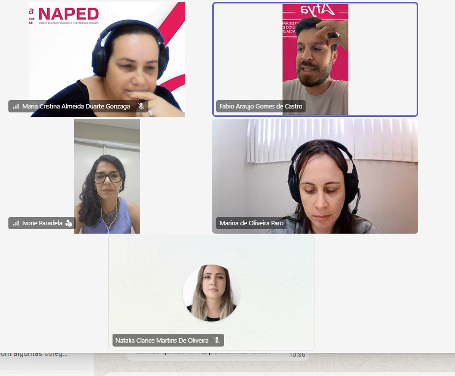
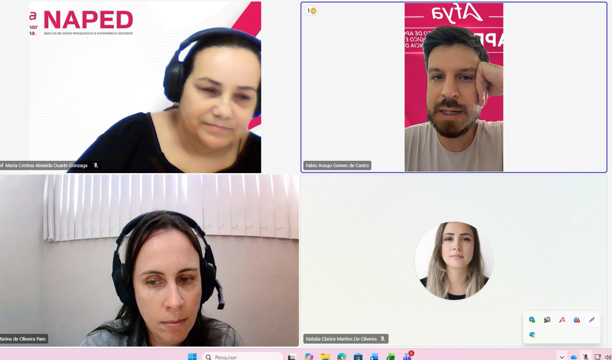

## Alinhamento e planejamento da formação em preceptoria

O NAPED realizou uma reunião com os supervisores do internato, com a participação da coordenadora do internato, Marina, para alinhar as orientações referentes à conclusão da pós-graduação em Preceptoria, com encerramento previsto para **30 de novembro de 2026**.

O encontro também teve como objetivo identificar as demandas de formação dos preceptores, a fim de subsidiar o planejamento da Semana de Desenvolvimento Docente (SDD) e de outras ações formativas voltadas à qualificação da preceptoria no internato.

## Evidências

  
  

