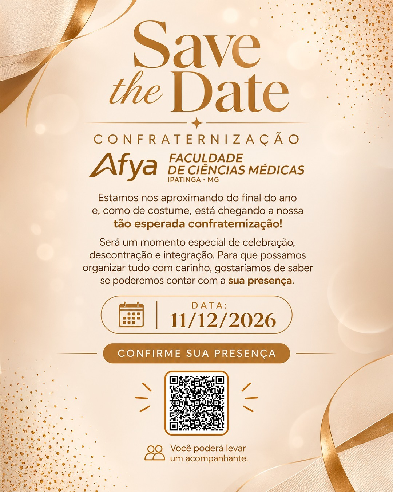

::: {.acao-figura}
{#fig-confraternizacao-afya-2026 fig-alt="Arte institucional Save the Date da confraternização da Afya Ipatinga, marcada para 11 de dezembro de 2026, com QR Code para confirmação de presença"}
:::

## Objetivo

Divulgar a confraternização de encerramento do ano da **Afya Faculdade de Ciências Médicas de Ipatinga**, incentivando a participação da comunidade acadêmica convidada em um momento de celebração e integração.

## Desenvolvimento

O NAPED apoia a comunicação institucional da confraternização prevista para **11 de dezembro de 2026**. O convite apresenta a proposta de um encontro voltado à celebração, à descontração e ao fortalecimento dos vínculos construídos ao longo do ano.

A confirmação de presença é realizada pelo QR Code disponível na própria arte. Conforme informado no convite, cada participante poderá levar um acompanhante. Horário e local não foram incluídos no texto por não constarem no material recebido.

## Resultados e encaminhamentos

Por se tratar de uma ação futura, o registro documenta a etapa de mobilização e divulgação. O próximo encaminhamento é a confirmação de presença pelos convidados, permitindo a organização da confraternização.

## Evidência

O convite institucional registra a data, a finalidade do encontro e o canal de confirmação de presença.
