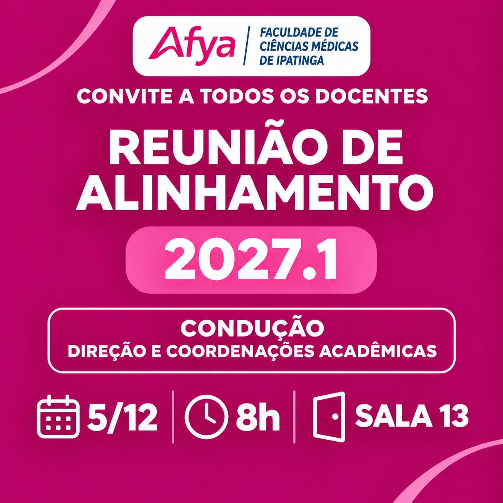

## Objetivo

Promover o alinhamento institucional entre a Direção, as Coordenações Acadêmicas e o corpo docente para a organização do semestre **2027.1**.

## Desenvolvimento

A reunião está programada para o dia **5 de dezembro de 2026**, sábado, às **8h**, na **sala 13**. Durante o encontro, serão compartilhadas as orientações para o próximo semestre e alinhados os preparativos para o início das atividades acadêmicas.

O convite foi direcionado a todos os docentes da Afya Ipatinga, com solicitação de reação à mensagem para sinalizar ciência da convocação.

## Encaminhamentos previstos

O encontro apoiará a comunicação das diretrizes institucionais, a integração das equipes e a preparação das atividades acadêmicas do semestre 2027.1.

## Evidência

{fig-alt="Card da Afya Faculdade de Ciências Médicas de Ipatinga com convite aos docentes para reunião de alinhamento em 5 de dezembro, às 8h, na sala 13"}
