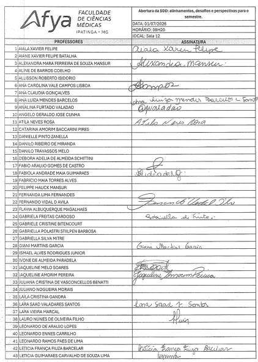
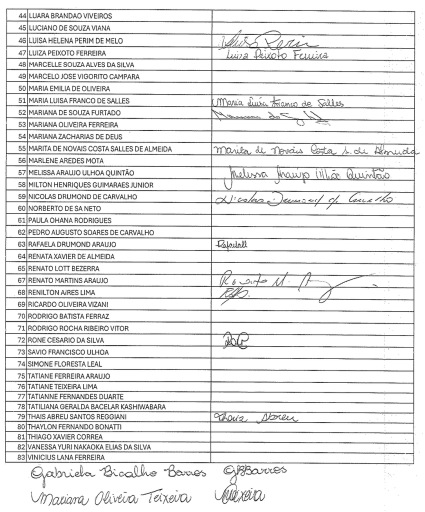
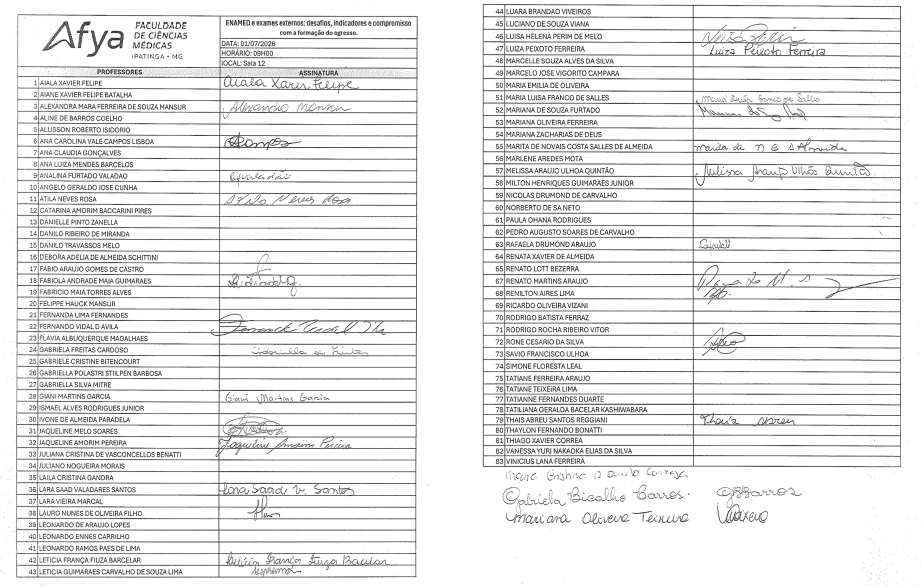
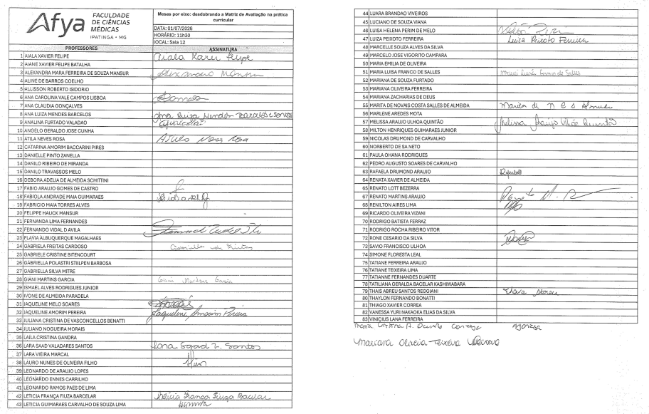
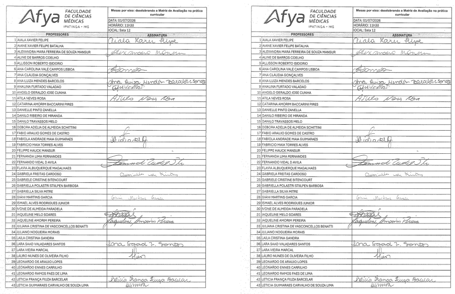
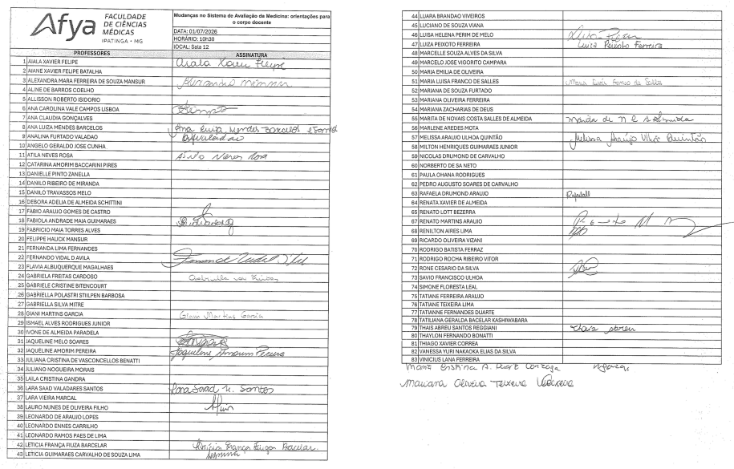
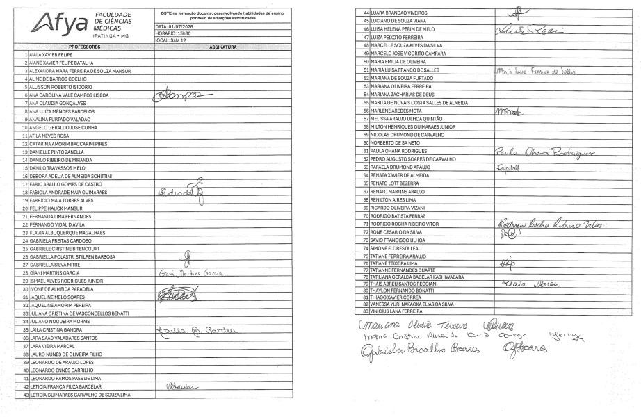
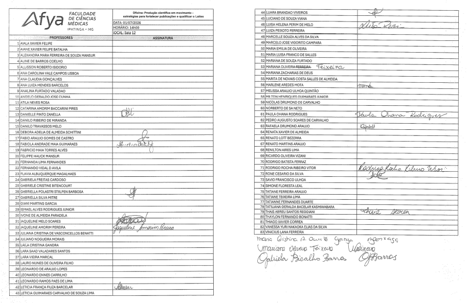
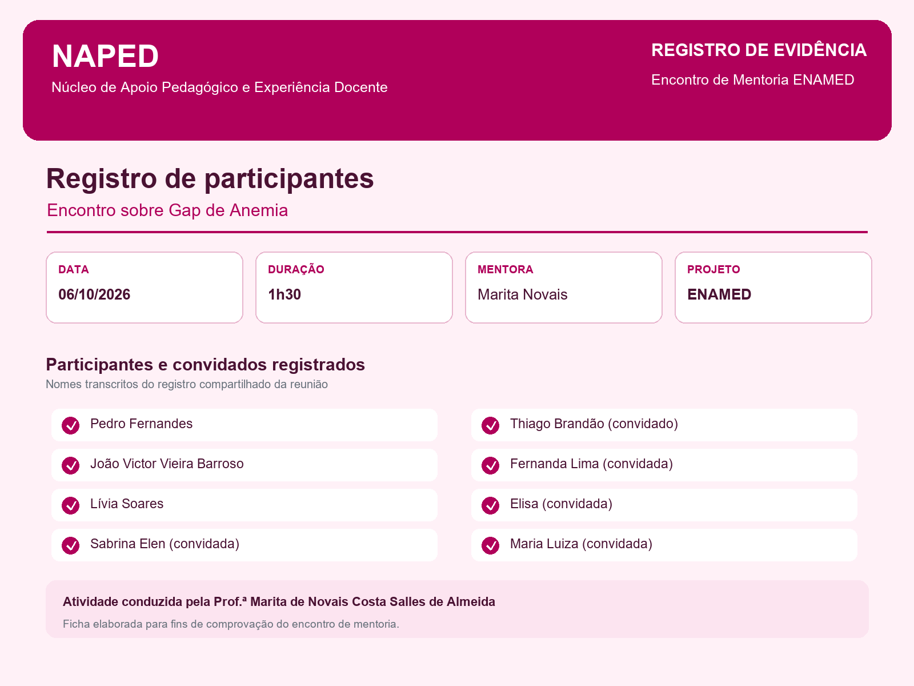
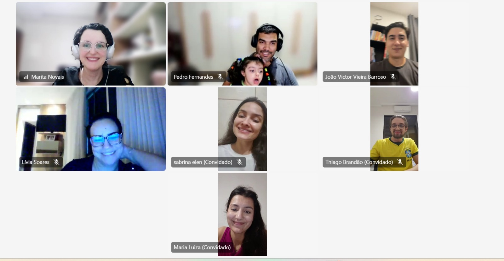

Evidências

Esta seção organiza fotografias, materiais e documentos autorizados para publicação pública, vinculados às ações e aos projetos correspondentes. As listas e fichas de presença são apresentadas como evidências documentais da realização das atividades e da participação registrada.



## Registros de participação docente

Esta é a pasta documental das comprovações de participação de professores: reuniões de alinhamento, Semana de Desenvolvimento Docente (SDD), formações, atendimentos e demais ações do NAPED. Cada registro deve identificar a atividade e a data, reunindo as fotos das listas ou fichas de presença correspondentes.

### SDD — Listas de presença de 01/07/2026

Registros de participação da Semana de Desenvolvimento Docente realizada em 01/07/2026. Selecione uma imagem para consultar o documento em tamanho ampliado.

::: {.attendance-grid}
{.attendance-document}

{.attendance-document}

{.attendance-document}

{.attendance-document}

{.attendance-document}

{.attendance-document}

{.attendance-document}

{.attendance-document}
:::

## Outros registros de participação

### Oficina de Avaliação Antropométrica

Lista de presença da oficina conduzida pela nutricionista Renata Leão. O documento registra os participantes inscritos e integra as evidências da realização da atividade.

[Baixar a lista de presença da Oficina de Avaliação Antropométrica](Lista_de_Presenca_Avaliacao_Antropometrica.docx){.btn .btn-primary}

### Mentoria ENAMED — encontro de 06/10/2026

Registro visual do encontro de mentoria sobre **Gap de Anemia**, conduzido pela Prof.ª Marita de Novais Costa Salles de Almeida, com duração de 1 hora e 30 minutos. A ficha organiza os participantes e convidados registrados, e as capturas documentam a realização da reunião on-line.

::: {.attendance-grid}
{.attendance-document}

{.attendance-document}

{.attendance-document}
:::
