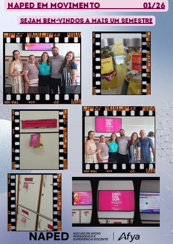
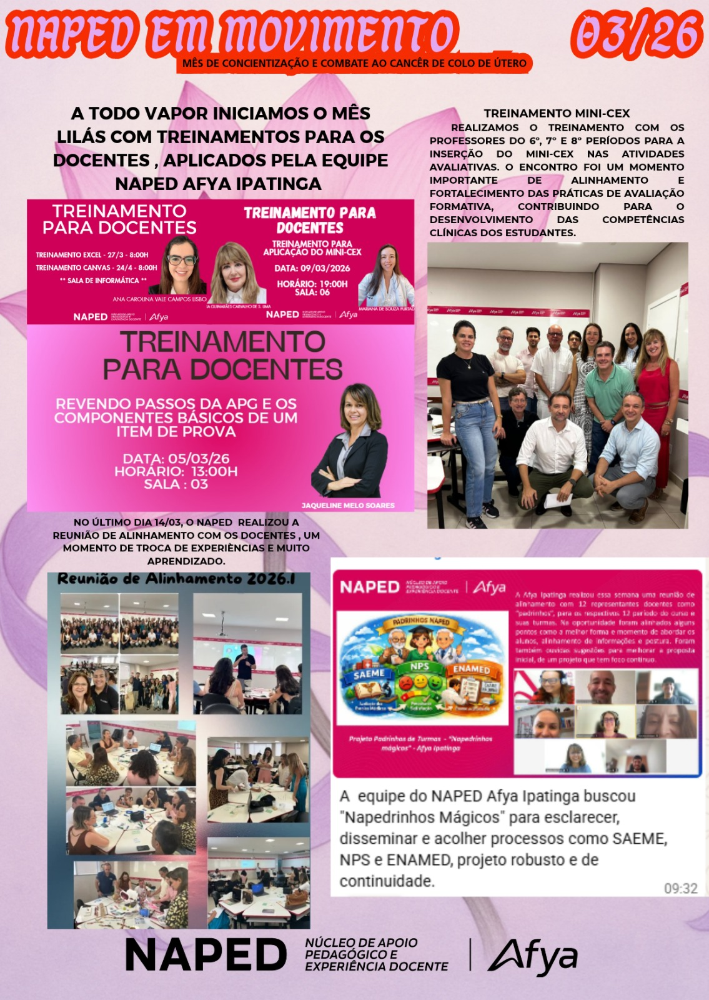
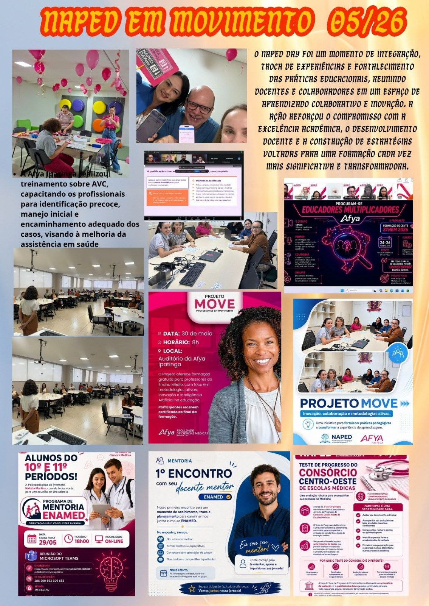
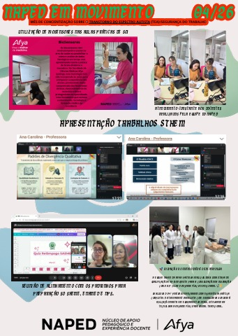
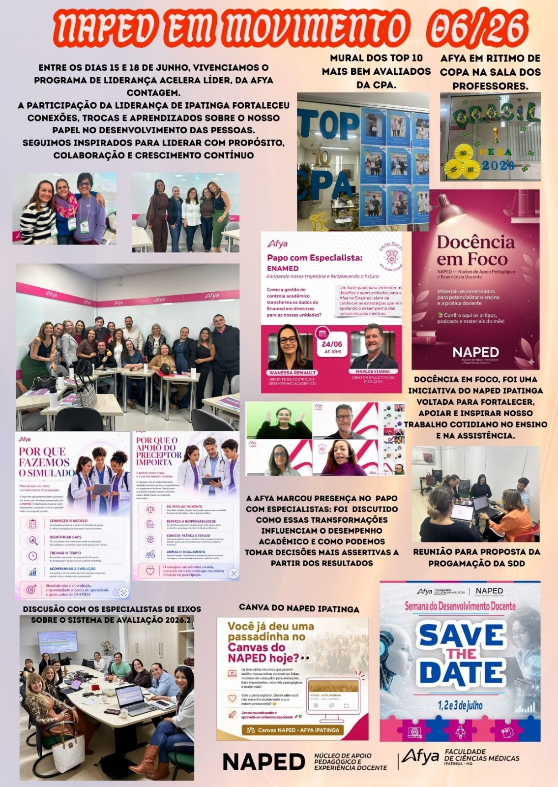
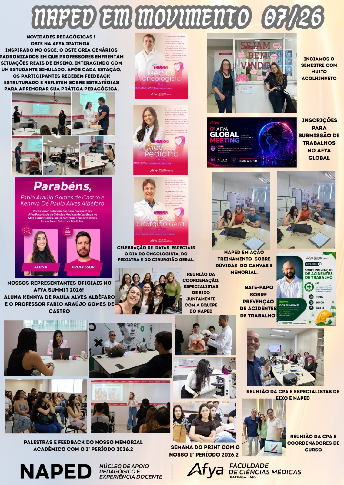
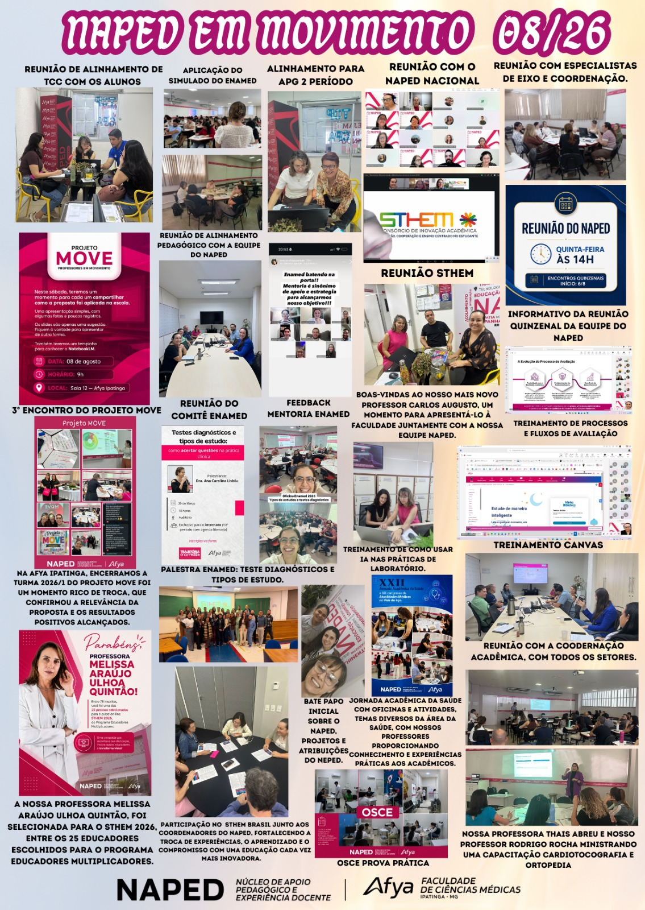
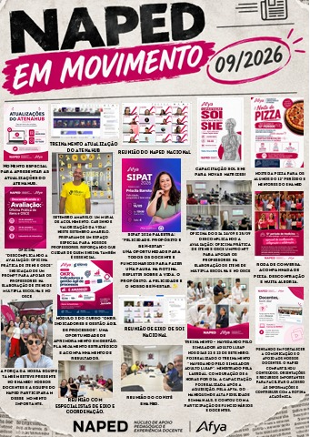

Em movimento

Os **Giros do NAPED** reúnem atualizações breves do cotidiano da equipe: articulações com docentes e setores, bastidores de formações, convites, acompanhamentos e outros movimentos que fortalecem a experiência pedagógica na Afya Ipatinga.

## Edições de janeiro a junho de 2026

::: {.evidence-grid}
<article class="evidence-card">Janeiro de 2026<h2>Acolhimento para um novo semestre</h2>
Registro da preparação da equipe NAPED para receber docentes e dar início às ações do semestre.
</article>

<article class="evidence-card">Fevereiro de 2026<h2>Recepção e formação de novos docentes</h2>
Boas-vindas, divulgação de oportunidades de formação e ações de integração na sala dos professores.
</article>

<article class="evidence-card">Março de 2026<h2>Formação e alinhamento docente</h2>
Treinamentos sobre avaliação, ferramentas digitais e reunião de alinhamento com docentes.
</article>

<article class="evidence-card">Março de 2026<h2>Práticas, parcerias e Projeto MOVE</h2>
Panorama de ações de formação, treinamento em saúde, mentoria ENAMED e divulgação do Projeto MOVE.
</article>

<article class="evidence-card">Abril de 2026<h2>Ensino, extensão e pesquisa</h2>
Registros de atividades acadêmicas, participação em eventos e articulações formativas do NAPED.
</article>

<article class="evidence-card">Junho de 2026<h2>Planejamento e desenvolvimento</h2>
Atualizações sobre Acelera Líder, Docência em Foco, ENAMED, Canvas e preparação da SDD.
</article>
:::

## Edições de julho a outubro de 2026

  <article class="giro-month-card" id="giro-07"><h2>Julho de 2026</h2><a class="giro-zoom" href="#giro-07-ampliado" aria-label="Ampliar o Giro de julho de 2026">⌕ Clique para ampliar</a></article>
  <article class="giro-month-card" id="giro-08"><h2>Agosto de 2026</h2><a class="giro-zoom" href="#giro-08-ampliado" aria-label="Ampliar o Giro de agosto de 2026">⌕ Clique para ampliar</a></article>
  <article class="giro-month-card" id="giro-09"><h2>Setembro de 2026</h2><a class="giro-zoom" href="#giro-09-ampliado" aria-label="Ampliar o Giro de setembro de 2026">⌕ Clique para ampliar</a></article>
  <article class="giro-month-card" id="giro-10"><h2>Outubro de 2026</h2><a class="giro-zoom" href="#giro-10-ampliado" aria-label="Ampliar o Giro de outubro de 2026">⌕ Clique para ampliar</a></article>

<a class="giro-lightbox-close" href="#giro-07" aria-label="Fechar">×</a><a class="giro-lightbox-prev" href="#giro-10-ampliado" aria-label="Mês anterior">‹</a><a class="giro-lightbox-next" href="#giro-08-ampliado" aria-label="Próximo mês">›</a>

<a class="giro-lightbox-close" href="#giro-08" aria-label="Fechar">×</a><a class="giro-lightbox-prev" href="#giro-07-ampliado" aria-label="Mês anterior">‹</a><a class="giro-lightbox-next" href="#giro-09-ampliado" aria-label="Próximo mês">›</a>

<a class="giro-lightbox-close" href="#giro-09" aria-label="Fechar">×</a><a class="giro-lightbox-prev" href="#giro-08-ampliado" aria-label="Mês anterior">‹</a><a class="giro-lightbox-next" href="#giro-10-ampliado" aria-label="Próximo mês">›</a>

<a class="giro-lightbox-close" href="#giro-10" aria-label="Fechar">×</a><a class="giro-lightbox-prev" href="#giro-09-ampliado" aria-label="Mês anterior">‹</a><a class="giro-lightbox-next" href="#giro-07-ampliado" aria-label="Próximo mês">›</a>

