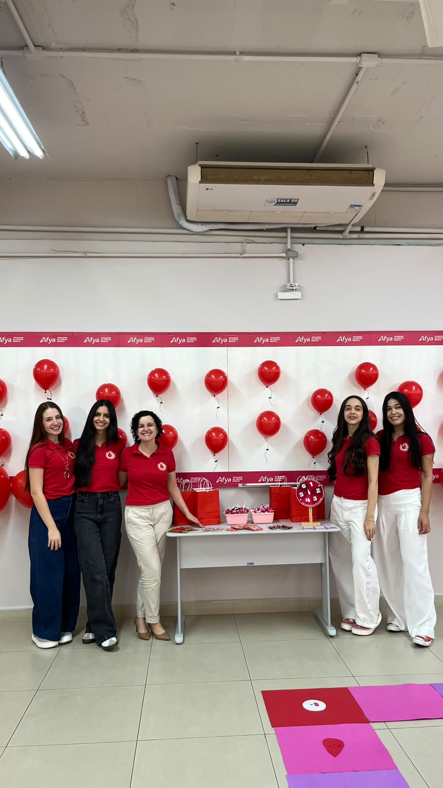
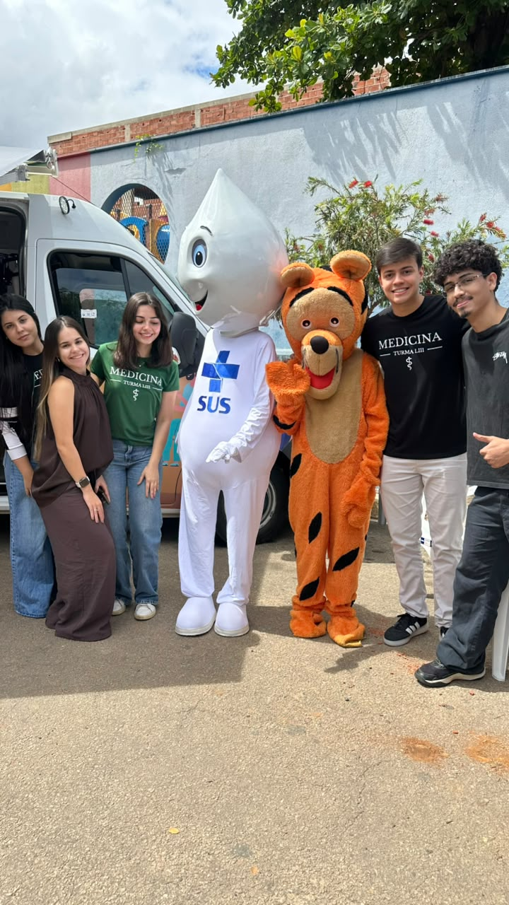
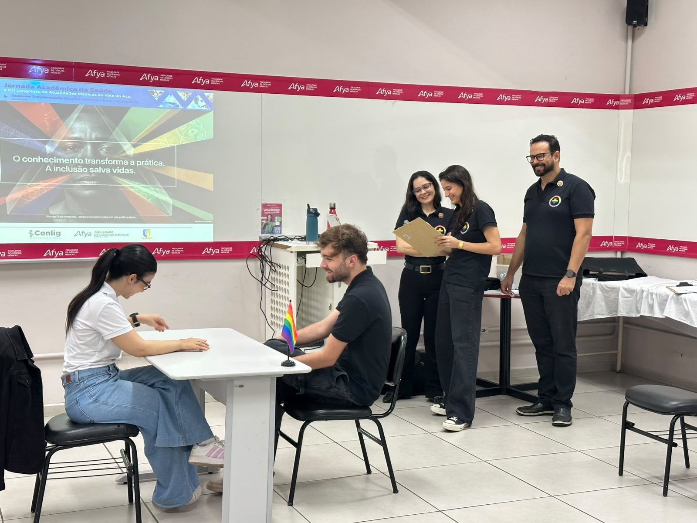
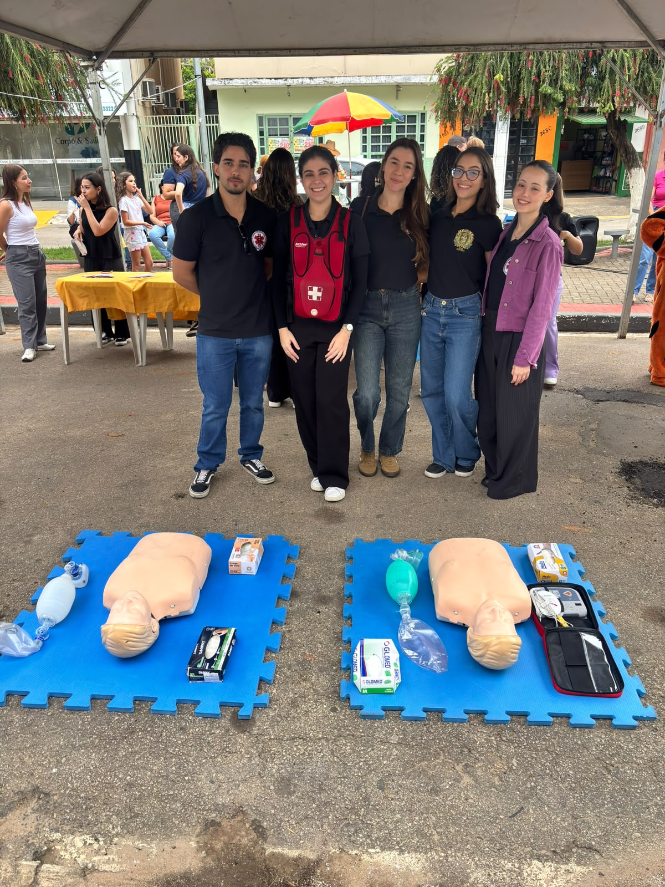
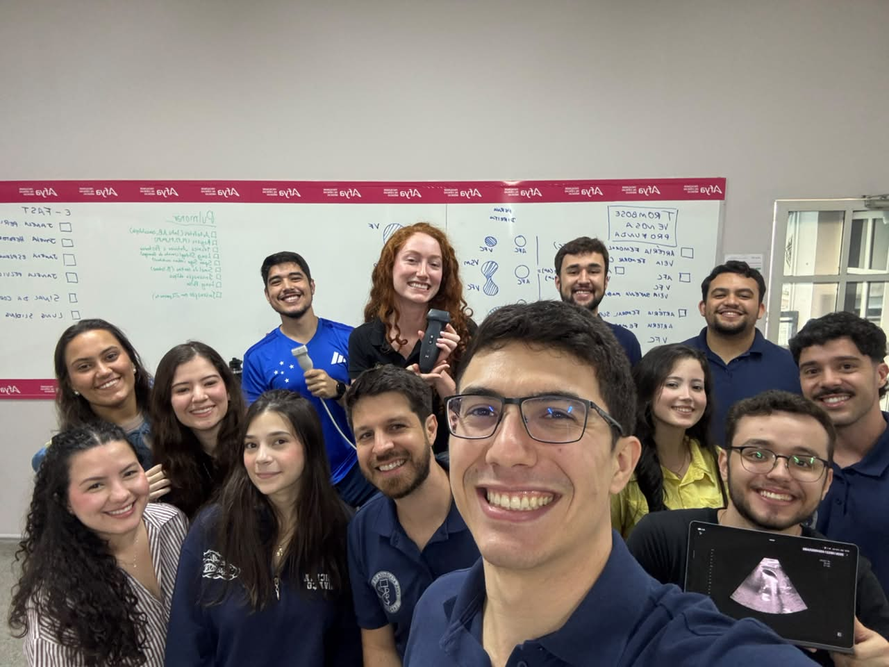

Ensino · extensão · protagonismo estudantil

As **Ligas Acadêmicas da Afya Ipatinga** são espaços de aprofundamento científico, integração entre ensino, pesquisa e extensão e fortalecimento da formação médica. Selecione uma liga para acessar sua página, seus textos institucionais e suas evidências.

  <a class="league-index-card" href="ligas/hematologia.html">Marita de Novais Costa Salles de Almeida<h2>Hematologia</h2><b>Ver publicações →</b></a>
  <a class="league-index-card" href="ligas/psiquiatria.html">Thiago Xavier Corrêa<h2>Psiquiatria</h2><b>Ver publicações →</b></a>
  <a class="league-index-card" href="ligas/neurologia.html">Melissa Araújo Ulhôa Quintão<h2>Neurologia</h2><b>Ver publicações →</b></a>
  <a class="league-index-card" href="ligas/saude-diversidade.html">Rone Cesario da Silva<h2>Saúde e Diversidade</h2><b>Ver publicações →</b></a>
  <a class="league-index-card" href="ligas/pediatria.html">Catarina Amorim Baccarini Pires<h2>Pediatria</h2><b>Ver publicações →</b></a>
  <a class="league-index-card" href="ligas/cirurgia-trauma.html">Felippe Hauck Mansur<h2>Cirurgia e Trauma</h2><b>Ver publicações →</b></a>
  <a class="league-index-card" href="ligas/pocus.html">Fábio Araujo Gomes de Castro<h2>POCUS</h2><b>Ver publicações →</b></a>
  <a class="league-index-card league-index-card--empty" href="ligas/alergologia.html">
LA
Aiala Xavier Felipe<h2>Alergologia</h2><b>Abrir página →</b></a>
  <a class="league-index-card league-index-card--empty" href="ligas/reanimacao-neonatal.html">
LA
Fabiola Andrade Maia Guimaraes<h2>Reanimação Neonatal</h2><b>Abrir página →</b></a>
  <a class="league-index-card league-index-card--empty" href="ligas/geriatria.html">
LA
Sávio Francisco Ulhoa<h2>Geriatria</h2><b>Abrir página →</b></a>
  <a class="league-index-card league-index-card--empty" href="ligas/dermatologia.html">
LA
Ismael Alves Rodrigues Junior<h2>Dermatologia</h2><b>Abrir página →</b></a>
  <a class="league-index-card league-index-card--empty" href="ligas/nutrologia.html">
LA
Thaygra Thays Assuncao De Melo<h2>Nutrologia</h2><b>Abrir página →</b></a>
  <a class="league-index-card league-index-card--empty" href="ligas/ortopedia.html">
LA
Rodrigo Rocha Ribeiro Vitor<h2>Ortopedia</h2><b>Abrir página →</b></a>
  <a class="league-index-card league-index-card--empty" href="ligas/ginecologia.html">
LA
Thais Abreu Santos Reggiani<h2>Ginecologia</h2><b>Abrir página →</b></a>

