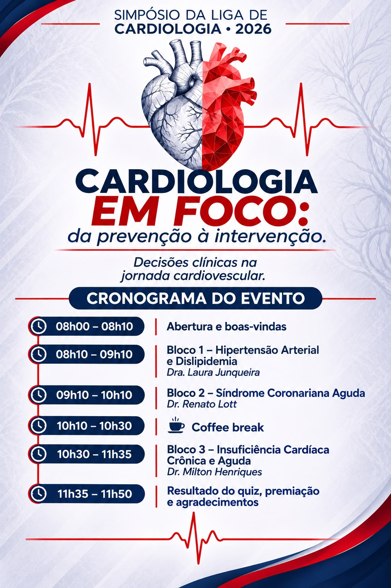
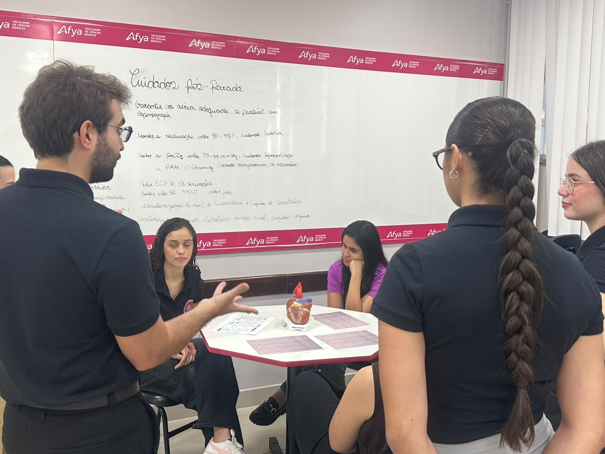
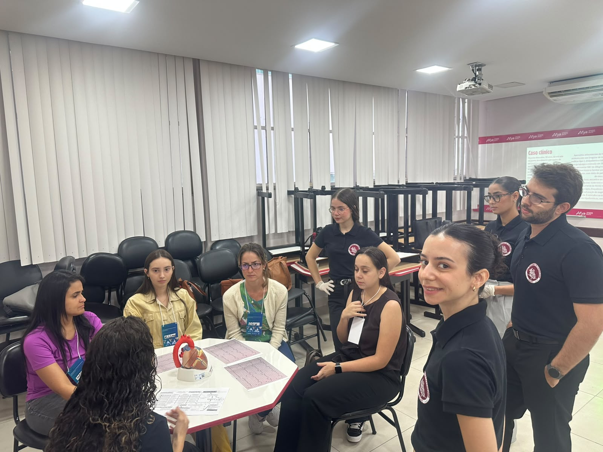
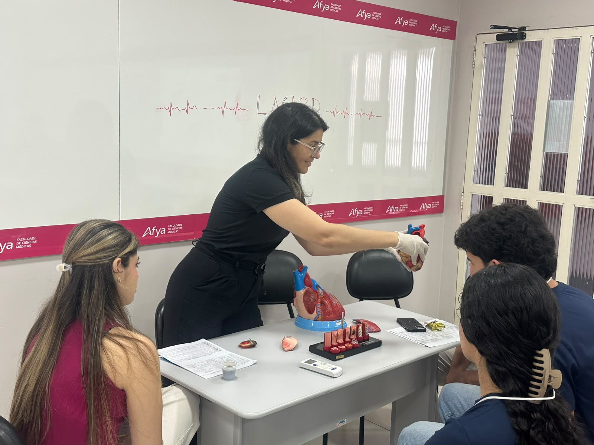
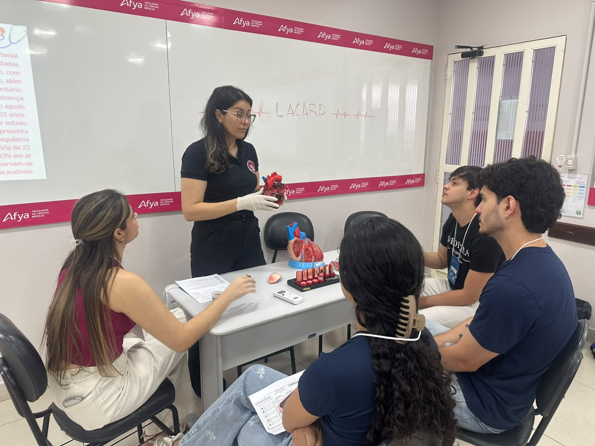

::: {.league-page}
[← Voltar para Ligas Acadêmicas](../ligas-academicas.qmd){.league-back}

## Simpósio da Liga de Cardiologia 2026

A Liga Acadêmica de Cardiologia realizará o simpósio **“Cardiologia em Foco: da prevenção à intervenção”**, dedicado à atualização científica e à discussão de decisões clínicas ao longo da jornada cardiovascular.

O encontro acontecerá no dia **28 de novembro de 2026**, às **8h**, no **Auditório da Faculdade Afya Ipatinga**. A programação abordará hipertensão arterial e dislipidemia com a **Dra. Laura Junqueira**, síndrome coronariana aguda com o **Dr. Renato Lott** e insuficiência cardíaca crônica e aguda com o **Dr. Milton Henriques**, além de quiz interativo e premiação.

[Inscreva-se no simpósio](https://forms.gle/CqPderDH41ipxmwn7){.btn .btn-primary}

{fig-alt="Card do Simpósio da Liga de Cardiologia 2026 com o tema Cardiologia em Foco e cronograma das atividades"}

## Integração entre anatomia, ECG e casos clínicos

A Liga Acadêmica de Cardiologia participou de uma atividade prática voltada à integração entre conhecimentos anatômicos e raciocínio clínico. Os estudantes utilizaram modelos cardiovasculares, traçados de eletrocardiograma e materiais de apoio para analisar casos e discutir condutas.

Os registros mostram momentos de orientação em pequenos grupos, revisão das estruturas cardíacas e discussão sobre cuidados pós-parada. A dinâmica favoreceu a participação ativa dos acadêmicos e a aplicação dos conteúdos em situações contextualizadas.

  
  
  
  

:::
