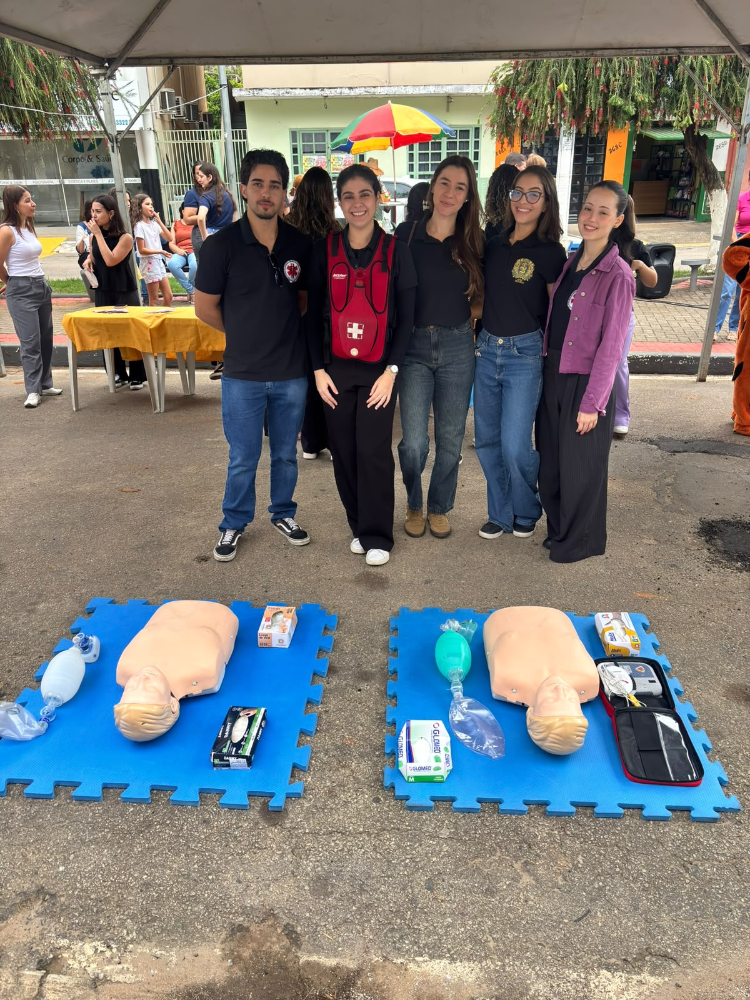
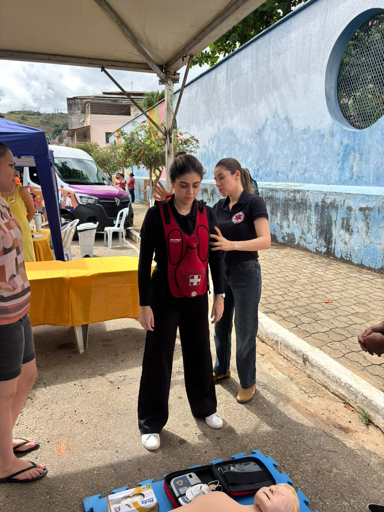
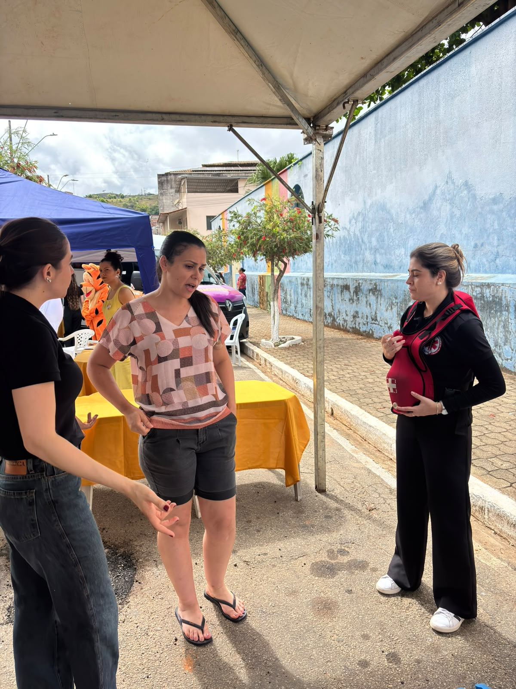
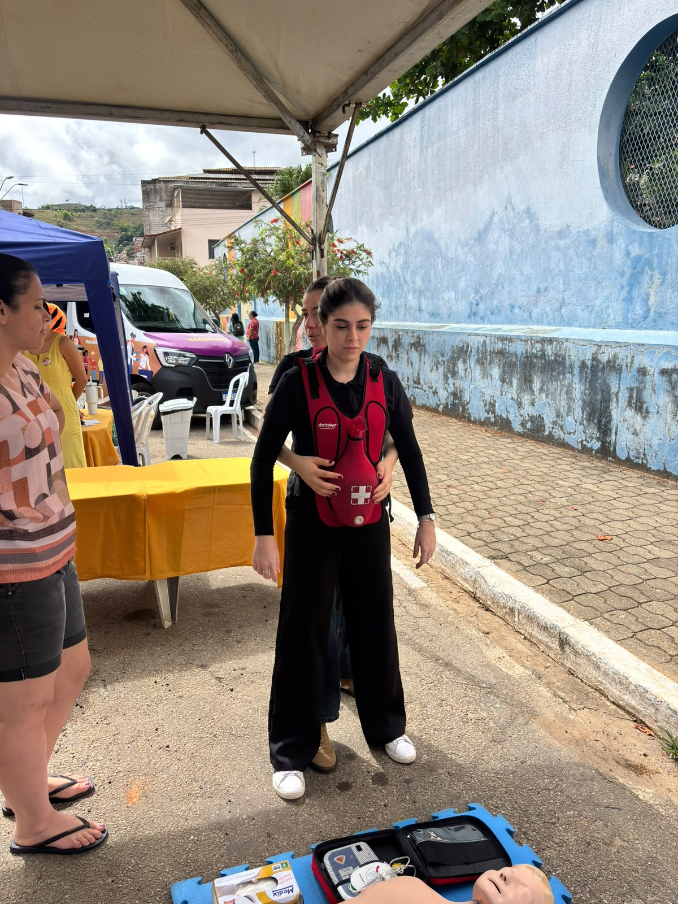
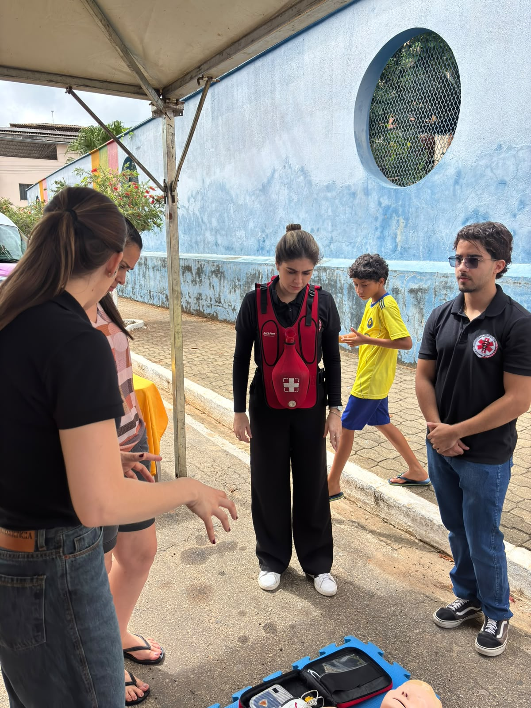
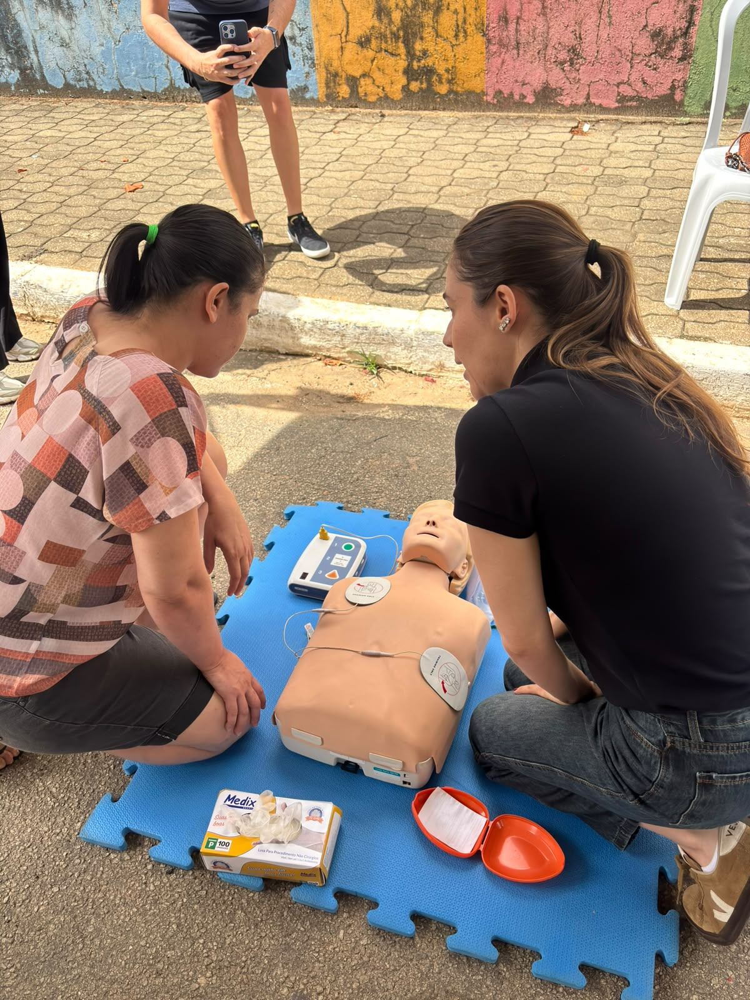
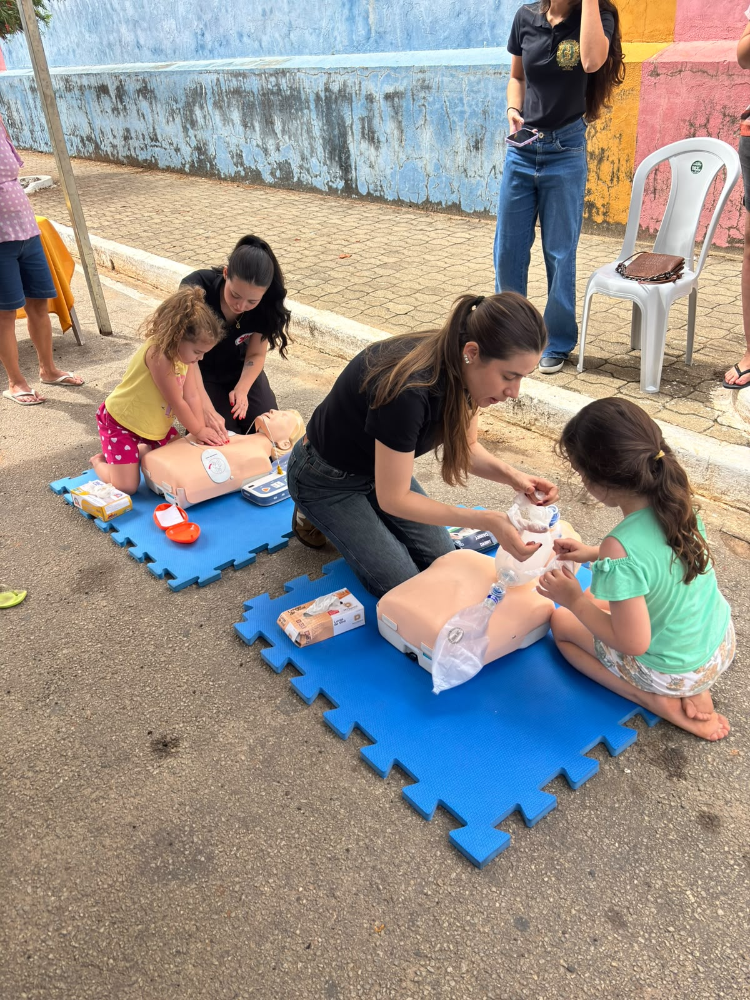
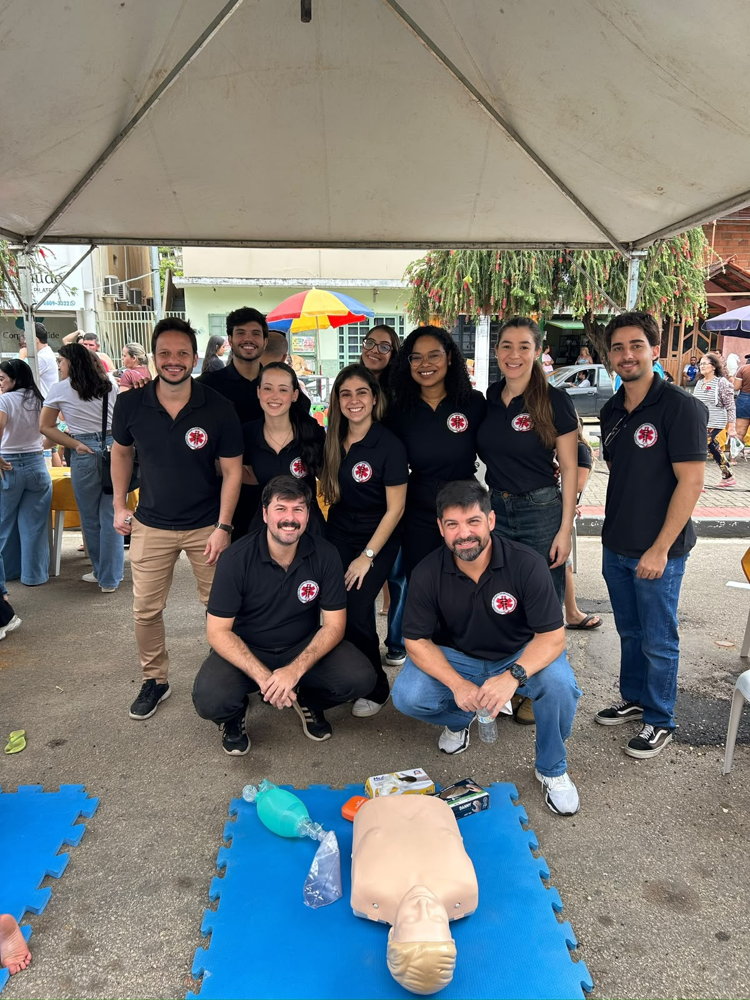

::: {.league-page}
[← Voltar para Ligas Acadêmicas](../ligas-academicas.qmd){.league-back}

<strong>Docente responsável:</strong> Prof. Felippe Hauck Mansur

## Conhecimento que prepara para salvar vidas

Sob orientação do professor **Felippe Hauck Mansur**, a Liga Acadêmica de Cirurgia e Trauma participou de uma ação comunitária de educação em saúde, aproximando os conhecimentos da formação médica das necessidades da população.

A iniciativa contou com demonstrações práticas de primeiros socorros e suporte básico de vida, utilizando manequins de simulação, desfibrilador externo automático e equipamentos de ventilação. Os registros evidenciam a interação dos acadêmicos com participantes da comunidade, incluindo crianças e adultos.

  
  
  
  
  
  
  
  

:::
