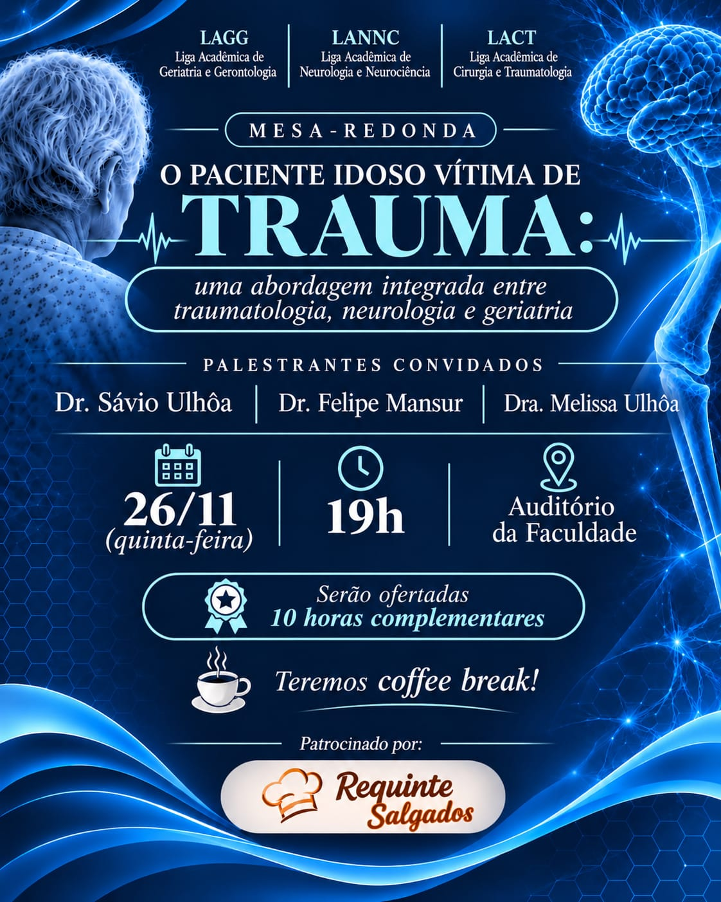

::: {.league-page}
[← Voltar para Ligas Acadêmicas](../ligas-academicas.qmd){.league-back}

<strong>Docente responsável:</strong> Prof. Sávio Francisco Ulhoa

## Mesa-redonda sobre o paciente idoso vítima de trauma {#mesa-redonda-trauma-paciente-idoso}

A mesa-redonda reúne perspectivas da traumatologia, da neurologia e da geriatria para discutir como as particularidades do envelhecimento influenciam a avaliação, as condutas e a recuperação do paciente idoso vítima de trauma.

O encontro será realizado na **quinta-feira, 26 de novembro de 2026, às 19h**, no **Auditório da Faculdade Afya Ipatinga**. Os palestrantes convidados são **Dr. Sávio Ulhôa**, **Dr. Felipe Mansur** e **Dra. Melissa Ulhôa**.

A realização é conjunta entre a **Liga Acadêmica de Geriatria e Gerontologia**, a **Liga Acadêmica de Neurologia e Neurociência** e a **Liga Acadêmica de Cirurgia e Traumatologia**.

Os participantes terão direito a certificado de **10 horas complementares**, disponibilizado pela Even3 em até sete dias após o evento. Haverá coffee break patrocinado pela Requinte Salgados.

[Inscreva-se pela Even3](https://www.even3.com.br/mesa-redonda-o-paciente-idoso-vitima-de-trauma-uma-abordagem-integrada-entre-traumatologia-neurologia-e-geriatria-812139){.btn .btn-primary}

{fig-alt="Cartaz azul da mesa-redonda sobre trauma na pessoa idosa, marcada para 26 de novembro de 2026, às 19h, no Auditório da Faculdade."}
:::
