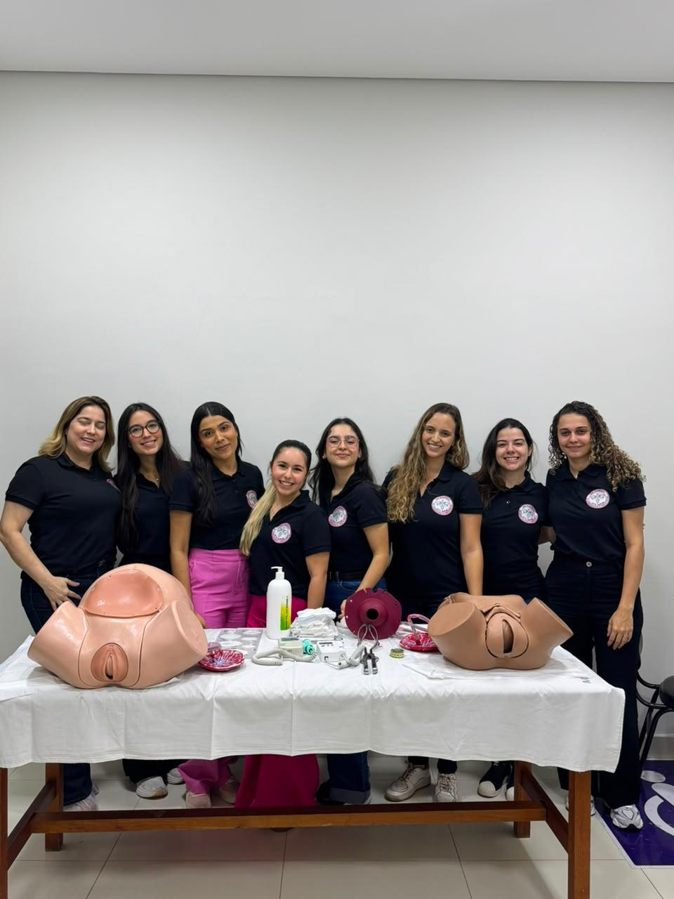
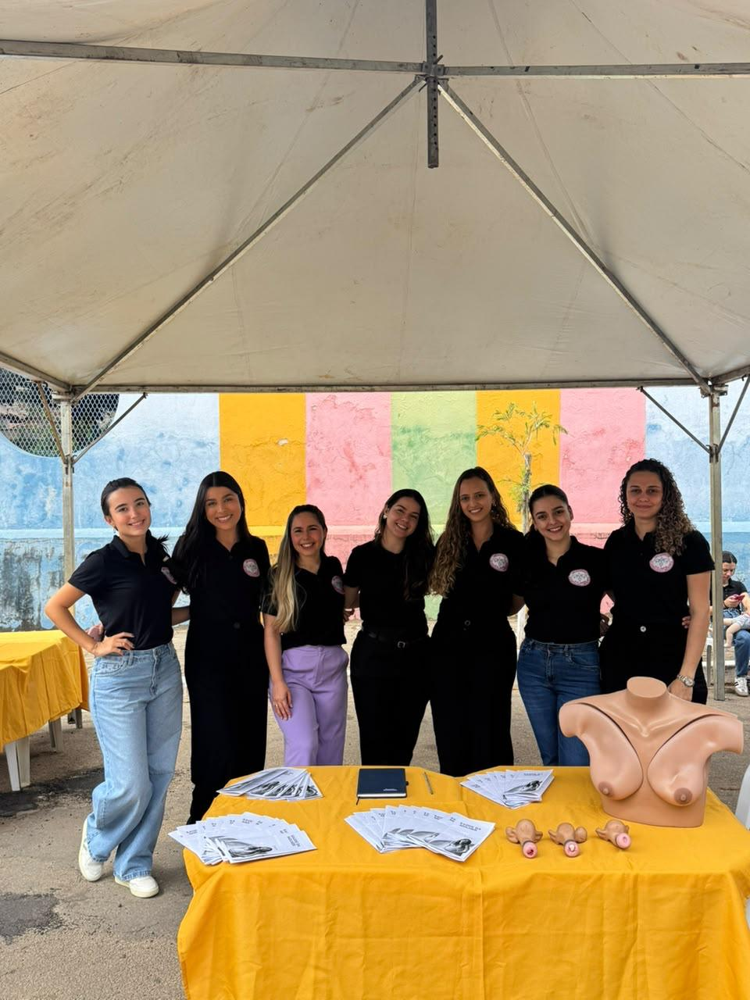
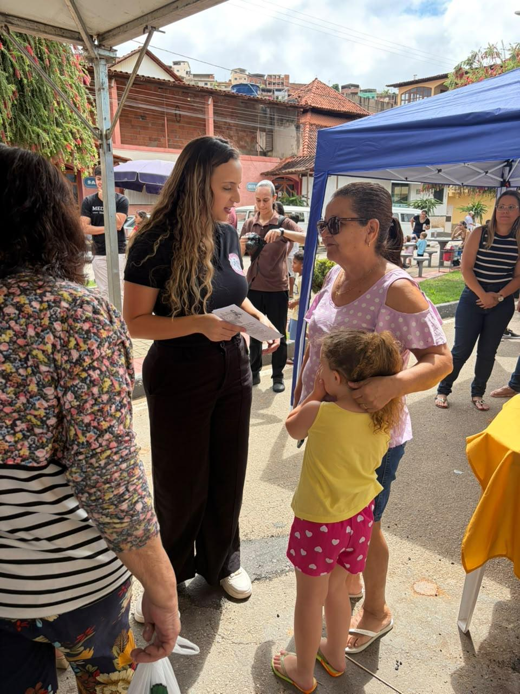

::: {.league-page}
[← Voltar para Ligas Acadêmicas](../ligas-academicas.qmd){.league-back}

<strong>Docente responsável:</strong> Prof.ª Thais Abreu Santos Reggiani

## Educação em saúde da mulher e atuação comunitária

A Liga Acadêmica de Ginecologia desenvolveu atividades educativas com o uso de modelos didáticos e materiais de orientação em saúde. Os registros apresentam a equipe reunida para a preparação das ações e a organização de recursos voltados à abordagem de temas relacionados à saúde da mulher.

Em atividade junto à comunidade, as integrantes da liga utilizaram modelos anatômicos e materiais impressos para orientar o público, dialogar com as participantes e ampliar o acesso a informações de cuidado e prevenção. A ação articula formação acadêmica, comunicação em saúde e compromisso social.

  
  
  
  

:::
