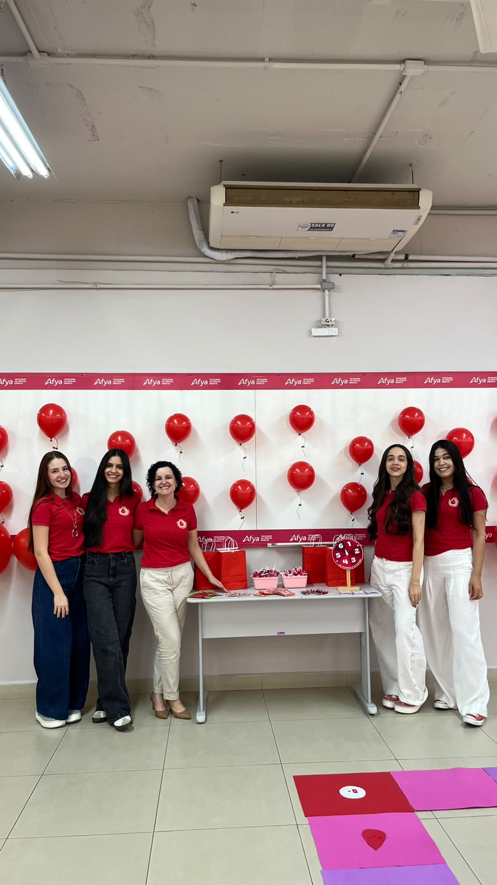
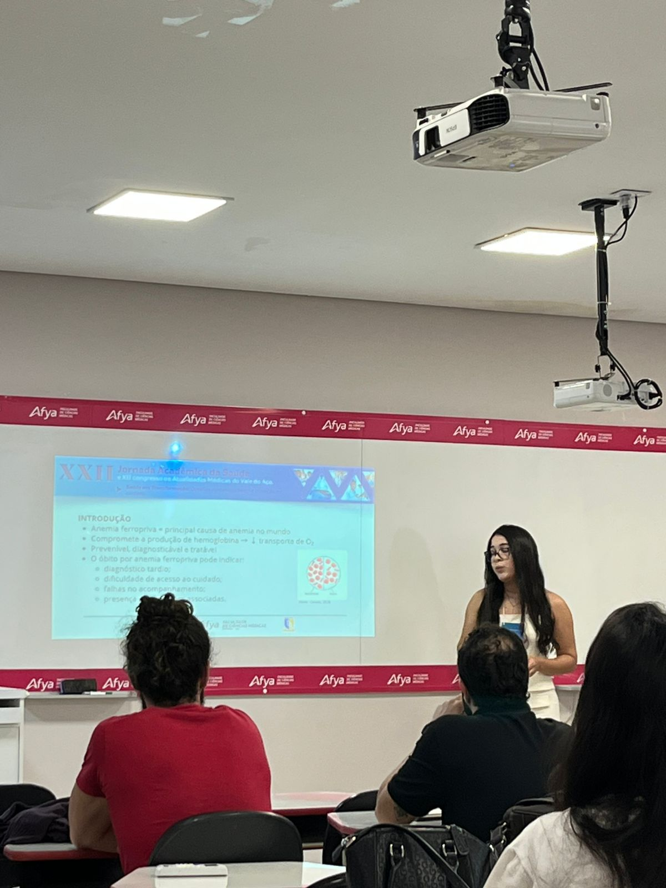
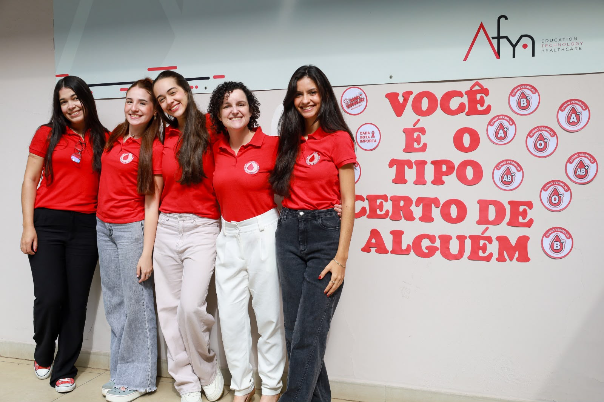
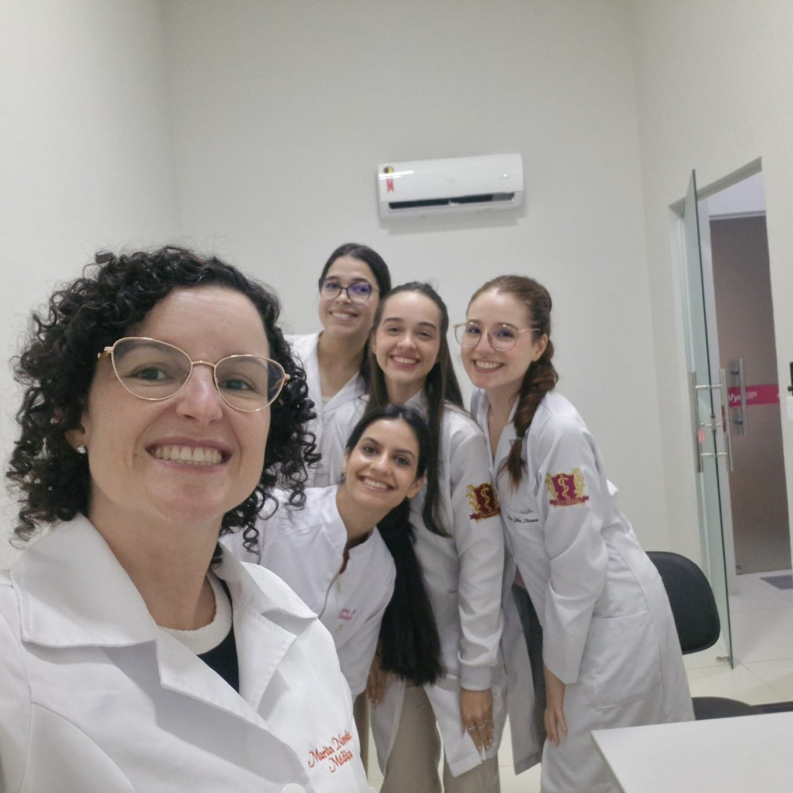

::: {.league-page}
[← Voltar para Ligas Acadêmicas](../ligas-academicas.qmd){.league-back}

<strong>Docente responsável:</strong> Prof.ª Marita de Novais Costa Salles de Almeida

## Ação acadêmica e educativa

A Liga Acadêmica de Hematologia desenvolve ações que contribuem para o aprofundamento do conhecimento científico, a formação prática dos estudantes e a promoção da educação em saúde. Nesta atividade, as ligantes participaram de momentos de organização, apresentação e sensibilização acadêmica, abordando temas de relevância para a área hematológica e para a formação médica.

As imagens evidenciam a participação ativa das estudantes em momentos de organização, acolhimento e orientação, além de uma atividade expositiva com conteúdo científico e abordagem educativa. A ação demonstra o compromisso da liga com a integração entre ensino e extensão, fortalecendo o protagonismo estudantil e a atuação orientada por docentes na construção de experiências acadêmicas significativas.

  
  
  
  

:::
