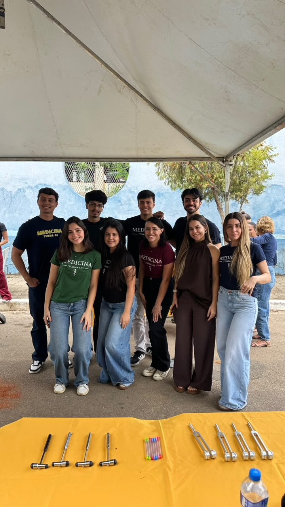
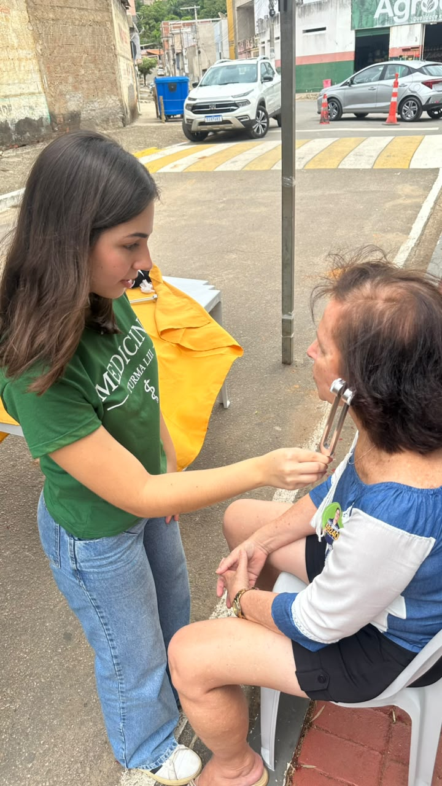
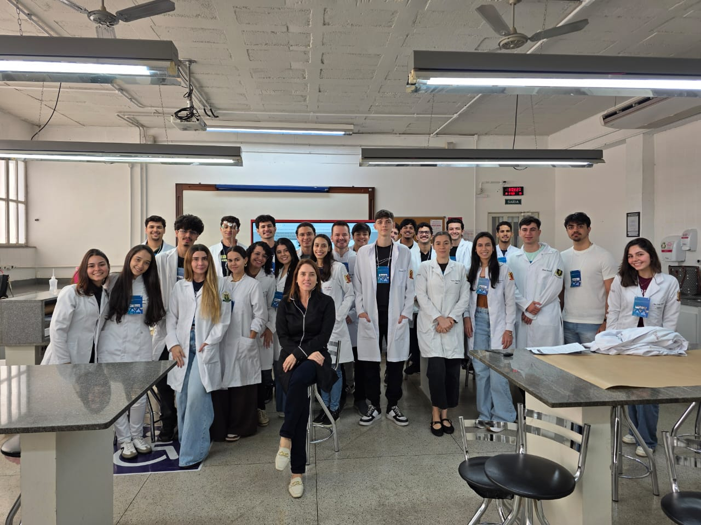

::: {.league-page}
[← Voltar para Ligas Acadêmicas](../ligas-academicas.qmd){.league-back}

<strong>Docente responsável:</strong> Prof.ª Melissa Araújo Ulhôa Quintão

## Conhecimento científico e cuidado com a comunidade

Sob orientação da professora **Melissa Araújo Ulhôa Quintão**, a Liga Acadêmica de Neurologia desenvolve experiências que aproximam os estudantes de Medicina da prática profissional e das necessidades da comunidade.

Os registros evidenciam uma ação externa de educação em saúde, com acolhimento, interação com o público e demonstrações relacionadas à avaliação neurológica. Também apresentam um encontro acadêmico em laboratório. Esses registros não são apresentados como partes de um mesmo evento.

  
  
  
  
  

:::
