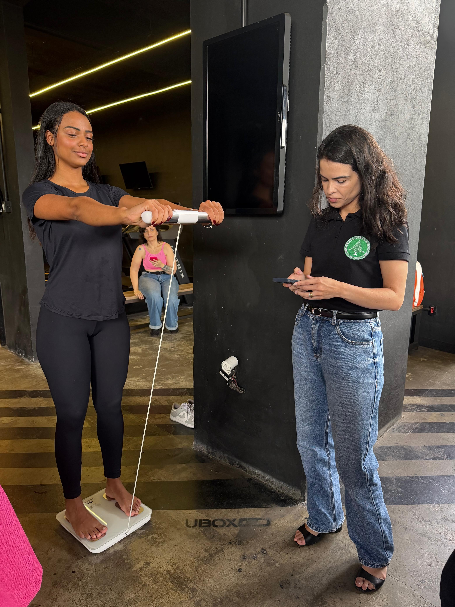
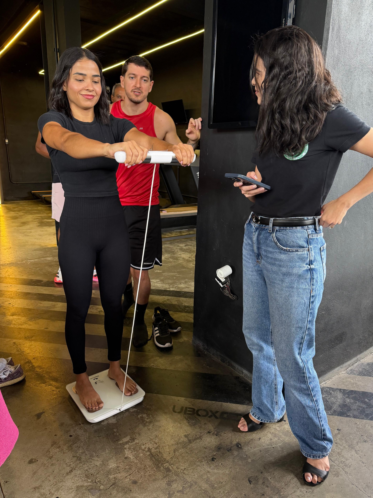
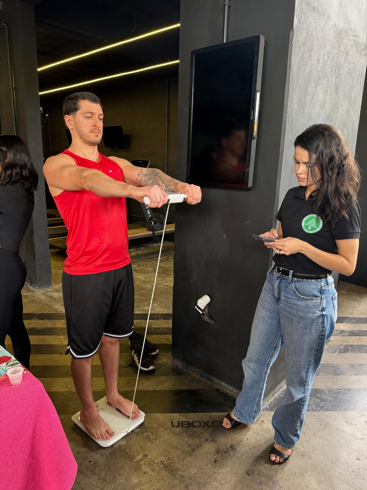
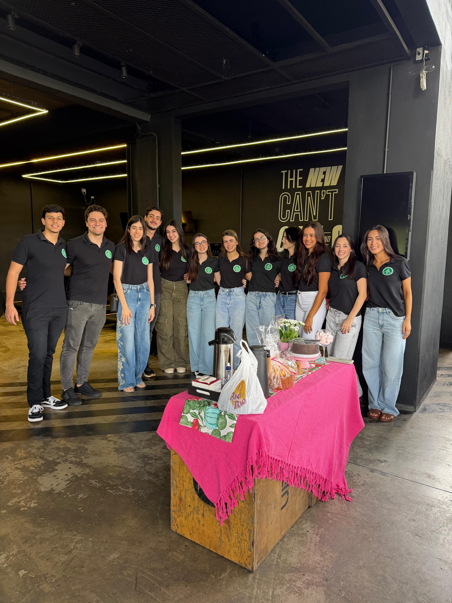

::: {.league-page}
[← Voltar para Ligas Acadêmicas](../ligas-academicas.qmd){.league-back}

<strong>Docente responsável:</strong> Prof.ª Thaygra Thays Assuncao De Melo

## Avaliação da composição corporal em atividade prática

A Liga Acadêmica de Nutrologia participou de uma atividade prática de avaliação corporal com o uso de equipamento de bioimpedância. Os registros mostram a organização das medições, o acompanhamento dos participantes e a atuação dos ligantes durante o procedimento.

A experiência aproximou os estudantes de uma ferramenta utilizada na avaliação da composição corporal e favoreceu a aprendizagem prática sobre preparação, posicionamento e registro das medidas. As imagens documentam o desenvolvimento da atividade sem expor resultados individuais.

::: {.league-gallery}
{fig-alt="Participante sobre a plataforma do equipamento de bioimpedância, segurando os sensores manuais, acompanhada por integrante da Liga de Nutrologia"}

{fig-alt="Participante utilizando os sensores manuais do equipamento de bioimpedância enquanto integrantes da liga acompanham o procedimento"}

{fig-alt="Participante em pé sobre a plataforma e segurando os sensores do equipamento durante atividade prática de Nutrologia"}

{fig-alt="Grupo de integrantes da Liga Acadêmica de Nutrologia reunido ao final da atividade de avaliação corporal"}
:::
:::
