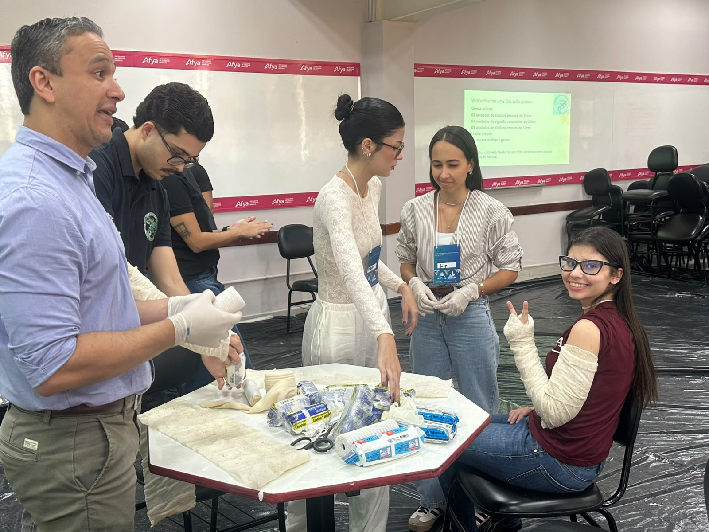
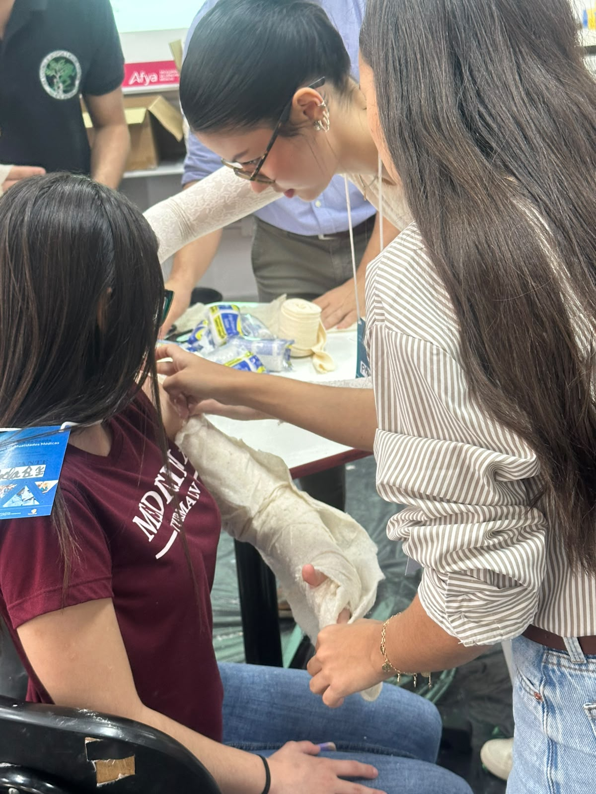
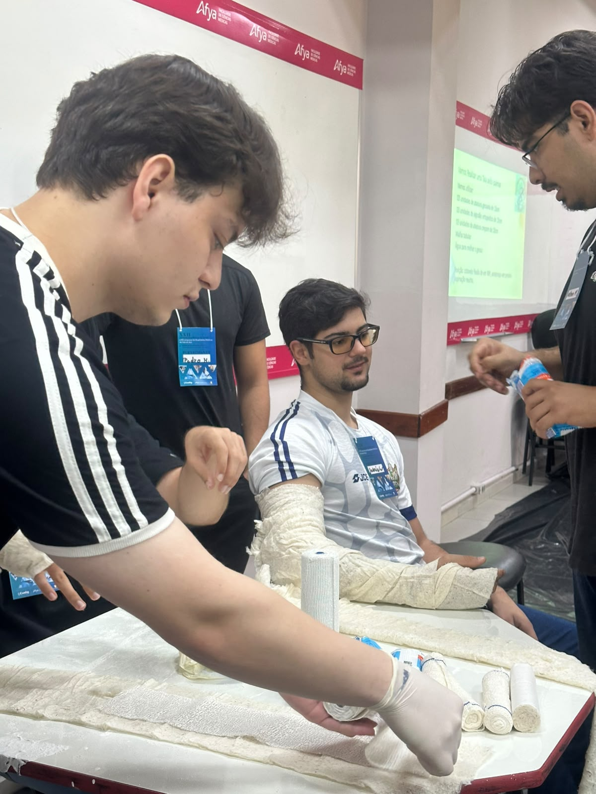
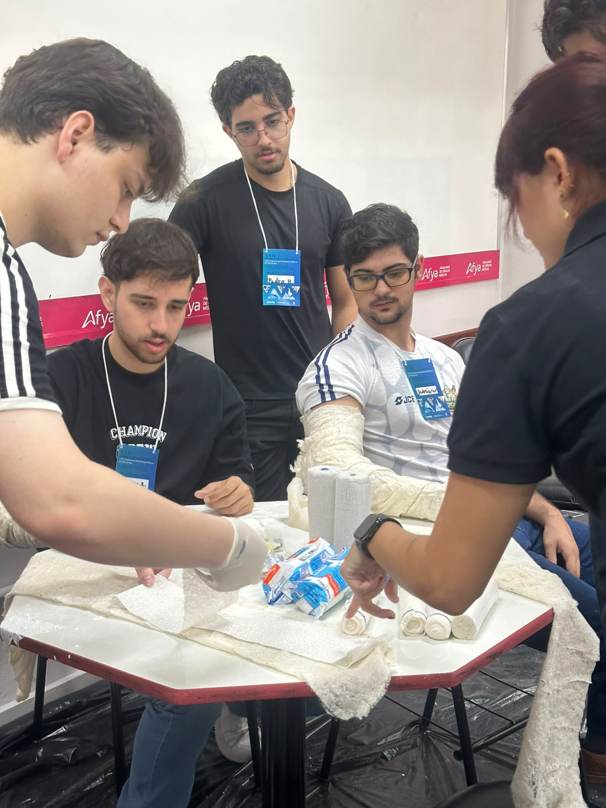

::: {.league-page}
[← Voltar para Ligas Acadêmicas](../ligas-academicas.qmd){.league-back}

<strong>Docente responsável:</strong> Prof. Rodrigo Rocha Ribeiro Vitor

## Aprendizagem prática em imobilizações ortopédicas

Sob orientação do professor **Rodrigo Rocha Ribeiro Vitor**, a Liga Acadêmica de Ortopedia desenvolveu uma atividade prática voltada à aplicação de técnicas de imobilização. Os estudantes participaram da preparação dos materiais e da confecção de imobilizações em membros superiores, utilizando ataduras e outros recursos próprios do treinamento.

Os registros evidenciam uma dinâmica colaborativa, com acompanhamento docente, participação ativa dos acadêmicos e execução das técnicas entre os próprios estudantes. A experiência contribui para aproximar os conhecimentos teóricos da prática e fortalecer habilidades importantes para o atendimento inicial de situações ortopédicas.

Não foram atribuídos data ou nome específico ao encontro, pois essas informações não foram confirmadas.

  
  
  
  

:::
