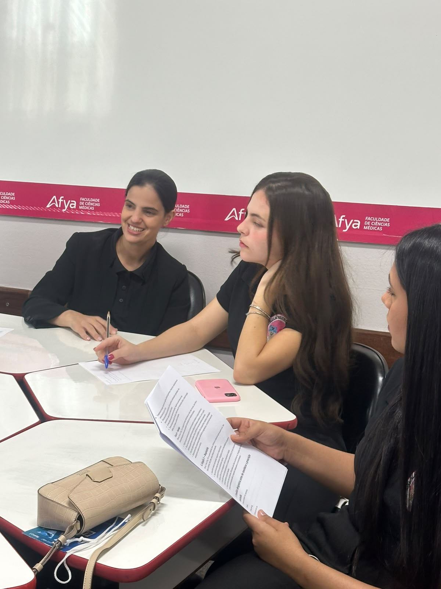
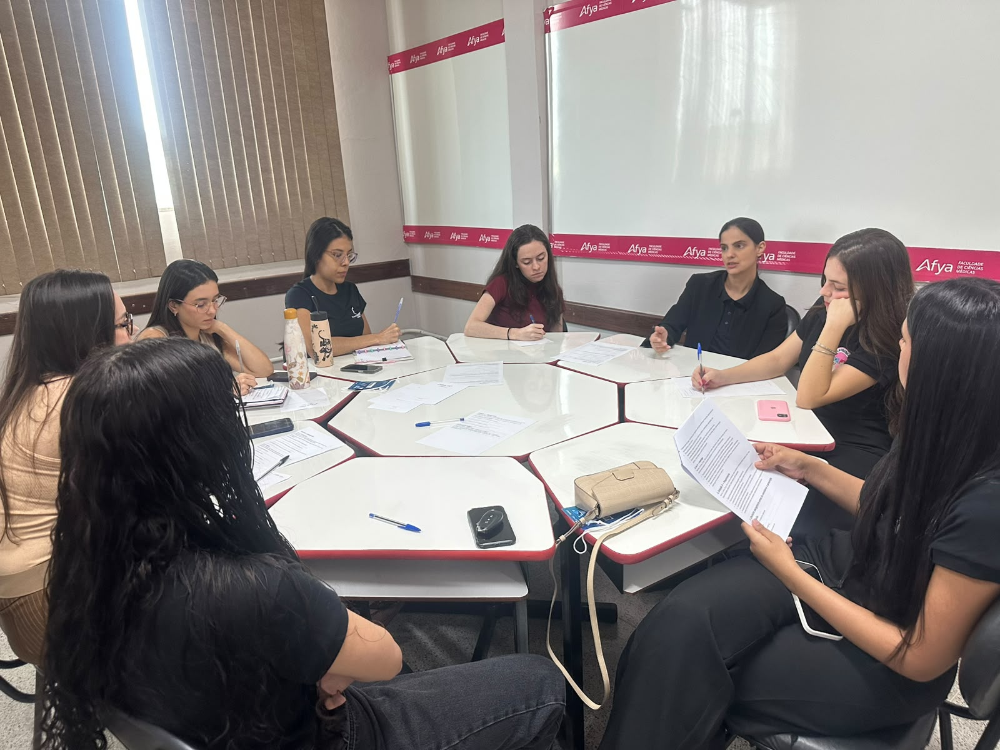
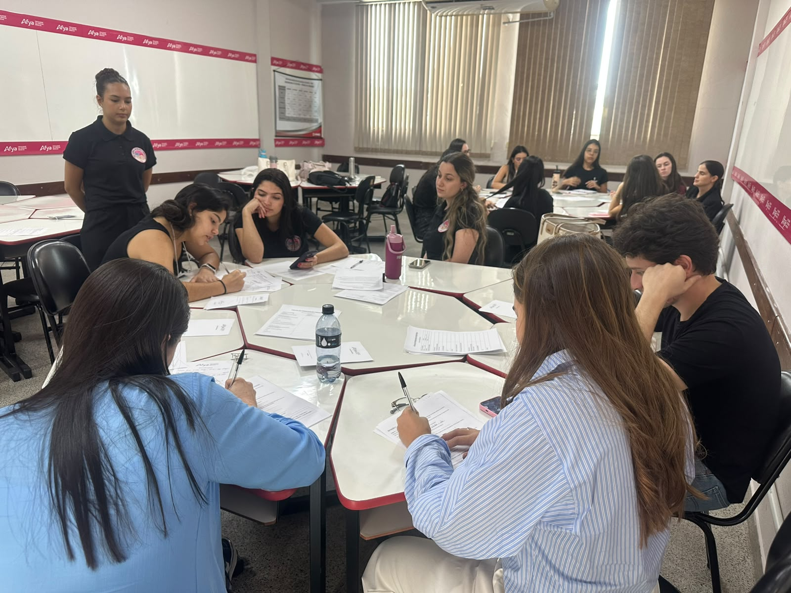
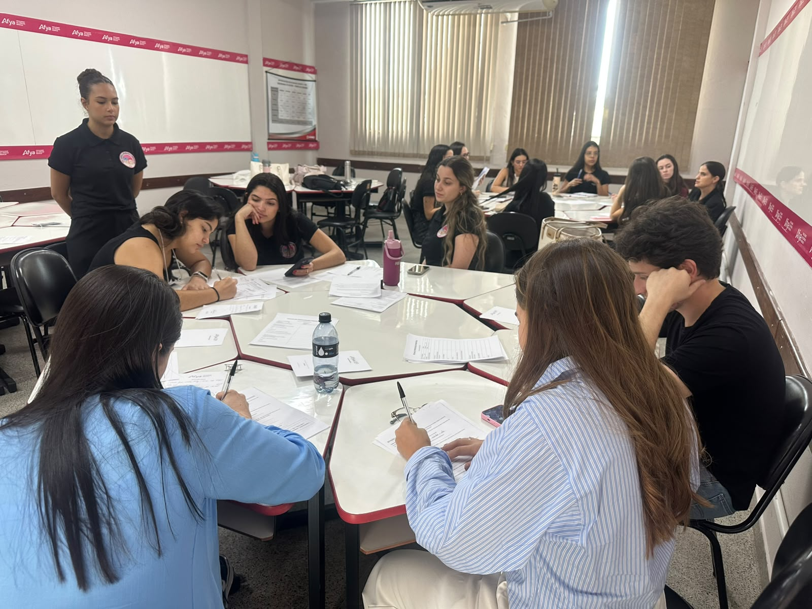

::: {.league-page}
[← Voltar para Ligas Acadêmicas](../ligas-academicas.qmd){.league-back}

<strong>Docente responsável:</strong> Prof.ª Catarina Amorim Baccarini Pires

## Aprendizagem colaborativa e protagonismo estudantil

Sob orientação da professora **Catarina Amorim Baccarini Pires**, a Liga Acadêmica de Pediatria promove atividades que ampliam as oportunidades de aprendizagem e aprofundamento científico dos estudantes de Medicina.

Os registros apresentam uma atividade organizada em pequenos grupos, na qual os participantes trabalham com materiais impressos, realizam anotações e compartilham conhecimentos por meio de discussões orientadas. O conteúdo específico discutido não foi atribuído, pois não pôde ser confirmado pelos registros.

  
  
  
  

:::
