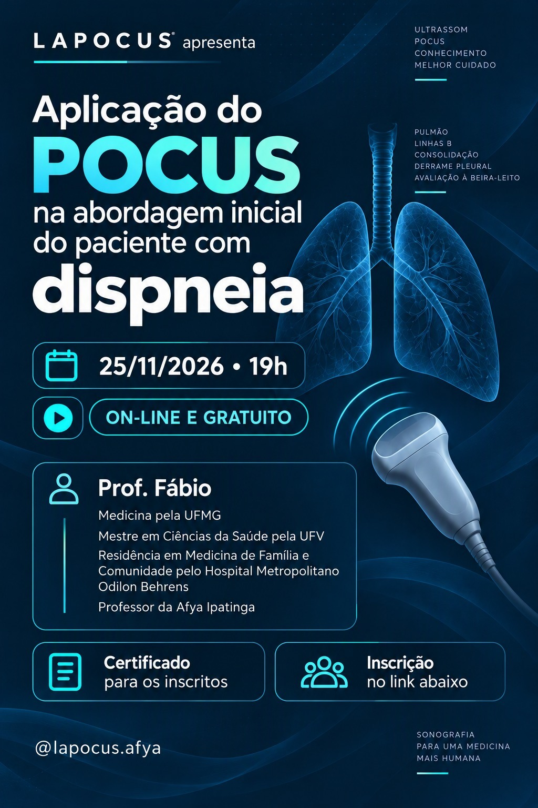
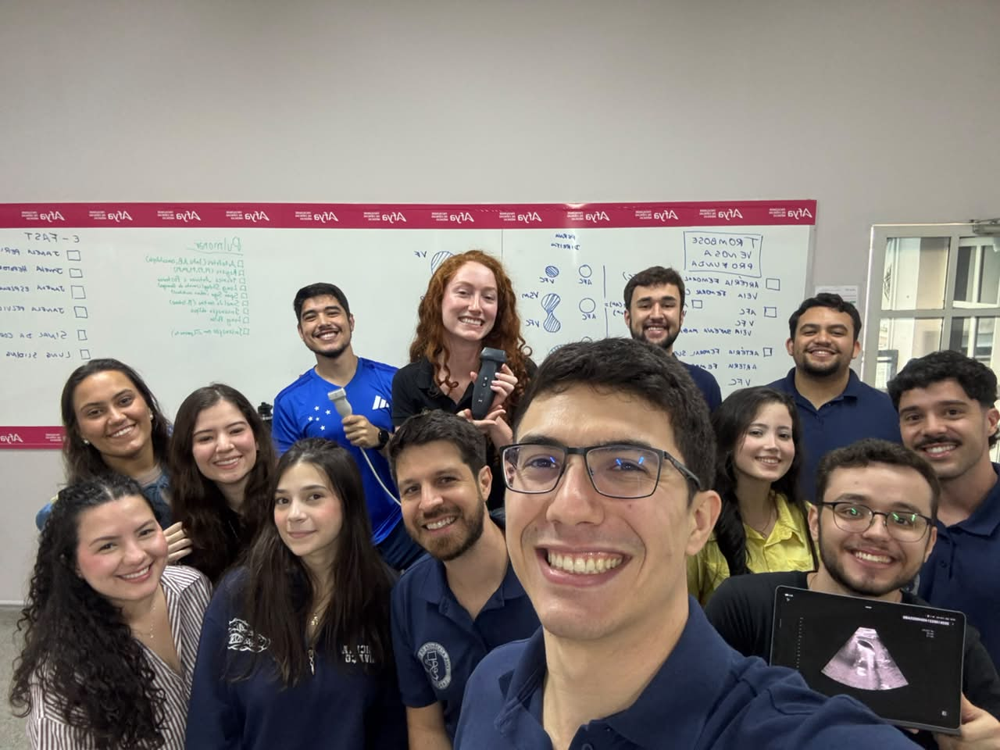
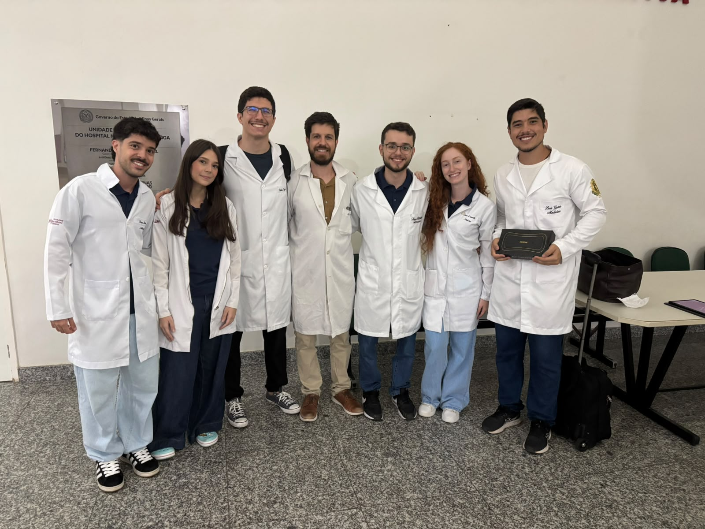
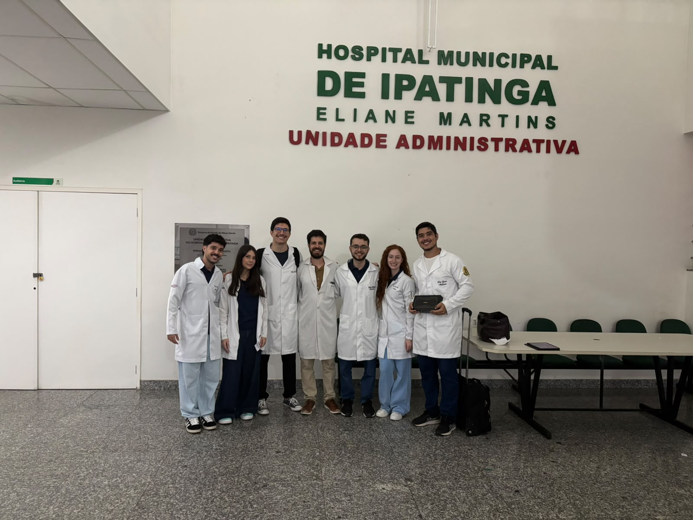
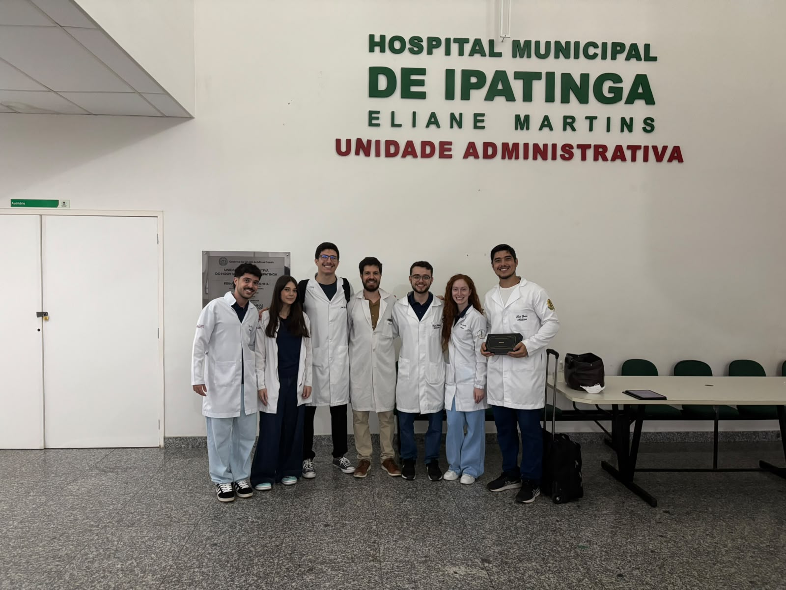

::: {.league-page}
[← Voltar para Ligas Acadêmicas](../ligas-academicas.qmd){.league-back}

<strong>Docente responsável:</strong> Prof. Fábio Araujo Gomes de Castro

## Evento on-line: POCUS na abordagem inicial da dispneia

A LAPOCUS promove o evento **“Aplicação do POCUS na abordagem inicial do paciente com dispneia”**, uma atividade voltada ao uso da ultrassonografia à beira do leito na avaliação inicial de quadros respiratórios.

O encontro será realizado no dia **25 de novembro de 2026**, às **19h**, em formato **on-line e gratuito**, com emissão de certificado para os inscritos. A atividade será conduzida pelo **Prof. Fábio**, médico de Família e Comunidade, mestre em Ciências da Saúde e professor da Afya Ipatinga.

[Inscreva-se no evento](https://forms.gle/phBRwnYQ6jGiCcz78){.btn .btn-primary}
[Acompanhe a LAPOCUS no Instagram](https://www.instagram.com/lapocus.afya/){.btn .btn-outline-primary}

{fig-alt="Card azul da LAPOCUS com ilustração dos pulmões e informações do evento on-line sobre aplicação do POCUS em pacientes com dispneia"}

## Formação prática e integração com os cenários de saúde

Os registros apresentam integrantes da Liga Acadêmica de POCUS em momentos de formação e integração, com utilização de equipamento portátil de ultrassonografia e participação em atividade no Hospital Municipal de Ipatinga.

As evidências documentam a aproximação dos estudantes com o uso do ultrassom à beira do leito e com cenários reais de atenção à saúde.

  
  
  
  

:::
