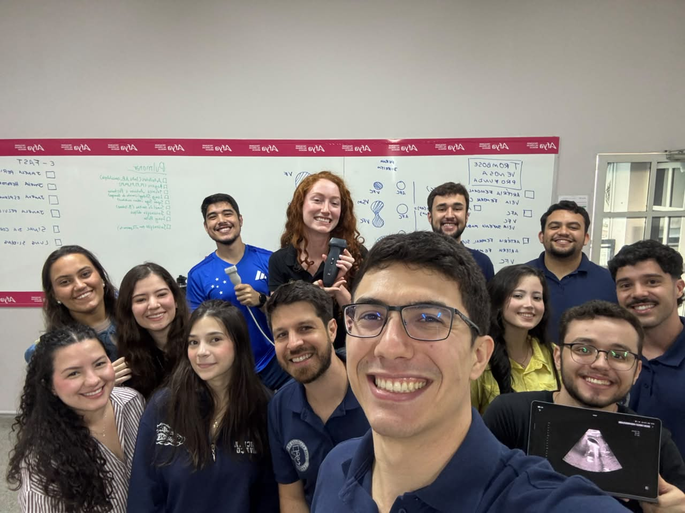
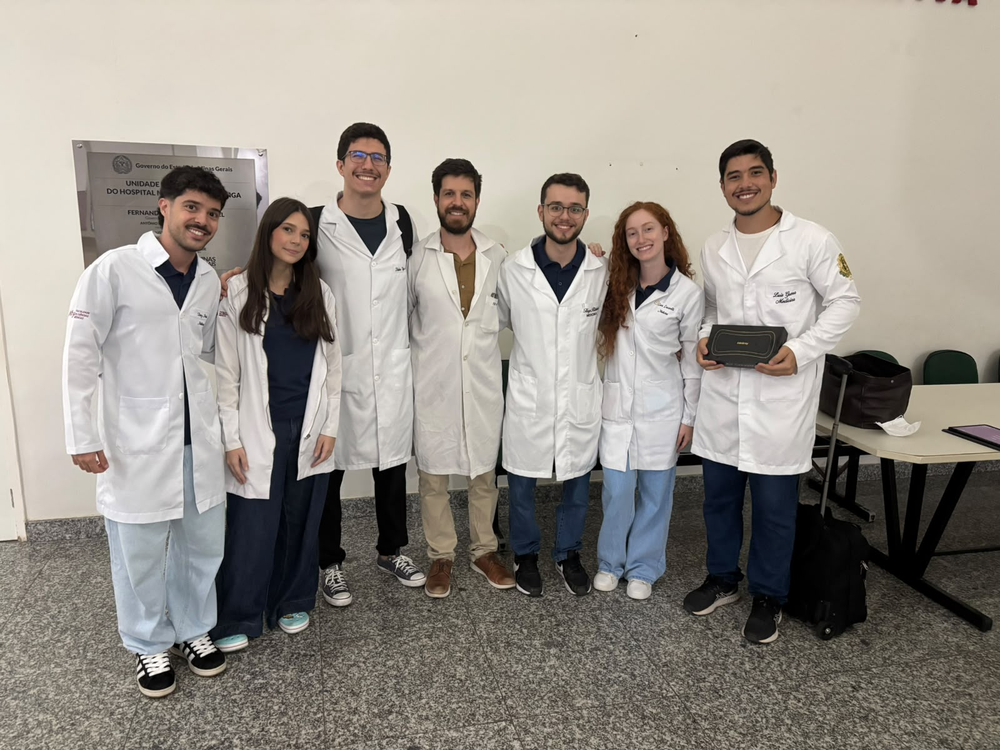
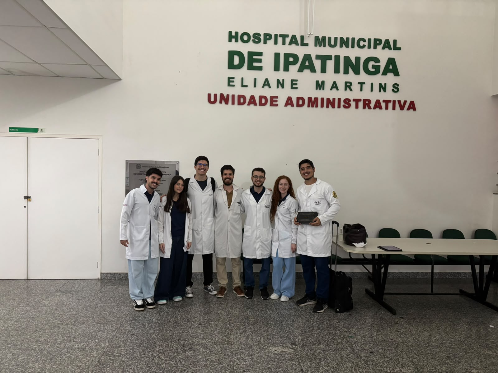
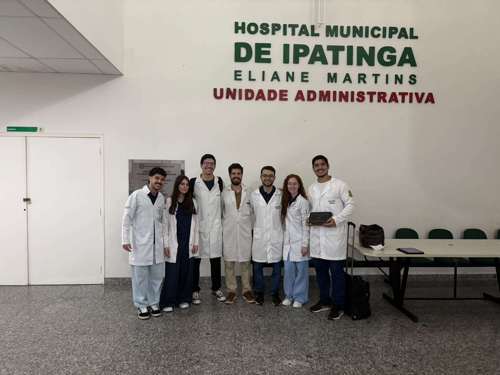

::: {.league-page}
[← Voltar para Ligas Acadêmicas](../ligas-academicas.qmd){.league-back}

<strong>Docente responsável:</strong> Prof. Fábio Araujo Gomes de Castro

## Formação prática e integração com os cenários de saúde

Os registros apresentam integrantes da Liga Acadêmica de POCUS em momentos de formação e integração, com utilização de equipamento portátil de ultrassonografia e participação em atividade no Hospital Municipal de Ipatinga.

As evidências documentam a aproximação dos estudantes com o uso do ultrassom à beira do leito e com cenários reais de atenção à saúde. Não foi atribuída data ou descrição específica da atividade, pois essas informações não foram confirmadas.

  
  
  
  

:::
