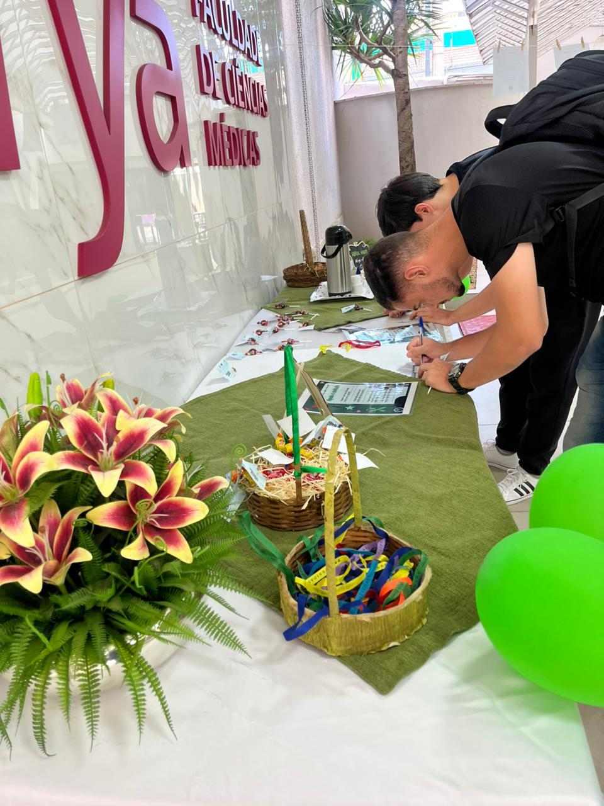
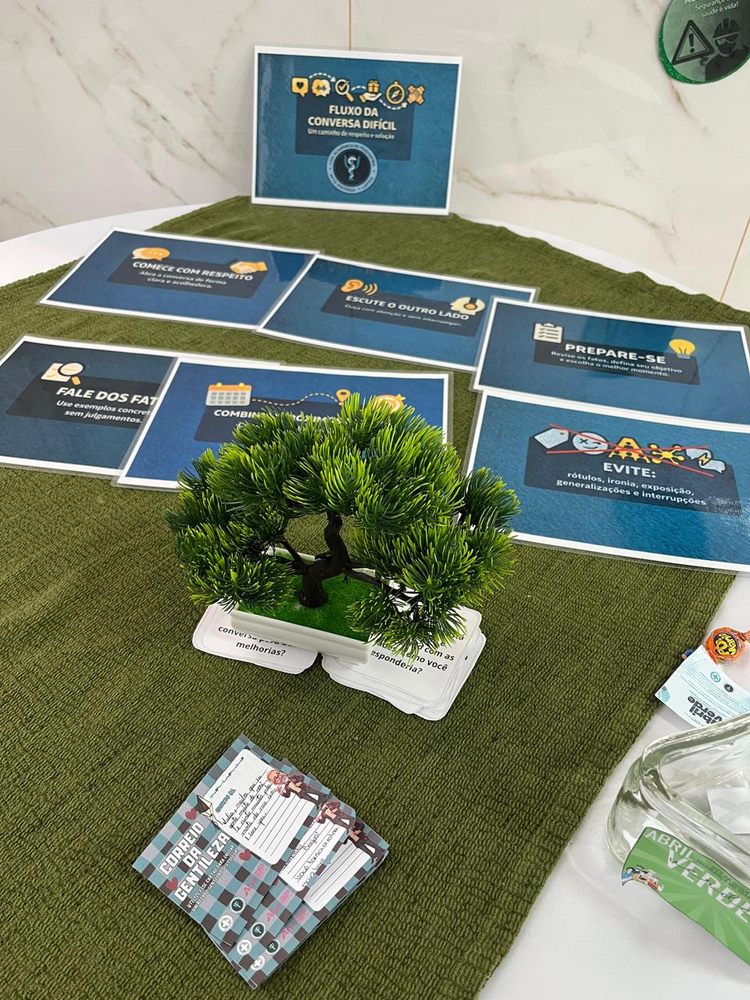
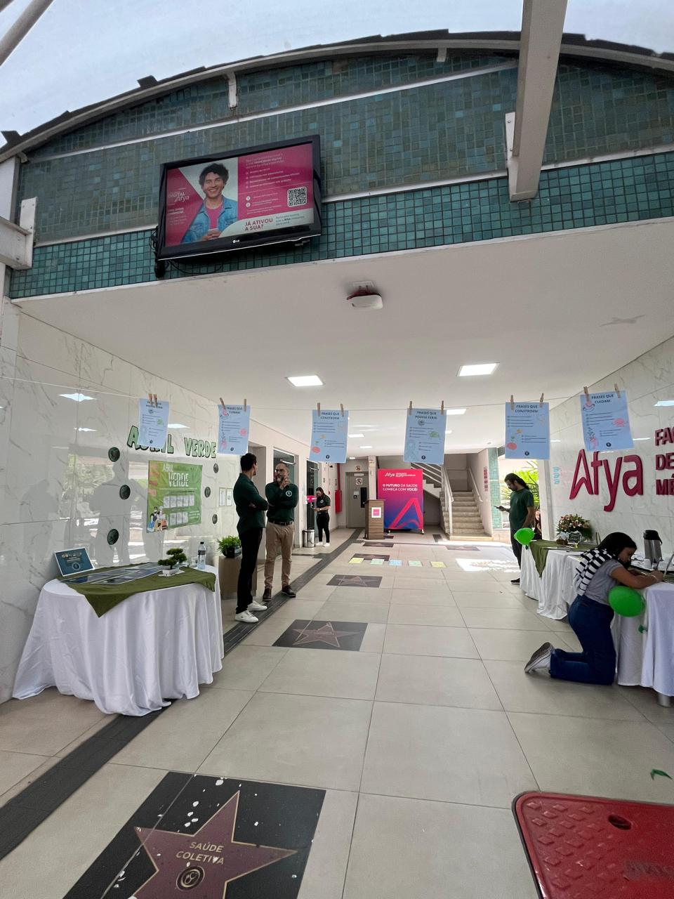
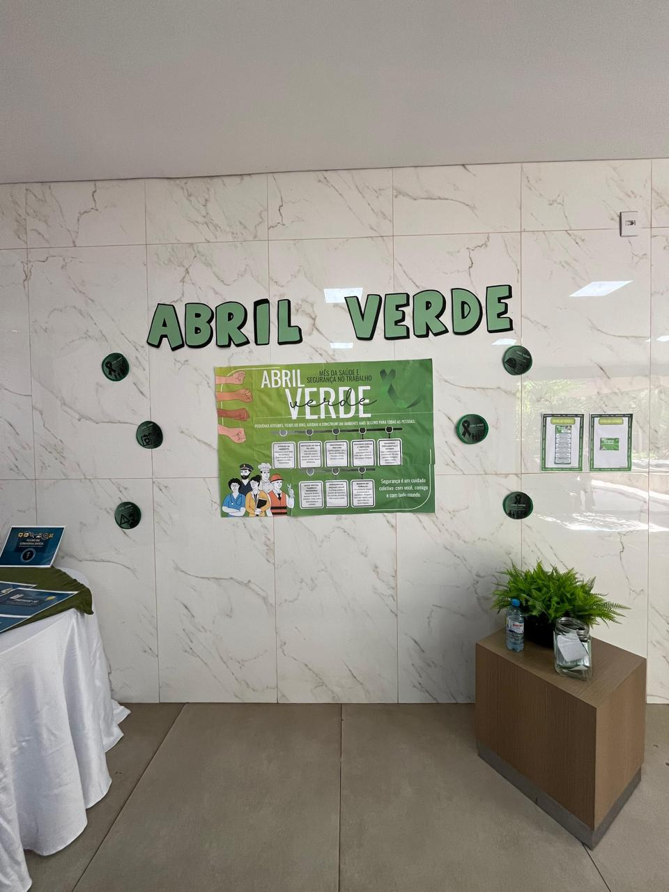
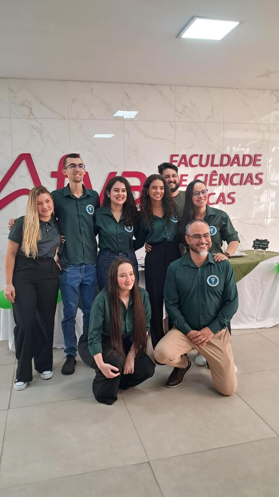
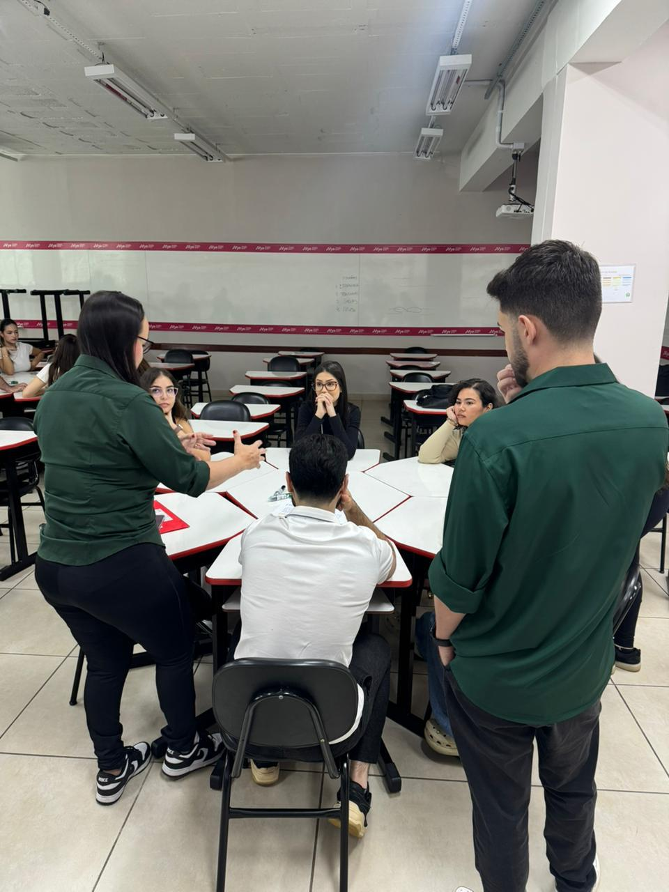
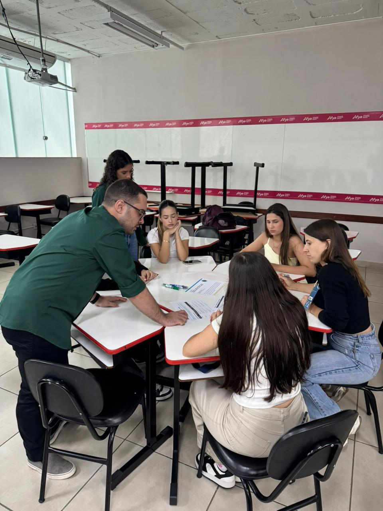
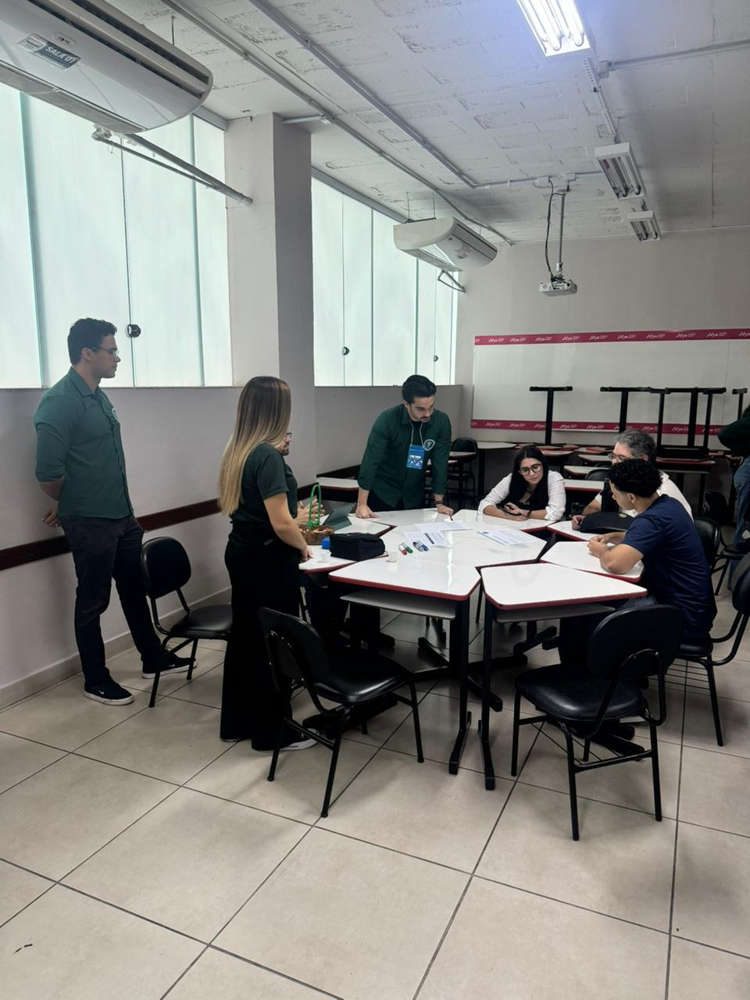
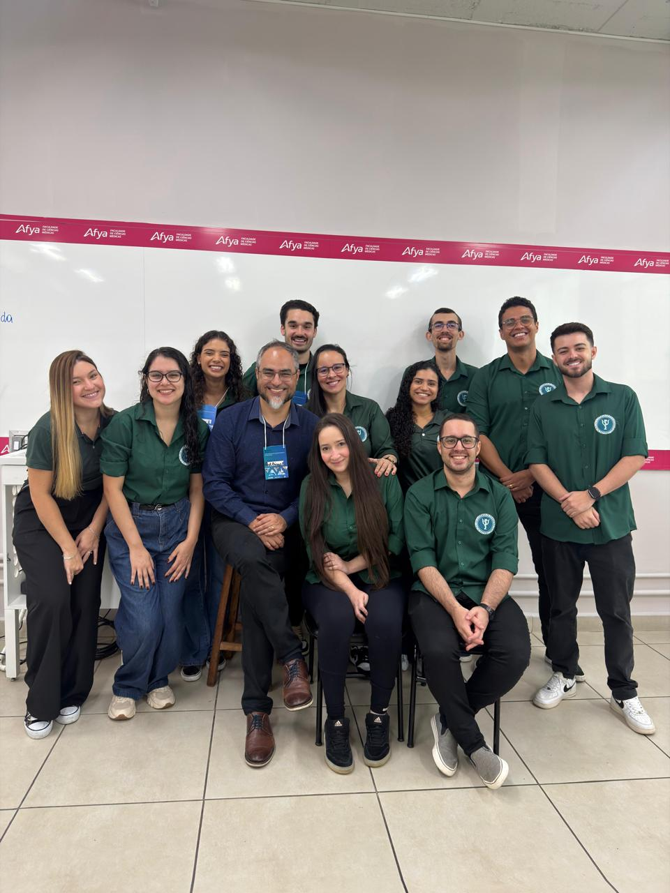

::: {.league-page}
[← Voltar para Ligas Acadêmicas](../ligas-academicas.qmd){.league-back}

<strong>Docente responsável:</strong> Prof. Thiago Xavier Corrêa

## Educação em saúde, prevenção e comunicação humanizada

A Liga Acadêmica de Psiquiatria desenvolveu atividades educativas relacionadas à campanha **Abril Verde**, com espaços informativos, materiais educativos e interação com o público sobre prevenção, cuidado coletivo e promoção de ambientes de trabalho mais seguros.

Entre as atividades documentadas, destaca-se a proposta **“Fluxo da Conversa Difícil — Um caminho de respeito e empatia”**, com orientações sobre escuta ativa, comunicação respeitosa e preparação para conversas delicadas. As fotografias também apresentam discussões em pequenos grupos, com materiais de apoio e participação ativa dos estudantes.

Os registros foram reunidos como um conjunto de ações, sem atribuição de data específica ou presunção de que ocorreram no mesmo encontro.

  
  
  
  
  
  
  
  
  
  

:::
