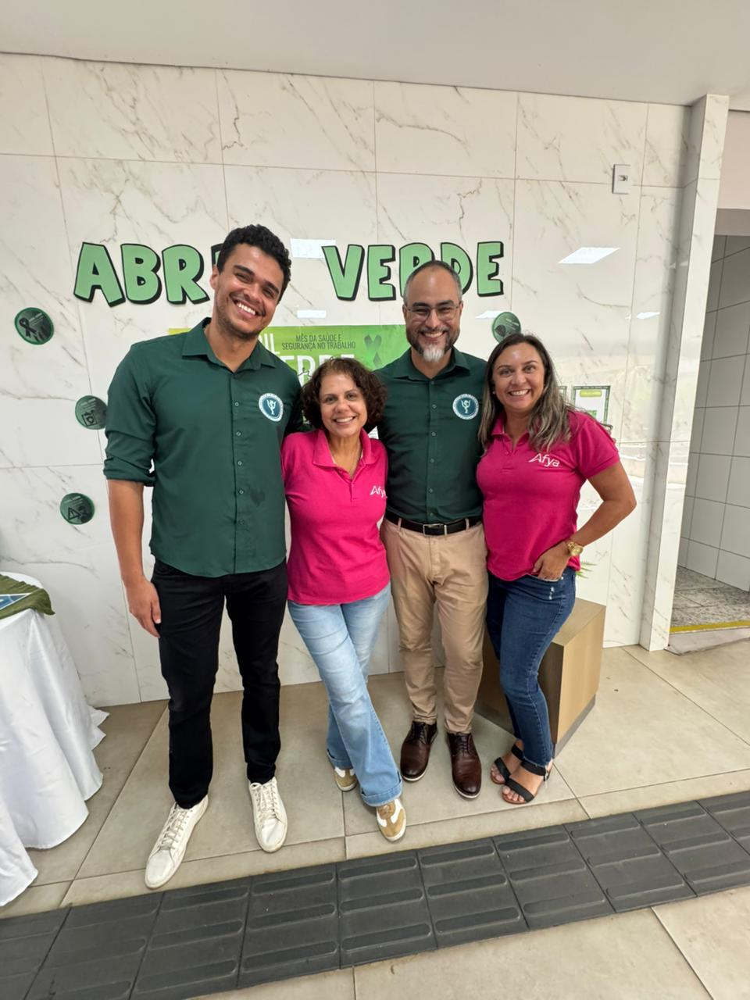
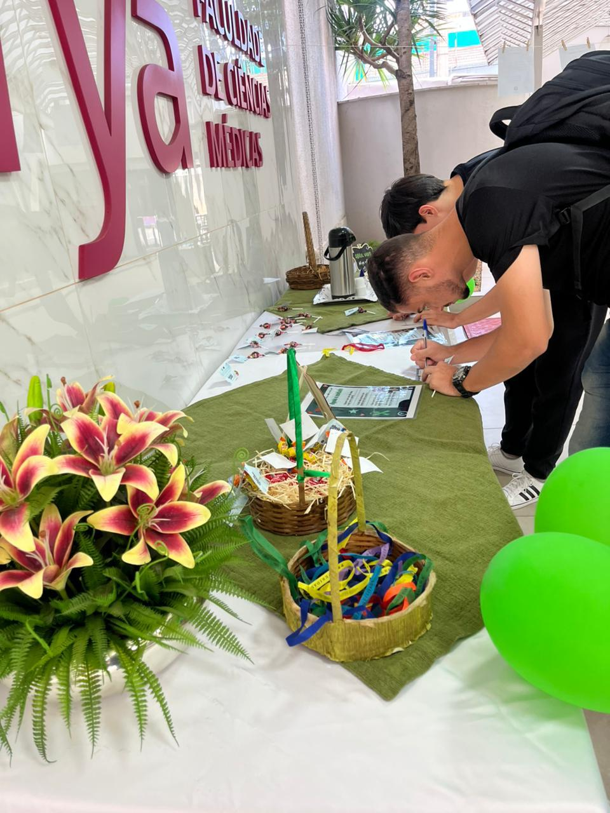
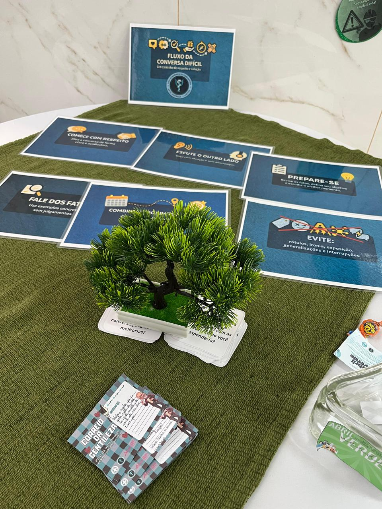
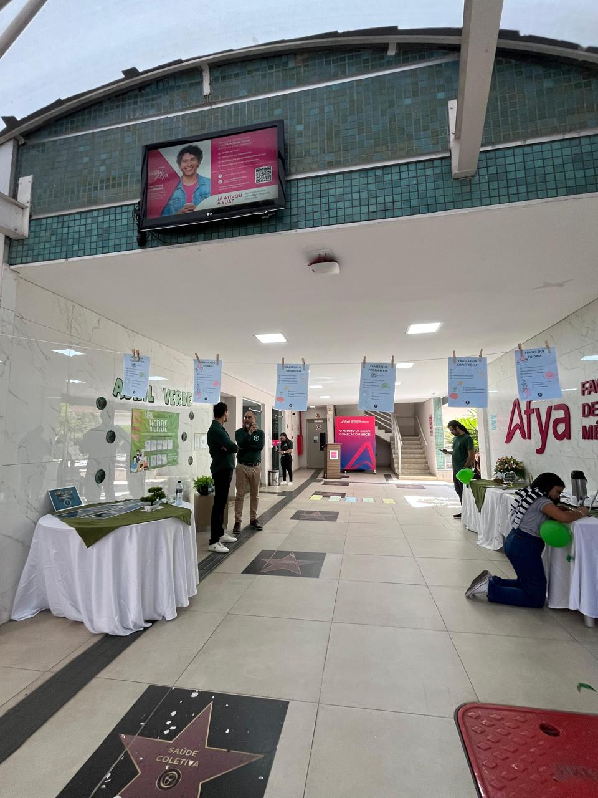
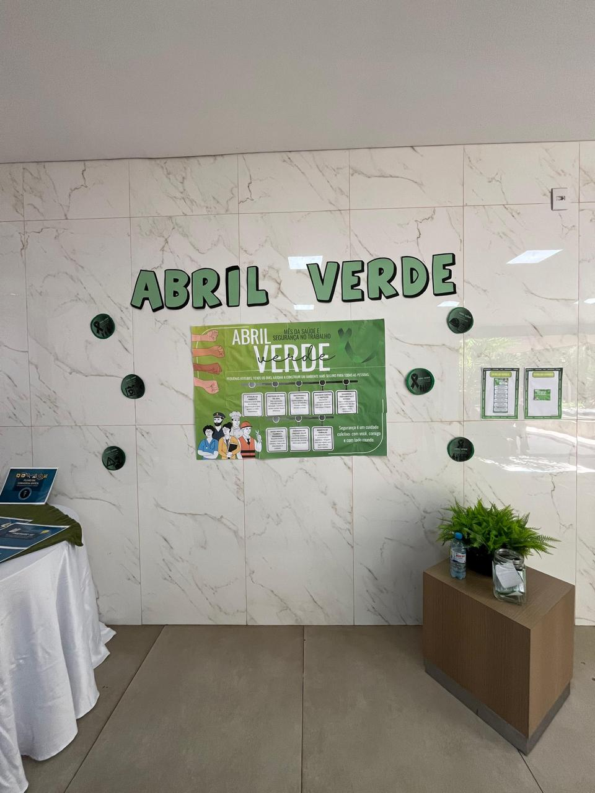
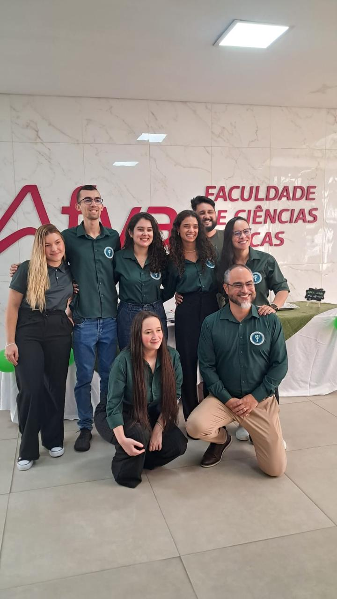
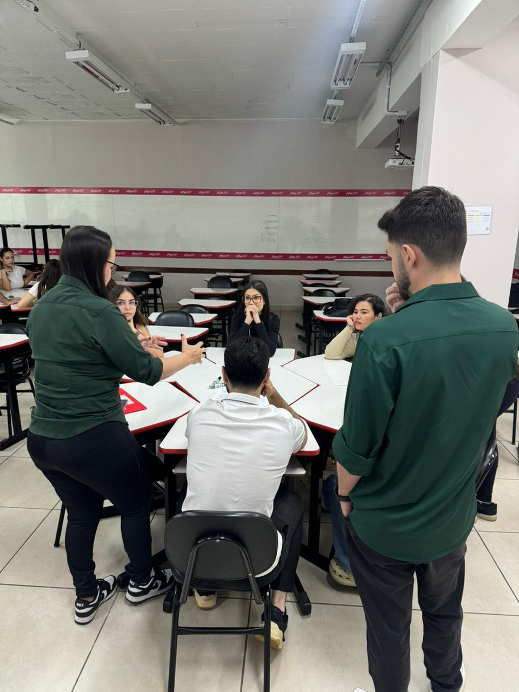
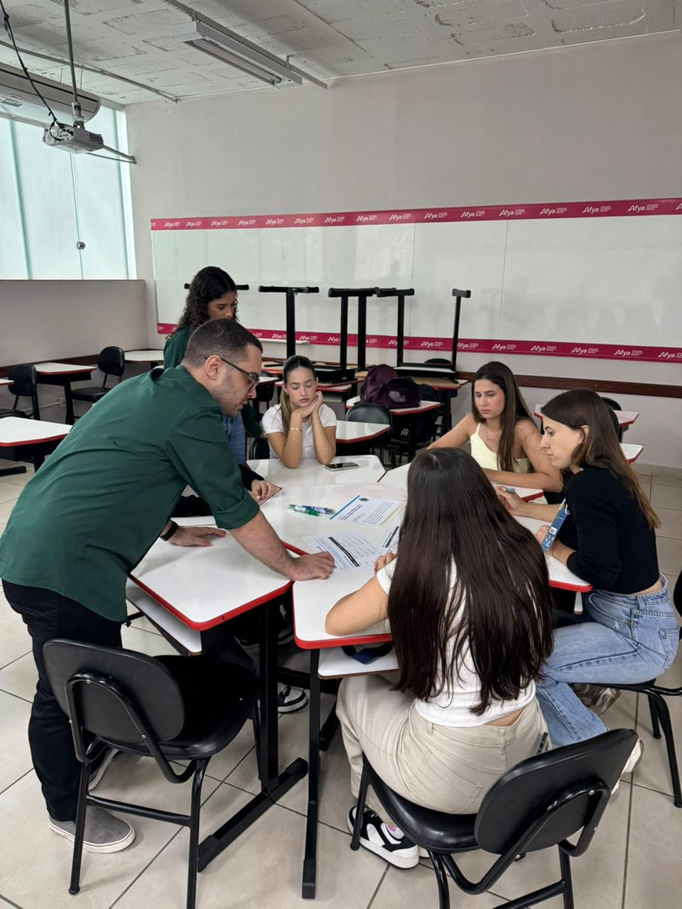
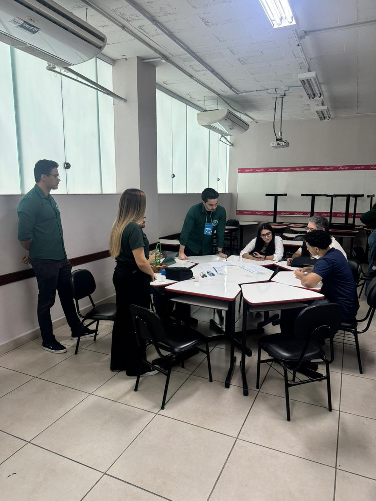
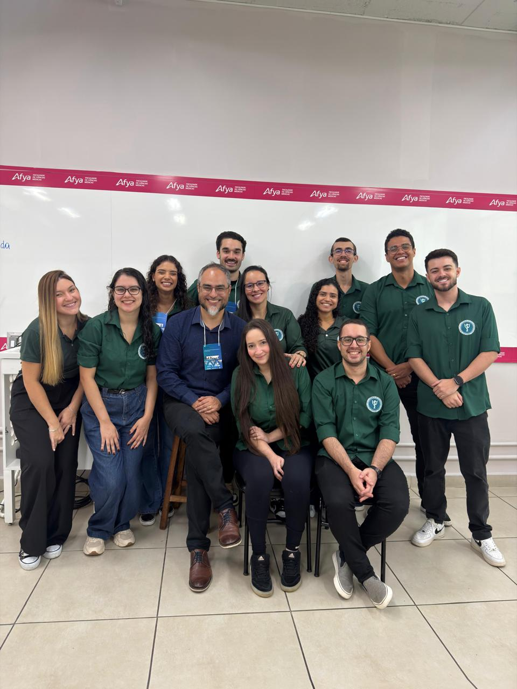

::: {.league-page}
[← Voltar para Ligas Acadêmicas](../ligas-academicas.qmd){.league-back}

<strong>Docente responsável:</strong> Prof. Thiago Xavier Corrêa

## Cinema Comentado: “Fitas”

A Liga Acadêmica de Psiquiatria convidou a comunidade acadêmica para uma sessão comentada do curta-metragem **“Fitas”**, seguida de mesa-redonda sobre o Transtorno do Espectro Autista, suas singularidades, desafios e possibilidades.

A programação de **23 de novembro de 2026**, às **20h**, no **Auditório da Afya**, previu a participação do psiquiatra **Dr. Thiago Xavier**, da pediatra **Dra. Lara Saad** e da acadêmica do 10º período **Mariana Almeida**. O encontro foi organizado para estimular a reflexão interdisciplinar, a troca de ideias e a participação do público, com certificado de **10 horas complementares**.

[Acesse a inscrição](https://forms.gle/2tprQSC8MKz72a2J6){.btn .btn-primary}

{fig-alt="Card da Liga Acadêmica de Psiquiatria para o Cinema Comentado Fitas, com informações de data, horário, local e certificado"}

## Educação em saúde, prevenção e comunicação humanizada

A Liga Acadêmica de Psiquiatria desenvolveu atividades educativas relacionadas à campanha **Abril Verde**, com espaços informativos, materiais educativos e interação com o público sobre prevenção, cuidado coletivo e promoção de ambientes de trabalho mais seguros.

Entre as atividades documentadas, destaca-se a proposta **“Fluxo da Conversa Difícil — Um caminho de respeito e empatia”**, com orientações sobre escuta ativa, comunicação respeitosa e preparação para conversas delicadas. As fotografias também apresentam discussões em pequenos grupos, com materiais de apoio e participação ativa dos estudantes.

  
  
  
  
  
  
  
  
  
  

:::
