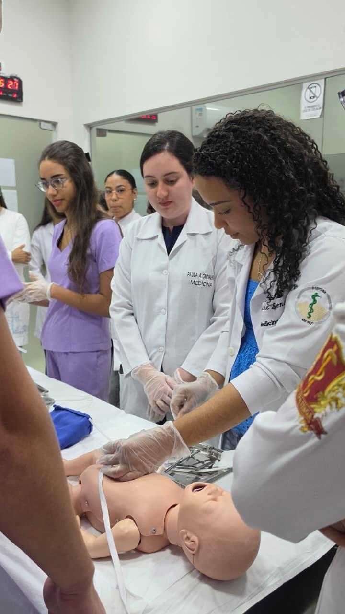
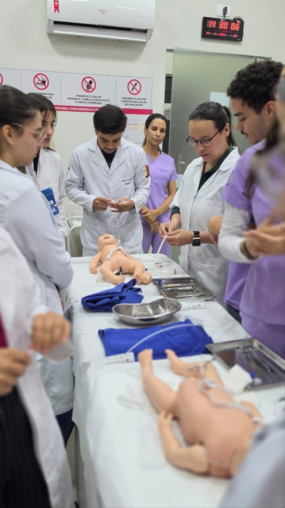
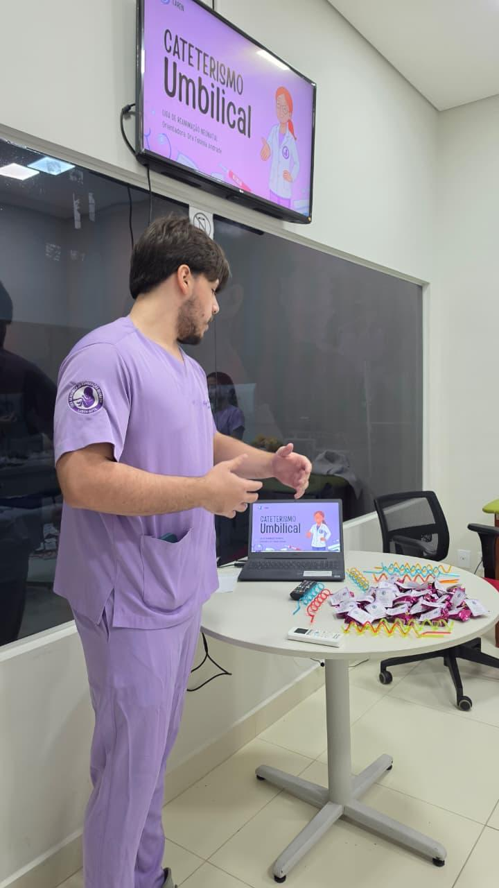
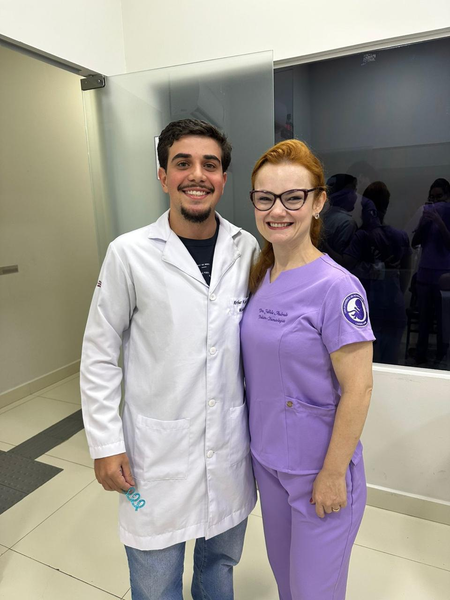
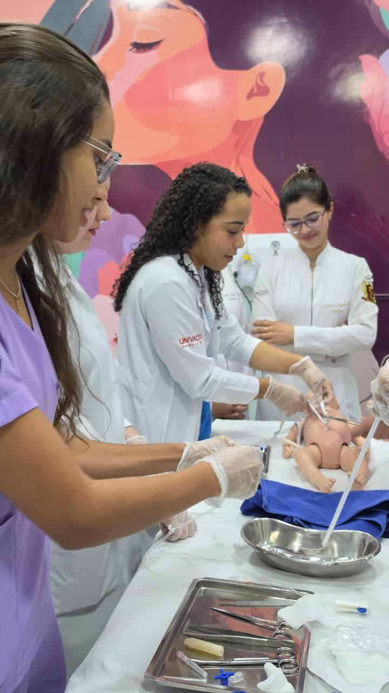
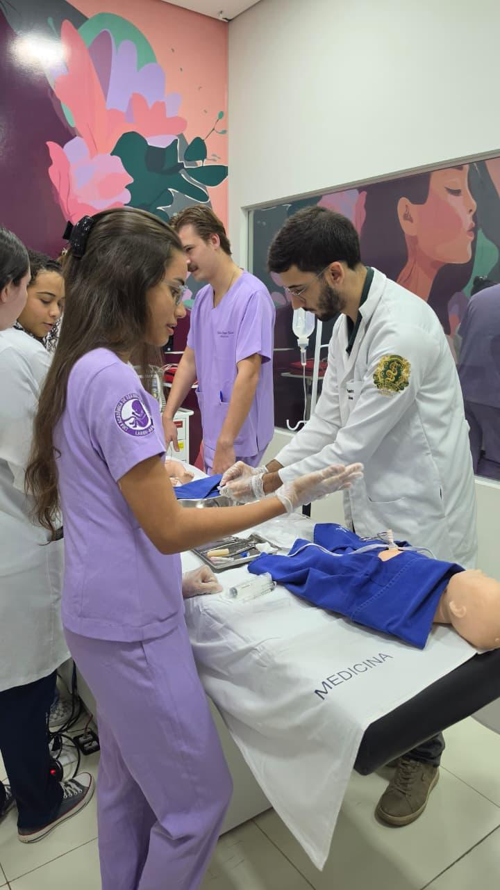

::: {.league-page}
[← Voltar para Ligas Acadêmicas](../ligas-academicas.qmd){.league-back}

<strong>Docente responsável:</strong> Prof.ª Fabiola Andrade Maia Guimaraes

## Atividade prática de reanimação neonatal

A Liga Acadêmica de Reanimação Neonatal realizou atividade prática de simulação voltada ao desenvolvimento de habilidades fundamentais para o cuidado neonatal. Sob responsabilidade da **Prof.ª Fabiola Andrade Maia Guimaraes**, o encontro reuniu integrantes da liga em uma experiência de aprendizagem ativa, com discussão, demonstração e prática supervisionada.

O registro evidencia o estudo do **cateterismo umbilical** e a aproximação dos estudantes com procedimentos e raciocínios próprios do cenário neonatal, de forma ética, técnica e colaborativa. A iniciativa fortalece o protagonismo estudantil e a integração entre conhecimento científico e prática clínica.

## Evidências

{fig-alt="Integrantes da Liga Acadêmica de Reanimação Neonatal em atividade de simulação"}

{fig-alt="Participantes em treinamento prático de reanimação neonatal com manequim"}

{fig-alt="Integrante apresentando conteúdo sobre cateterismo umbilical"}

{fig-alt="Professora responsável pela Liga de Reanimação Neonatal em registro com integrante"}

{fig-alt="Participantes praticando cateterismo umbilical em manequim neonatal"}

{fig-alt="Integrantes em treinamento prático de simulação neonatal"}
:::
