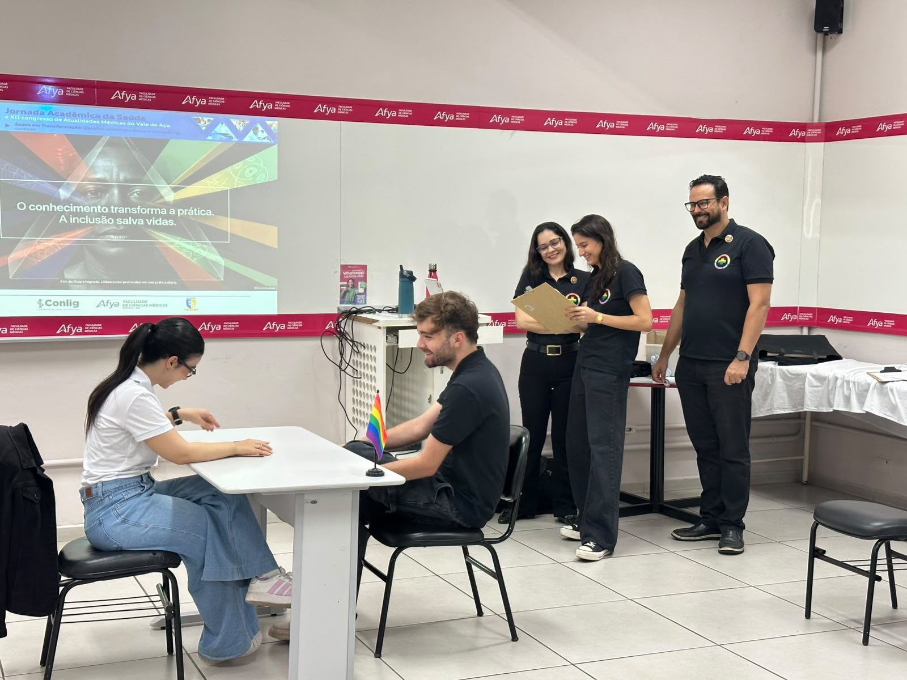
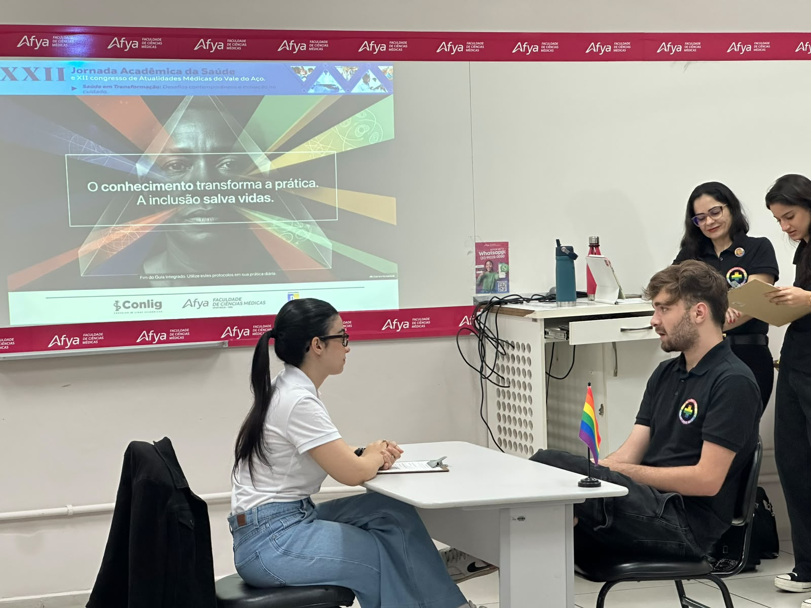
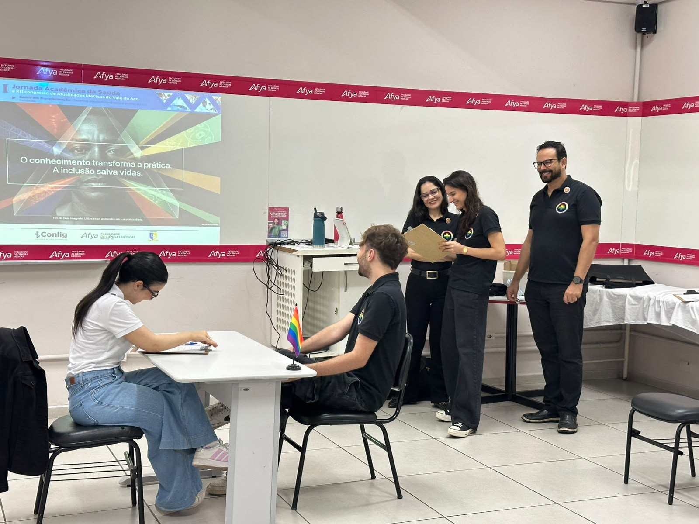
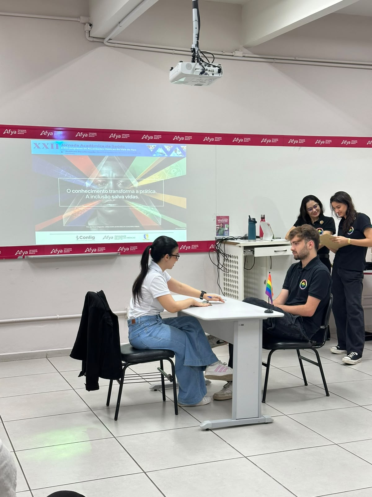

::: {.league-page}
[← Voltar para Ligas Acadêmicas](../ligas-academicas.qmd){.league-back}

<strong>Docente responsável:</strong> Prof. Rone Cesario da Silva

## A inclusão transforma o cuidado

Sob orientação do professor **Rone Cesario da Silva**, a Liga Acadêmica de Saúde e Diversidade participou da XXII Jornada Acadêmica da Saúde e do XII Congresso de Atualidades Médicas do Vale do Aço, promovendo reflexões sobre inclusão e respeito à diversidade na prática médica.

A atividade, apresentada sob o tema **“O conhecimento transforma a prática. A inclusão salva vidas”**, utilizou uma dinâmica de simulação de atendimento para valorizar a comunicação, a escuta qualificada e o acolhimento das particularidades de cada paciente.

  
  
  
  

:::
