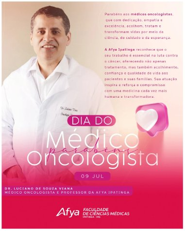
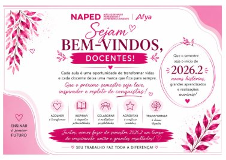
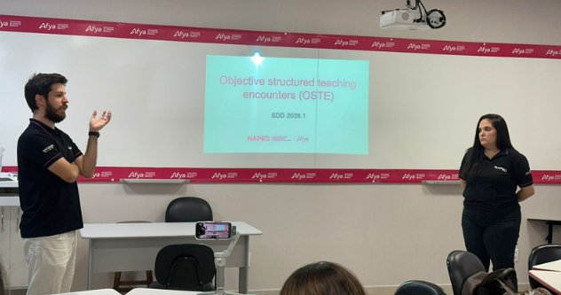
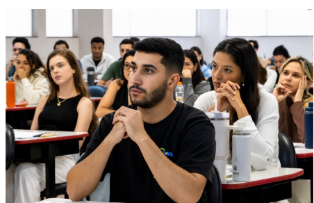
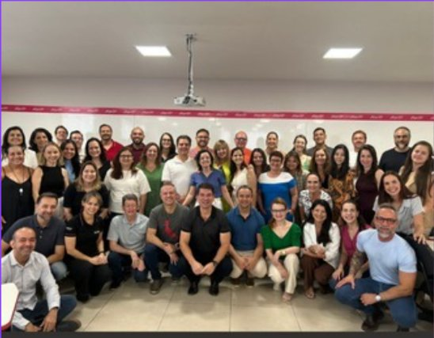

Linha do tempo · 2026

<article class="action-card">
  
  

22/07/2026
Comunicação InstitucionalValorização Docente
  <h3><a href="../acoes/2026-07-homenagem-oncologista-pediatra-cirurgiao.html">Dia do Oncologista, do Pediatra e do Cirurgião Geral</a></h3>
Homenagem de julho aos docentes das especialidades de Oncologia, Pediatria e Cirurgia Geral.

</article>
<article class="action-card">
  
  

15/07/2026
Acolhimento DocenteComunicação Institucional
  <h3><a href="../acoes/2026-07-volta-as-aulas-2026-2.html">Volta às Aulas — Semestre 2026.2</a></h3>
Acolhimento do corpo docente no início do semestre 2026.2, com mensagens personalizadas e painel de boas-vindas.

</article>
<article class="action-card">
  
  

08/07/2026
Formação DocenteInovação Pedagógica
  <h3><a href="../acoes/2026-07-oficina-oste-sdd.html">Oficina OSTE — Semana de Desenvolvimento Docente</a></h3>
Oficina com a metodologia OSTE (Objective Structured Teaching Encounters) na SDD da Afya Ipatinga, com simulação e feedback estruturado para docentes.

</article>
<article class="action-card">
  
  

03/07/2026
Formação DocenteAcompanhamento AcadêmicoCurrículo
  <h3><a href="../acoes/2026-07-reuniao-primeiro-ano-gaps.html">SDD — Reunião do 1º ano: acolhimento, GAPS e progressão acadêmica</a></h3>
Reunião de alinhamento sobre acolhimento, lacunas de aprendizagem e progressão acadêmica no primeiro ano.

</article>
<article class="action-card">
  
  

02/07/2026
Formação DocenteAcolhimento e Permanência
  <h3><a href="../acoes/2026-07-ned-em-foco.html">SDD — NED em foco: acolhimento, diversidade e permanência</a></h3>
Encontro sobre acolhimento discente, diversidade e permanência estudantil.

</article>
<article class="action-card">
  
  

02/07/2026
Formação DocentePesquisa
  <h3><a href="../acoes/2026-07-oficina-producao-cientifica-lattes.html">SDD — Produção Científica em Movimento</a></h3>
Oficina sobre estratégias para fortalecer publicações e qualificar o Currículo Lattes.

</article>
<article class="action-card">
  
  

02/07/2026
Formação DocenteTecnologias EducacionaisMetodologias Ativas
  <h3><a href="../acoes/2026-07-oficina-inteligencia-artificial-notebooklm.html">SDD — Oficina de Inteligência Artificial e NotebookLM</a></h3>
Oficina prática sobre o uso de Inteligência Artificial e NotebookLM na docência.

</article>
<article class="action-card">
  
  

01/07/2026
Acompanhamento AcadêmicoPreparação ENAMED
  <h3><a href="../acoes/2026-07-primeiro-simulado-trajetoria-enamed.html">Primeiro simulado pós-férias — Trajetória ENAMED</a></h3>
Realização do primeiro simulado pós-férias do programa Trajetória ENAMED, voltado ao acompanhamento da evolução acadêmica e à preparação estratégica dos estudantes.

</article>
<article class="action-card">
  
  

01/07/2026
Formação DocenteAvaliaçãoCurrículo
  <h3><a href="../acoes/2026-07-sdd-mesas-por-eixo.html">SDD — Mesas por eixo e Matriz de Avaliação</a></h3>
Discussão por eixos para desdobrar a Matriz de Avaliação na prática curricular.

</article>
<article class="action-card">
  
  

01/07/2026
Formação DocenteAvaliação
  <h3><a href="../acoes/2026-07-sdd-mudancas-sistema-avaliacao.html">SDD — Mudanças no Sistema de Avaliação de Medicina</a></h3>
Orientações ao corpo docente sobre as atualizações do sistema de avaliação do curso de Medicina.

</article>
<article class="action-card">
  
  

01/07/2026
Formação DocenteENAMED
  <h3><a href="../acoes/2026-07-sdd-enamed-exames-externos.html">SDD — ENAMED e exames externos</a></h3>
Atividade da Semana de Desenvolvimento Docente sobre desafios, indicadores e compromisso com a formação do egresso.

</article>
<article class="action-card">
  
  

01/07/2026
Formação DocenteComunicação Institucional
  <h3><a href="../acoes/2026-07-sdd-semana-desenvolvimento-docente.html">SDD — Semana de Desenvolvimento Docente</a></h3>
Identidade visual e programação da SDD 2026.1, com cards informativos da agenda, horários, atividades e responsáveis.

</article>

