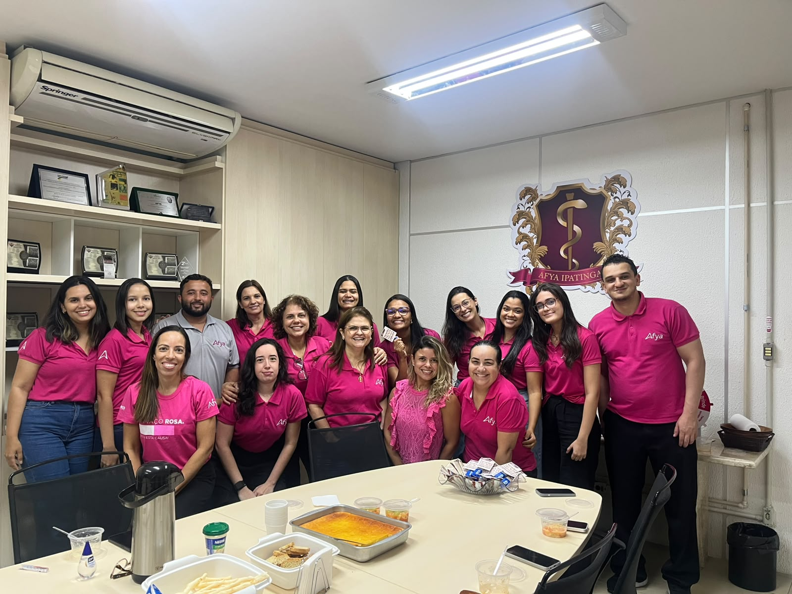
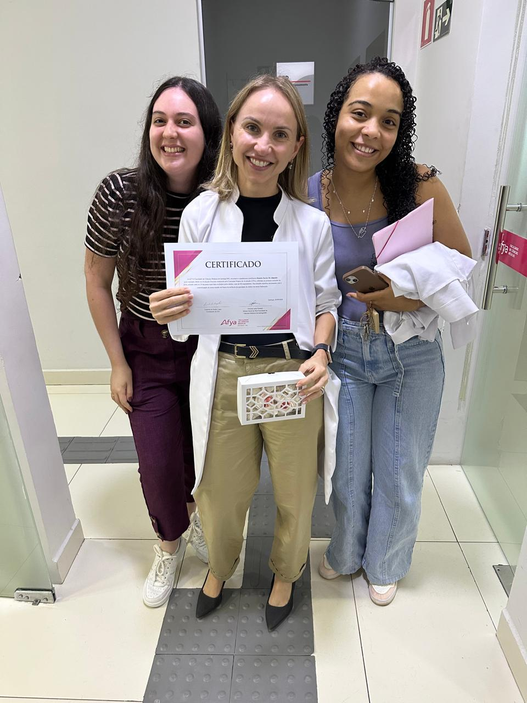
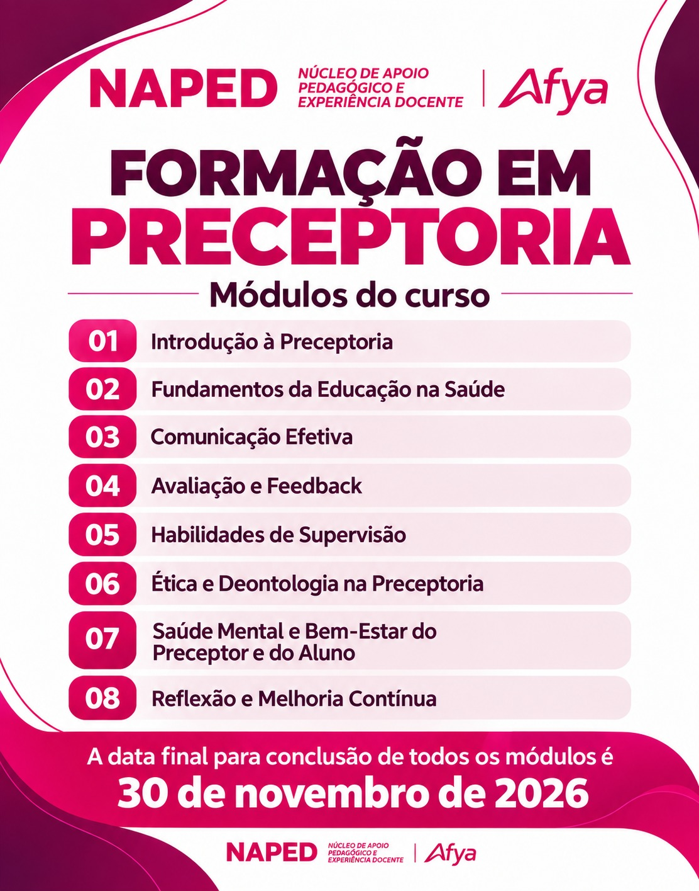
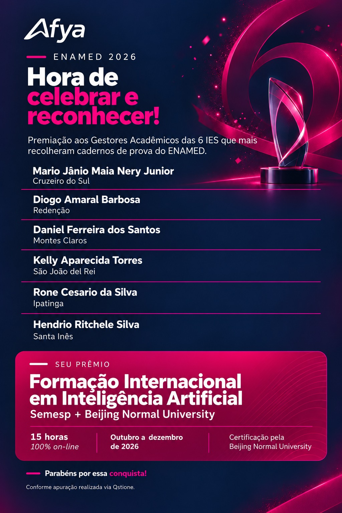
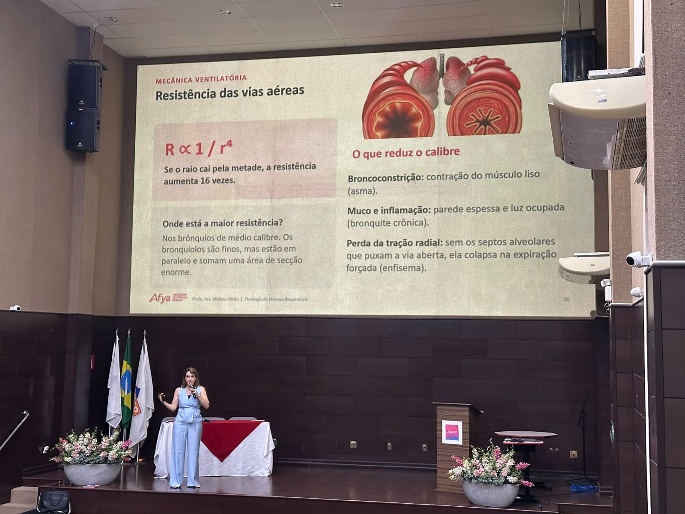
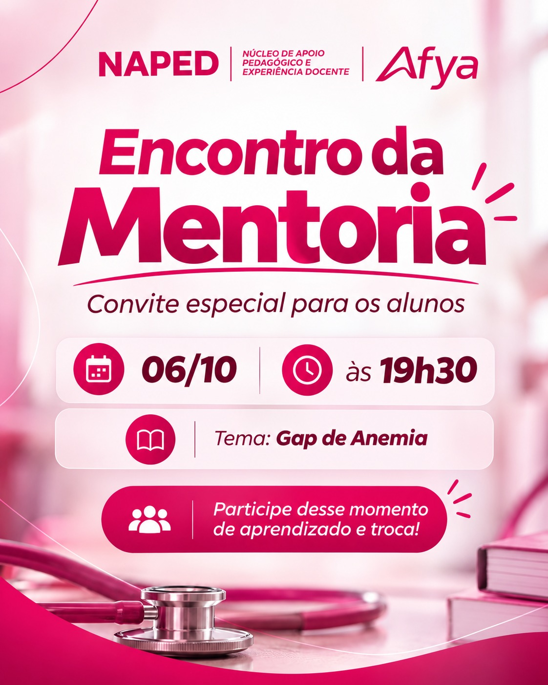
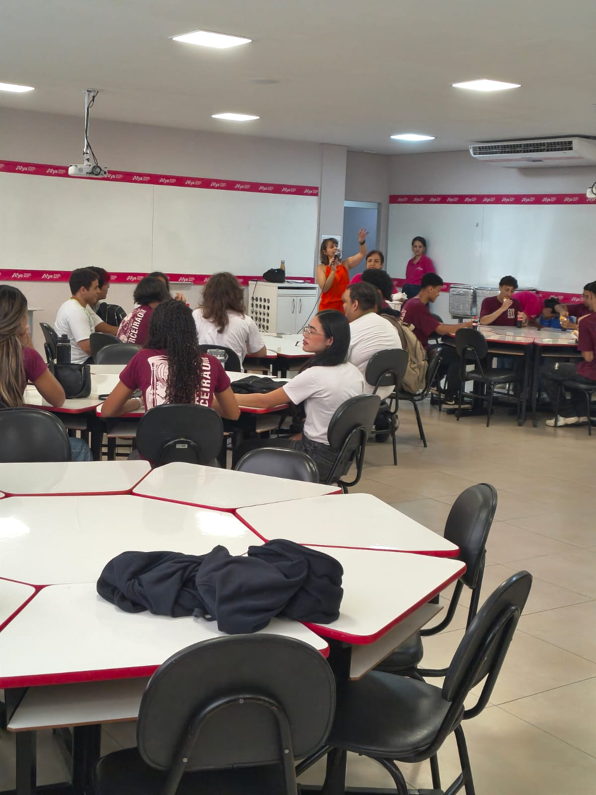

Linha do tempo · 2026

<article class="action-card">
  
  

20/10/2026
Participação InstitucionalFormação DocenteMetodologias Ativas
  <h3><a href="../acoes/2026-10-formacao-matriz-ai-first-naped.html">Participação do NAPED na semana de formações da Matriz AI First 2027.1</a></h3>
Registro da participação do NAPED na semana de reuniões e formações da nova matriz curricular de Medicina, realizada de 20 a 30 de outubro e pautada em metodologias ativas.

</article>
<article class="action-card">
  
  

19/10/2026
Liderança e GestãoDesenvolvimento Institucional
  <h3><a href="../acoes/2026-10-acelera-lider-ipatinga.html">Acelera Líder — desenvolvimento de lideranças em Ipatinga</a></h3>
Treinamento institucional de desenvolvimento de lideranças, realizado com participação de setores técnico-administrativos e parceria do NAPED com a coordenação.

</article>
<article class="action-card">
  
  

19/10/2026
Valorização DocenteReconhecimento Institucional
  <h3><a href="../acoes/2026-10-premiacao-docente.html">Valorização do profissional — Premiação docente</a></h3>
Reconhecimento aos docentes de Enfermagem e Medicina da Afya Ipatinga, organizado por faixas de avaliações registradas.

</article>
<article class="action-card">
  
  

19/10/2026
Gestão InstitucionalQualidade Acadêmica
  <h3><a href="../acoes/2026-10-acreditacao-saeme-naped-institucional.html">Afya Ipatinga celebra acreditação SAEME</a></h3>
Ação integrada do NAPED e do setor institucional para comunicar e valorizar a acreditação da Afya Ipatinga pelo SAEME-CFM.

</article>
<article class="action-card">
  
  

19/10/2026
Apoio DocenteGestão Pedagógica
  <h3><a href="../acoes/2026-10-atendimentos-naped-corpo-docente.html">Atendimentos do NAPED junto ao corpo docente</a></h3>
Registro de atendimento, escuta e apoio pedagógico do NAPED aos docentes da Afya Ipatinga.

</article>
<article class="action-card">
  
  

08/10/2026
Comunicação InstitucionalValorização Docente
  <h3><a href="../acoes/2026-10-cafe-dia-professores-tecnicos.html">Café da tarde em comemoração ao Dia dos Professores e Técnicos Administrativos</a></h3>
Encontro de integração e valorização da equipe Afya Ipatinga, com fala da direção sobre a importância das pessoas, mudanças e novos projetos institucionais.

</article>
<article class="action-card">
  
  

07/10/2026
Formação de PreceptoresDesenvolvimento Docente
  <h3><a href="../acoes/2026-10-formacao-preceptoria-modulos.html">Formação em Preceptoria — módulos do curso</a></h3>
Divulgação dos oito módulos da formação em preceptoria do NAPED e do prazo para conclusão até 30 de novembro de 2026.

</article>
<article class="action-card">
  
  

07/10/2026
Reconhecimento AcadêmicoGestão Institucional
  <h3><a href="../acoes/2026-10-premiacao-enamed-rone-cesario.html">Reconhecimento pela mobilização do ENAMED 2026</a></h3>
Homenagem à gestão acadêmica de Rone Cesário da Silva pelo reconhecimento da Afya Ipatinga entre as IES que mais recolheram cadernos de prova do ENAMED 2026.

</article>
<article class="action-card">
  
  

06/10/2026
Acompanhamento AcadêmicoFormação em Saúde
  <h3><a href="../acoes/2026-10-semana-memorial-palestra-melissa-ulhoa.html">Semana do Memorial Acadêmico — programação de 6 a 8 de outubro</a></h3>
Ação institucional realizada em conjunto com o NAPED durante a Semana do Memorial Acadêmico, com palestras, treinamento e momentos formativos para os estudantes.

</article>
<article class="action-card">
  
  

06/10/2026
Acompanhamento AcadêmicoPreparação ENAMED
  <h3><a href="../acoes/2026-10-encontro-mentoria-gap-anemia.html">Encontro de Mentoria ENAMED — Gap de Anemia</a></h3>
Encontro de mentoria do Projeto ENAMED sobre gap de anemia, conduzido por Marita de Novais Costa Salles de Almeida.

</article>
<article class="action-card">
  
  

05/10/2026
Formação DocenteComunicação Institucional
  <h3><a href="../acoes/2026-10-openday-metodologias-ativas.html">Open Day: metodologias ativas e aproximação com a comunidade</a></h3>
Participação do NAPED no Open Day da Afya Ipatinga, com atividade sobre metodologias ativas para estudantes do 3º ano do Ensino Médio.

</article>

