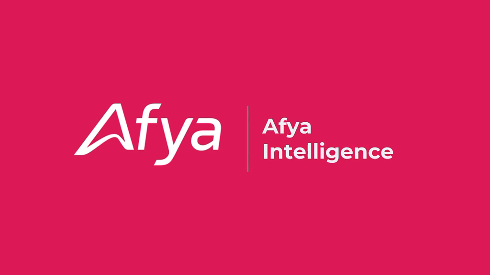
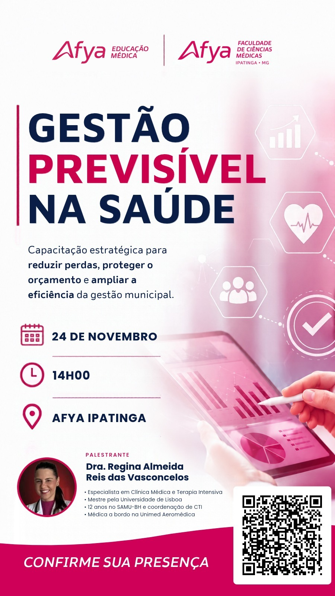
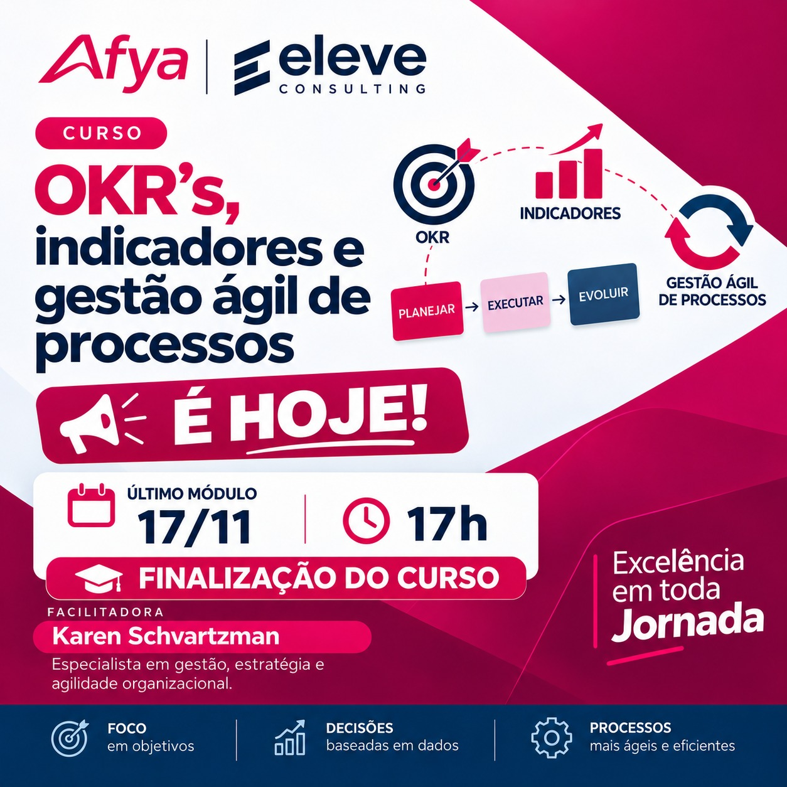
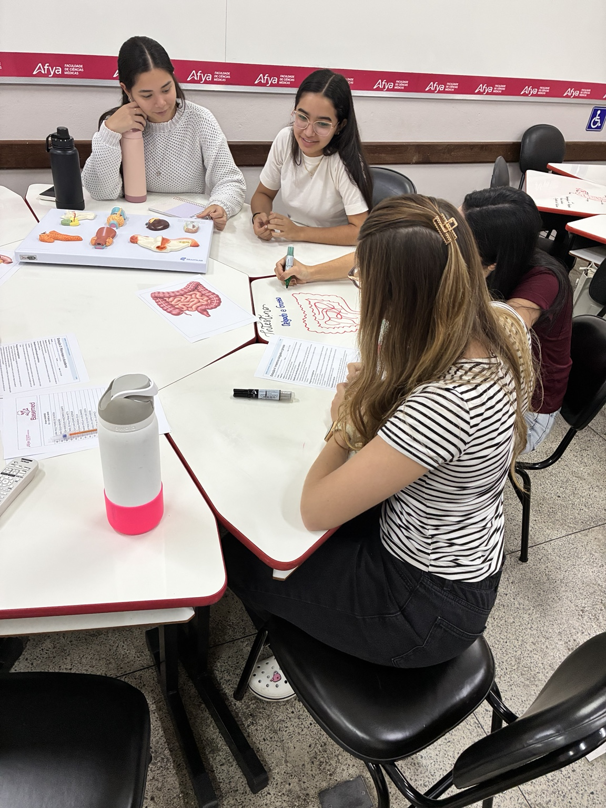
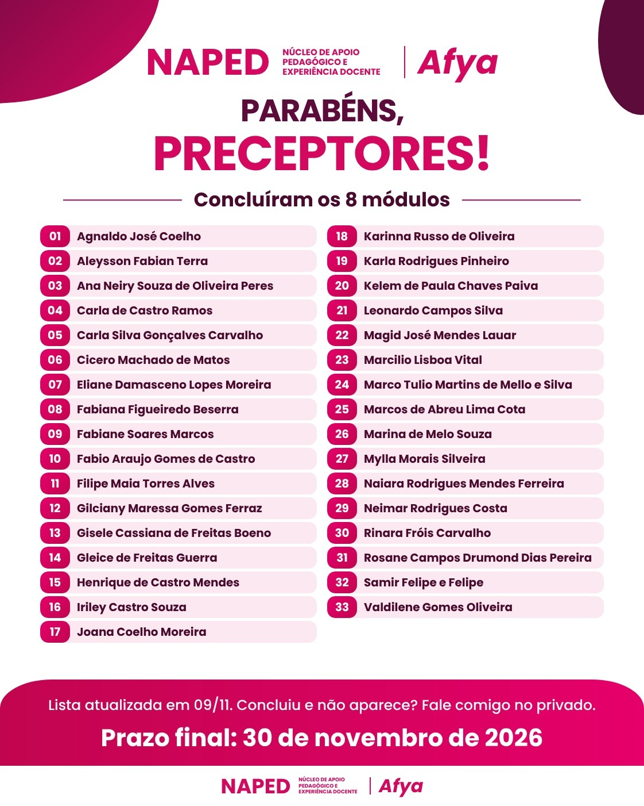
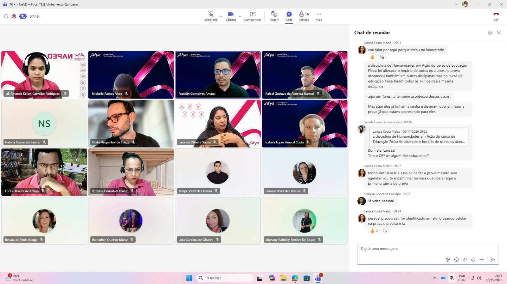
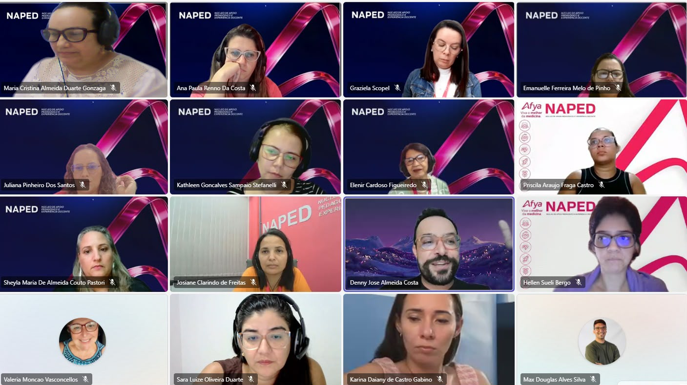
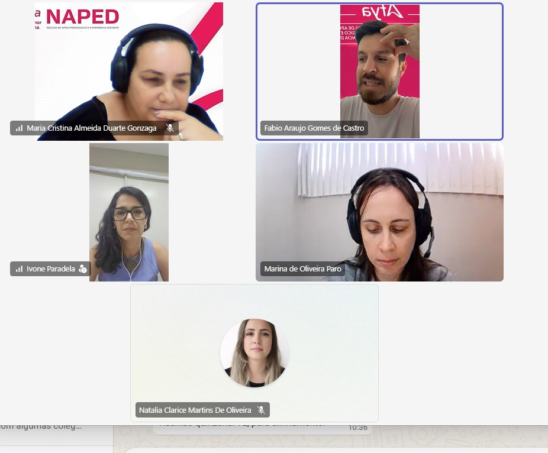

Linha do tempo · 2026

<article class="action-card">
  
  

28/11/2026
Formação DocenteInovação Pedagógica
  <h3><a href="../acoes/2026-11-afya-intelligence.html">Afya Intelligence no apoio ao trabalho docente</a></h3>
Conheça a plataforma que reúne indicadores acadêmicos e recursos de inteligência artificial para apoiar o acompanhamento e o planejamento no curso de Medicina.

</article>
<article class="action-card">
  
  

24/11/2026
Gestão em SaúdeFormação ProfissionalAtenção Primária
  <h3><a href="../acoes/2026-11-gestao-previsivel-saude.html">Gestão Previsível na Saúde</a></h3>
Capacitação estratégica sobre qualificação das equipes, decisões assistenciais e fortalecimento da Atenção Primária na gestão municipal.

</article>
<article class="action-card">
  
  

17/11/2026
Desenvolvimento da EquipeGestão PedagógicaPlanejamento
  <h3><a href="../acoes/2026-11-formacao-equipe-naped-okrs.html">Formação da equipe do NAPED em OKRs, indicadores e gestão ágil</a></h3>
Conclusão da jornada formativa voltada a objetivos, indicadores, processos ágeis e comunicação de resultados.

</article>
<article class="action-card">
  
  

10/11/2026
Bases BiológicasSistemas Orgânicos IntegradosMetodologias Ativas
  <h3><a href="../acoes/2026-11-basemed-sistema-digestorio.html">BASEMED — Estações de aprendizagem do sistema digestório</a></h3>
Atividade prática do BASEMED sobre anatomia, fisiologia e integração metabólica do sistema digestório, realizada em 10 de novembro de 2026.

</article>
<article class="action-card">
  
  

09/11/2026
Formação de PreceptoresDesenvolvimento DocenteAcompanhamento Pedagógico
  <h3><a href="../acoes/2026-11-acompanhamento-pos-graduacao-preceptoria.html">NAPED acompanha preceptores na pós-graduação</a></h3>
Acompanhamento da trilha de pós-graduação em preceptoria, com orientações, suporte e reconhecimento aos preceptores que concluíram os módulos.

</article>
<article class="action-card">
  
  

06/11/2026
Tecnologias EducacionaisGestão Pedagógica
  <h3><a href="../acoes/2026-11-reuniao-quinzenal-te.html">Reunião quinzenal de Tecnologias Educacionais</a></h3>
Encontro quinzenal para alinhamento de demandas, orientações e processos relacionados às Tecnologias Educacionais.

</article>
<article class="action-card">
  
  

04/11/2026
Formação DocenteArticulação Institucional
  <h3><a href="../acoes/2026-11-formacao-regional-matrizes-she.html">NAPED Ipatinga participa de formação sobre as novas matrizes SHE</a></h3>
Cristina Gonzaga representou o NAPED da Afya Ipatinga na formação das Regionais 2 e 3 sobre as novas matrizes de Saúde, Humanas e Exatas.

</article>
<article class="action-card">
  
  

Registro institucional
Desenvolvimento DocenteGestão PedagógicaArticulação Institucional
  <h3><a href="../acoes/2026-11-reuniao-naped-nacional-sdd.html">Reunião do NAPED Nacional para alinhamento da SDD</a></h3>
Encontro institucional para alinhar o planejamento e as orientações da Semana de Desenvolvimento Docente.

</article>
<article class="action-card">
  
  

novembro de 2026
PreceptoriaGestão PedagógicaDesenvolvimento Docente
  <h3><a href="../acoes/2026-11-reuniao-supervisores-internato.html">Reunião com supervisores do internato</a></h3>
Alinhamento sobre a conclusão da pós-graduação em Preceptoria e levantamento de demandas formativas dos preceptores do internato.

</article>

