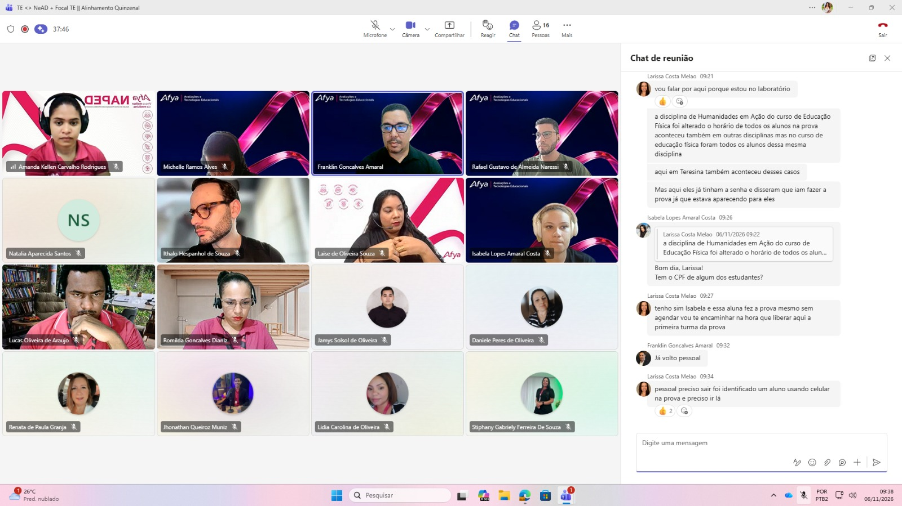
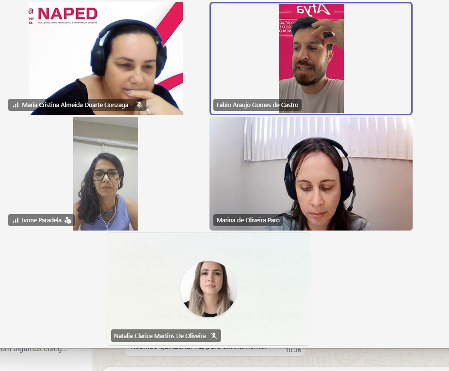

Linha do tempo · 2026

<article class="action-card">
  
  

06/11/2026
Tecnologias EducacionaisGestão Pedagógica
  <h3><a href="../acoes/2026-11-reuniao-quinzenal-te.html">Reunião quinzenal de Tecnologias Educacionais</a></h3>
Encontro quinzenal para alinhamento de demandas, orientações e processos relacionados às Tecnologias Educacionais.

</article>
<article class="action-card">
  
  

novembro de 2026
PreceptoriaGestão PedagógicaDesenvolvimento Docente
  <h3><a href="../acoes/2026-11-reuniao-supervisores-internato.html">Reunião com supervisores do internato</a></h3>
Alinhamento sobre a conclusão da pós-graduação em Preceptoria e levantamento de demandas formativas dos preceptores do internato.

</article>

